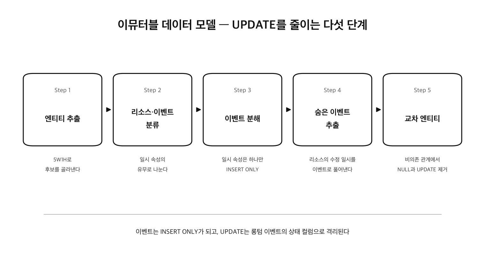
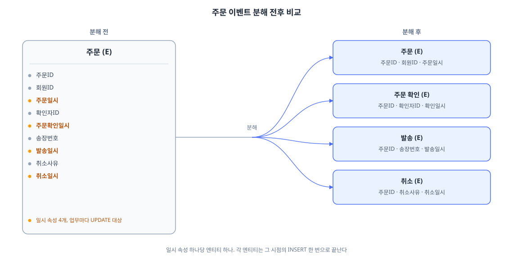
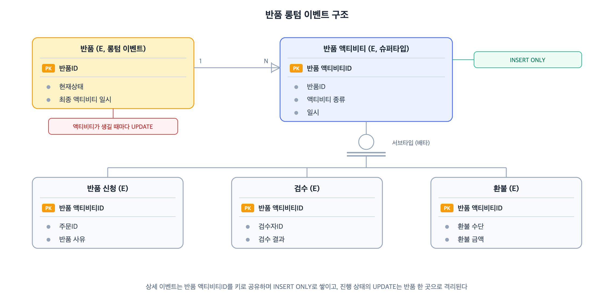
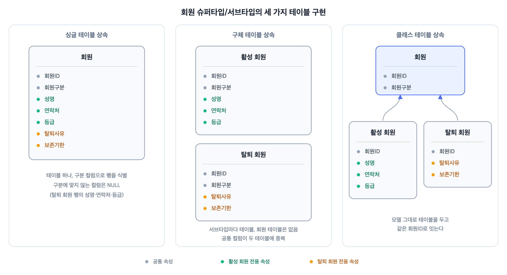
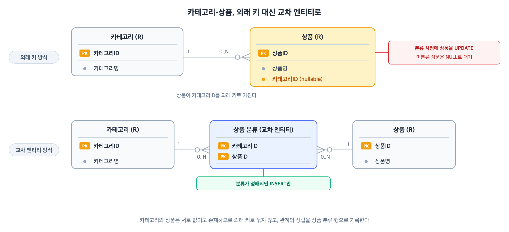
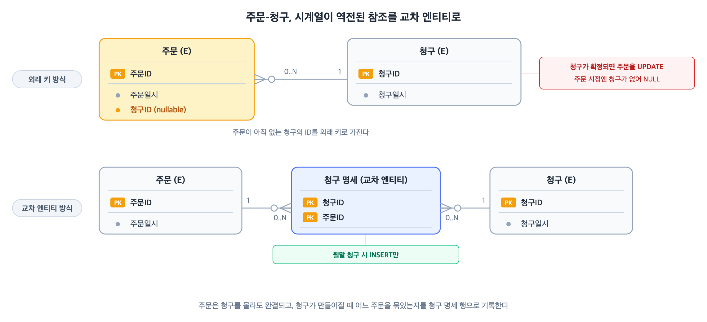

이 글은 소프트웨어 복잡도를 줄이기 위한 방법들 중에 데이터베이스 영역에서 복잡도를 줄일 수 고민들을 그때 그때 정리했던 메모들을 하나 둘, 취합하고 정리해서 탄생한 글이다. 주요한 내용은 테이블의 컬럼 업데이트를 줄여서 애플리케이션의 복잡도를 줄여주는 것이다. 칼럼의 업데이트는 해당 칼럼의 상태 전이를 관리해야 하기 때문에 부가적인 복잡도를 증가시킨다. INSERT는 새로운 사실을 추가할 뿐이지만, UPDATE는 이미 있는 사실을 덮어쓴다. 덮어쓰기에는 복잡한 규칙이 따라붙는다. 어떤 상태에서 어떤 상태로 바뀔 수 있는지, 어느 업무가 어느 컬럼을 갱신해도 되는지, 갱신 전의 값은 남겨야 하는지 같은 것들이다. 

DELETE도 사실을 지운다는 점에서 의심 대상이지만, 발생 빈도가 훨씬 높은 UPDATE를 이 글의 중심에 두고 삭제는 Step 4에서 따로 다룬다. 업무 자체에 복잡한 규칙이 있는 것은 어쩔 수 없더라도, 시스템·설계 측면에서 복잡성을 더 늘리지는 않아야 한다. UPDATE에 주목하고 그 발생을 가능한 한 줄이면 복잡성을 억제할 수 있다. 그 방법 중 하나가 Immutable Data Model이다.

## 왜 현실을 시간과 사실(Fact)의 관점으로 모델링해야 하는가?

현실 세계의 사건 대부분은 되돌릴 수 없다. 송금, 주문, 계약 체결처럼 일단 일어난 일은 나중에 수정되지 않는다. 계약을 파기해도 "체결했다"는 사실이 사라지는 것이 아니라 "파기했다"는 새로운 사실이 뒤에 추가될 뿐이다. 이렇게 일어난 일의 기록이 **사실(Fact)** 이다. "3번 주문이 7월 10일에 진행되었다"처럼 사실 대부분에는 시점이 붙고, 한번 일어난 사실은 시간이 지나도 그 존재는 사실이다. 이 글에서는 시점이 붙은 사실을 이벤트라 부르고, 시점 없이 관계의 성립만을 담는 사실은 Step 5에서 따로 다룬다. 현실은 상태가 아니라 사실의 연속이며, 상태는 그 사실들이 쌓인 결과다. 그런데 데이터베이스에서는 사람의 관행과 의도에 의해 UPDATE를 한다. 저장 장치가 비싸던 시절에 현재 상태 하나만 저장하고 덮어쓰던 설계가, 저장 비용이 무시할 만큼 떨어진 지금도 관행으로 남은 결과다.

이 관행은 현실과 모델 사이에 어긋남을 만든다. 현실에서 주문, 주문 확인, 발송은 각각 다른 시점에 일어난 별개의 사실인데, 이를 주문 한 행의 컬럼 갱신으로 표현하는 순간 사실들의 독립성이 사라지고 갱신 규칙들이 생겨난다. 그리고 갱신 전의 값(이력, history), 누가 왜 바꿨는지(감사, audit), 지난 시점의 상태를 다시 볼 가능성(시간, time)이 함께 사라진다. 현실이 사실을 추가하기만 하듯 모델도 사실을 추가하기만 하게 만들면, 덮어쓰기를 관리하기 위한 복잡성은 많이 줄어든다.

이 관점에서 상태는 시간 축을 특정 시점에서 자른 단면이다. "이 회원의 주소는 무엇인가"는 불완전한 질문이고, "지금 이 회원의 주소는 무엇인가"가 완전한 질문이다. 상태만 저장하는 모델은 "지금"에 대한 답만 갖고 있어서, 시간이 개입하는 질문(지난달 말 기준 재고는 얼마였나, 이 가격은 언제부터 적용됐나)에는 답하지 못한다. 시점이 붙은 사실을 그대로 보존하는 모델은 어느 시점의 단면이든 다시 만들어 답할 수 있다. 덮어쓰지 않고 변화를 기록하는 구조는 이미 일상에 있다. 통장이 그렇다. 입금과 출금은 한 줄씩 추가될 뿐 이미 적힌 줄은 고쳐지지 않고, 잘못 보낸 돈도 지난 줄을 고치는 대신 정정 거래를 한 줄 더 적어 바로잡으며, 현재 잔액은 쌓인 거래의 결과를 요약한 숫자일 뿐이다. 

여기에서 사용된 **Immutable Data Model** 은 데이터 모델을 이 통장처럼 설계해서 UPDATE의 발생 자체를 설계 단계에서 줄이는 모델링 기법이다. 일어난 일은 새 행으로 추가하고(INSERT), 덮어쓰기가 필요한 자리는 잔액처럼 요약 값 한 곳으로 좁혀 격리한다. Immutable Data Model 기법을 여기에서는 다섯 단계의 절차로 구성한다.


## Step 1. 엔티티를 추출한다

절차는 요구사항 문서에서 엔티티를 추출하는 것으로 시작한다. 기준은 5W1H다. Who·What·When·Where는 업무에 등장하는 사람·사물·시간·장소이고, Why·How는 업무 활동이 일어나는 이유와 수단, 즉 활동 자체와 그 활동을 담은 문서다. 대부분 비즈니스 모델을 구현할때 DB영역에서 모델링할 때 필요한 활동이다.

| 구분 | 쇼핑몰의 엔티티 후보 예 |
|---|---|
| Who | 회원, 판매자, 상담원, 배송 기사 |
| What | 상품, 재고, 쿠폰, 리뷰 |
| When | 날짜, 월, 연도, 판촉 기간 |
| Where | 배송지, 창고, URL |
| Why | 주문, 반품, 결제, 환불 |
| How | 주문서, 청구서, 영수증 |

예를 들어 다음 요구사항이 있다고 하자.

> 주문 담당자가 주문 리스트를 바탕으로 상품의 재고를 확인하고, 재고가 있으면 상품을 주문자가 주문할 때 지정한 배송지 주소로 발송한다.

여기서 5W1H에 해당하는 단어를 골라낸다. 주문 담당자와 주문자(Who), 상품과 재고(What), 배송지 주소(Where), 주문과 발송(Why), 주문 리스트(How)가 엔티티 후보가 된다.

### 구현 방식을 먼저 정하지 않는다

엔티티를 추출하는 단계에서 "이건 프로퍼티 파일로 하자", "이건 enum으로 충분하다"처럼 구현을 미리 정하고 엔티티에서 제외하는 경우가 있는데, 이는 조기 최적화다. 이 단계에서는 그 아이디어가 최적의 구현인지 알 수 없다. 더 큰 문제는 판단이 틀렸을 때 되돌리는 비용이 비대칭적이라는 점이다. 엔티티로 남겨 두면 최종 구현이 enum이나 프로퍼티 파일로 끝나더라도 괜찮다. 반대로 엔티티에서 빼 버리면, 그 값에 이력을 남기거나 다른 엔티티와 관계를 맺어야 하는 요구가 나중에 생겼을 때 스키마와 코드를 다시 설계해야 한다. enum 값은 이력을 가질 수 없고, 프로퍼티 파일에 넣은 값은 SQL로 조회하거나 다른 테이블과 조인할 수 없다.

## Step 2. 엔티티를 리소스와 이벤트로 분류한다

추출한 엔티티는 **리소스** 와 **이벤트** 로 나눈다. 리소스는 회원, 상품, 배송지, 판촉 기간처럼 관리 대상이 되는 사람·사물·장소·시간이고, 이벤트는 주문, 발송처럼 시간의 흐름 속에서 발생하는 사건이다. 판정 기준은 업무 활동이 실제로 일어난 일시(시점) 속성을 갖는가이다.

| 엔티티 | 일시 속성 | 분류 |
|---|---|---|
| 주문 | 주문 일시 | 이벤트 (E) |
| 발송 | 발송 일시 | 이벤트 (E) |
| 회원 | 없음 | 리소스 (R) |
| 상품 | 없음 | 리소스 (R) |

엔티티명에 "~한다"를 붙여 보는 방법으로도 판별할 수 있다. "주문한다"는 자연스럽지만 "회원한다"는 성립하지 않는다. 즉 이벤트는 동사에서 나온 엔티티다. 그리고 이벤트는 앞에서 말한 사실 가운데 시점을 가진 것이다. 일시(시점) 속성이 있으면 그 엔티티는 시간 축 위의 한 점에 놓인, 일어난 일의 기록이다. Step 1의 5W1H와도 대응해서 생각해보면, Who·What·When·Where에서 나온 엔티티는 리소스, Why·How에서 나온 엔티티는 이벤트가 된다. ER 다이어그램에는 엔티티명에 (R), (E)를 붙여 한눈에 구별되게 해 두면 이해와 커뮤니케이션 효율이 올라간다.

> 중요한 것은 여기서 말하는 일시 속성의 범위다. "청구 예정일"처럼 미래의 예정을 나타내는 속성이나 "유효 기간", "적용 시작일"처럼 데이터의 라이프사이클을 나타내는 속성은 해당하지 않는다. 이벤트 엔티티는 업무 활동의 기록이고, 여기서 말하는 일시 속성은 그 활동이 실제로 일어난 시점을 가리킨다.

리소스와 이벤트 중 나는 이벤트를 더 중요하게 본다. 주문과 청구 같은 이벤트 엔티티에 돈을 버는 사업 활동 그 자체가 기록되기 때문이다. ER 다이어그램을 그릴 때도 이벤트 엔티티부터 추출해 도면의 중심에 놓고, 리소스를 그 주변에 배치하면 업무의 흐름이 도면에서 읽힌다.

### 마스터와 트랜잭션의 분류는 사용하지 않는다

엔티티 분류에는 전통적으로 마스터(잘 변하지 않는 것)와 트랜잭션(자주 변하는 것)이라는 구분이 쓰여 왔다. 하지만 이 구분은 판별 기준도 쓰임새도 모호해서, 사소한 논쟁으로 시간을 낭비하게 만들기 쉽다.

## Step 3. 이벤트 엔티티는 일시(시점) 속성을 하나만 갖게 한다(이벤트 분해)

분류가 끝나면 리소스와 이벤트 각각에 대해 설계 방식이 달라진다. 먼저 이벤트에서 할 일은 하나다. 이벤트 엔티티가 일시 속성을 단 하나만 갖도록 분해한다. 깊이 생각하지 않고 만든 이벤트 엔티티는 일시 속성을 여러 개 갖는 경우가 많다. 그래서 이를 분해해 각각 이벤트 엔티티를 만드는 것이다.



분해 전 형태에서는 첫 번째 일시 속성을 제외한 나머지 일시 속성마다 UPDATE가 한 번씩 발생한다. 주문 시점에는 주문 일시 이후의 컬럼이 전부 NULL인 채로 INSERT되고, 확인·발송·취소 업무가 진행될 때마다 해당 컬럼이 UPDATE된다. 그러면 UPDATE 규칙이 따라붙는다. "주문을 확인할 때는 확인자 ID와 주문확인 일시 외에는 UPDATE해서는 안 된다", "취소는 발송 전에만 가능하다" 같은 규칙들이다. 이 규칙은 엔티티에서 읽어낼 수 없고 화면 설계서와 배치 설계서에 흩어지며, 복잡성이 단숨에 늘어난다.

같은 업무(3번 주문의 주문 확인)를 SQL로 비교하면 차이가 분명해진다.

```sql
-- 분해 전: 기존 행을 덮어쓴다
UPDATE 주문
   SET 확인자ID = 17, 주문확인일시 = '2021-06-12 10:30'
 WHERE 주문ID = 3
   AND 취소일시 IS NULL;  -- 취소된 주문을 덮어쓰지 않도록 조건도 함께 관리해야 한다

-- 분해 후: 새로운 사실을 추가한다
-- (취소 행이 없는지는 INSERT 전에 존재 검사로 확인한다)
INSERT INTO 주문확인 (주문ID, 확인자ID, 확인일시)
VALUES (3, 17, '2021-06-12 10:30');
```

분해 전 쪽은 WHERE 조건과 SET 대상 컬럼이 곧 업데이트 규칙이고, 이 규칙은 주문을 업데이트하는 화면과 배치마다 반복해서 지켜져야 한다. 분해 후 쪽은 각 엔티티에 해당 업무 시점에 INSERT가 한 번 일어날 뿐이라 덮어쓸 대상이 없고, 갱신 규칙이 생길 자리도 없다. "취소는 발송 전에만 가능하다" 같은 업무 규칙 자체가 사라지지는 않지만, 그 규칙은 취소를 INSERT하기 전에 발송 행이 있는지 확인하는 존재 검사로 바뀐다. 어느 컬럼을 언제 덮어써도 되는지 따지는 갱신 규칙과는 성격이 다르다. 업무 활동이 엔티티로 명확하게 드러나고, 정규화의 원칙인 "One fact in one place"도 자연스럽게 실현된다. 분해 후의 행 하나가 곧 사실 하나("3번 주문을 17번 담당자가 확인했다")이기 때문이다. 다만 이 예제는 분해 자체를 보이려고 단순화한 것이다. 실제 주문도 접수에서 시작해 발송이나 취소로 끝나는, 시작과 끝이 있는 업무이므로 다음 절의 롱텀 이벤트로 감싸 현재 상태를 두게 된다.

### 시작과 끝이 있는 이벤트는 롱텀 이벤트로 감싼다

업무에서 인식하는 이벤트에는 시작과 끝이 있어 시점이 하나로 잡히지 않는 경우가 많다. 이때도 일시(시점) 속성 하나라는 원칙은 유지하되, 큰 이벤트가 지금 어떤 상태인지 보고 싶은 요구가 있으므로 이를 표현하는 엔티티를 하나 더 둔다. 이것이 **롱텀 이벤트 패턴**이다. 롱텀 이벤트 엔티티 자체는 일시 속성을 갖지 않고 상세 이벤트들이 시점을 나눠 갖지만, 시작 이벤트가 발생해야 비로소 생기고 끝 이벤트로 닫히는 업무 활동이므로 리소스가 아니라 이벤트로 분류한다.

반품이 좋은 예다. 회원이 반품을 신청하고, 반송된 상품을 검수하고, 문제가 없으면 환불한다. 반품이라는 긴 이벤트 안에서 상세 이벤트가 차례로 일어난다.



반품은 반품ID를 키로 현재 상태와 최종 액티비티 일시만 갖는 롱텀 이벤트다. 반품 신청, 검수, 환불은 공통으로 일시(시점) 속성을 가지므로 슈퍼타입인 반품 액티비티로 묶고, 일시는 슈퍼타입에만 둔다. 각 상세 이벤트는 반품 액티비티ID를 키로 이어받아 자기 업무에만 필요한 속성(신청이면 주문ID와 반품 사유, 검수면 검수자와 결과, 환불이면 수단과 금액)을 갖는다. 반품 하나가 진행되는 동안 각 테이블에 데이터가 어떻게 쌓이는지 따라가 보면 다음과 같다.

| 업무 | 반품 (롱텀 이벤트) | 반품 액티비티 (슈퍼타입) | 상세 이벤트 |
|---|---|---|---|
| 7/1 회원이 반품을 신청 | INSERT (현재상태 '신청', 최종 일시 7/1 10:00) | INSERT (종류 '신청', 7/1 10:00) | 반품 신청 INSERT (주문ID, 반품 사유) |
| 7/3 반송품을 검수 | UPDATE (현재상태 '검수', 최종 일시 7/3 14:00) | INSERT (종류 '검수', 7/3 14:00) | 검수 INSERT (검수자ID, 검수 결과) |
| 7/4 환불 | UPDATE (현재상태 '환불', 최종 일시 7/4 09:00) | INSERT (종류 '환불', 7/4 09:00) | 환불 INSERT (환불 수단, 환불 금액) |

업무가 진행될수록 액티비티와 상세 이벤트에 사실이 한 행씩 쌓일 뿐이고, UPDATE가 발생하는 곳은 롱텀 이벤트인 반품의 현재 상태와 최종 액티비티 일시로 격리된다. 상세 이벤트들은 일시(시점) 속성 하나짜리 INSERT ONLY 엔티티로 유지된다. 반품은 한 시스템 안에서 진행되는 업무 절차지만, 같은 구조는 시스템 경계를 넘어 상대의 응답을 기다리는 워크플로에서도 나타난다. 이는 글 말미의 애그리거트 절에서 다룬다.

## Step 4. 리소스에 숨겨진 이벤트를 찾는다

각 리소스 엔티티에 수정 일시를 두고 싶은지 검토해 본다. 두고 싶다는 생각이 들었다면, 그 리소스에 관련된 이벤트가 아직 추출되지 않았다는 신호다. 회원 엔티티에 수정 일시를 두고 싶다고 하자. 그렇다면 먼저 회원이 수정되는 경우를 나열해 본다.

- 회원이 직접 회원 정보 변경 페이지에서 수정한다
- 규약 위반 회원을 고객 센터 상담원이 강제 탈퇴시킨다
- "실수로 탈퇴했으니 되돌려 달라"는 문의를 받고 상담원이 탈퇴를 취소한다

이 세 가지는 각각 "회원 정보 변경", "강제 탈퇴", "탈퇴 취소"라는 이벤트 엔티티가 된다. 나열해 보면 각 이벤트에서 기록하고 싶은 속성도 서로 다르다. 회원 정보 변경에는 변경 내용이, 강제 탈퇴에는 위반 사유와 담당자가, 탈퇴 취소에는 탈퇴 사유가 붙는다. 물론 이벤트를 INSERT한 뒤에는 회원 리소스의 현재 값(바뀐 연락처, 탈퇴로 바뀐 회원 구분)을 갱신한다. 리소스의 현재 값 갱신 자체는 남지만, 무엇이 언제 왜 바뀌었는지는 이벤트에 기록된다. 이 추출을 생략하고 수정 일시 하나로 뭉뚱그리면 "위반 사유도 남겨 달라", "탈퇴 취소 사유도 보고 싶다" 같은 요구가 생길 때마다 회원 테이블에 컬럼을 덧붙이게 되고, 서로 다른 업무의 속성이 한 테이블에 뒤섞인다.

### 모든 테이블에 붙는 등록·수정 날짜 컬럼

모든 엔티티에 일률적으로 등록 날짜와 수정 날짜를 붙이는 설계 규칙을 자주 본다. 이를 자동으로 채워 주는 프레임워크 기능까지 있다. 하지만 그 컬럼이 무엇을 위해 있는지 물어보면 "문제가 생겼을 때 추적하기 위해"라는 답이 돌아오는 경우가 많은데, 수정 날짜와 수정자 ID로 알 수 있는 것은 마지막 한 번의 업데이트가 언제 있었는지뿐이다. 무슨 일이 있었는지(사실)가 아니라 무언가 있었다는 흔적만 남는다. 그 전에 무엇이 어떻게 바뀌었는지는 남지 않으므로 원인 규명에 도움이 되는 경우는 드물고, 복구는 아예 불가능하다. 정말 추적이 목적이라면 앞 절에서 한 대로 변경을 일으키는 업무마다 이벤트 엔티티를 두고, 거기에 변경 전 값을 보존하는 설계가 필요하다. 리소스의 등록 날짜도 마찬가지다. 회원이 등록된 시점은 회원 가입이라는 이벤트의 날짜지 회원 리소스의 속성이 아니다.

한편 이벤트 엔티티는 Step 3에 의해 일시 속성을 하나만 가지므로 같은 의미의 등록 날짜를 또 붙일 이유가 없다. 결국 추적을 목적으로 일률적으로 부여한 등록·수정 날짜는 리소스에서도, 이벤트에서도 그 목적을 달성하지 못한다. 소급 입력처럼 업무 시점과 기록 시점이 다를 수 있는 이벤트의 기록 시각이나, 증분 적재와 복제 지연 확인 같은 운영 목적의 갱신 시각은 별개의 요구이므로, 그 요구가 있을 때 그 이름으로 둔다.

### 업무상 취급이 달라지는 리소스는 구분과 서브타입으로

리소스 엔티티에는 구분이라는 성질이 있다. 활성 회원과 탈퇴 회원처럼 값이 바뀌는 속성이라는 점에서는 롱텀 이벤트의 상태와 모양이 비슷하지만, 구분은 업무 진행 단계가 아니라 그 값에 따라 업무상 취급이 달라지는 분류다. 예를 들어 탈퇴 회원의 데이터는 주문 실적 집계 때문에 남겨 둘 필요가 있지만, 개인정보 보호 관점에서 성명과 연락처는 지워야 한다고 하자. 이런 경우 회원에 "회원 구분" 속성을 두고, 구분 값마다 서브타입 엔티티를 둔다. 여기서는 활성 회원과 탈퇴 회원이다. 업무상 취급이 달라지는 것은 모두 이렇게 모델에 드러낸다. 모델에 표현되어 있지 않으면 개별 화면·배치 설계서를 읽어 풀어내야 하고, 설계에서 놓치는 부분이 발생할 수 있다. 이 슈퍼타입/서브타입을 테이블로 어떻게 구현할지는 별개의 물리 설계 문제이고, 선택지는 세 가지다. 회원 예제로 보면 회원ID와 회원 구분은 두 서브타입의 공통 속성이고, 성명·연락처·등급은 활성 회원에만, 탈퇴 사유·보존 기한은 탈퇴 회원에만 붙는다고 하자.



**싱글 테이블 상속(Single Table Inheritance)** 은 슈퍼타입과 서브타입의 속성을 테이블 하나에 모으고 회원 구분 컬럼으로 행이 어느 서브타입인지 식별한다. 탈퇴 회원 행에서는 성명·연락처·등급이 NULL이 되고, 활성 회원 행에서는 탈퇴 사유·보존 기한이 NULL이 된다. 전체 회원 수 집계처럼 구분을 가로지르는 조회가 쿼리 하나로 끝나는 대신, 구분에 따라 쓰이지 않는 NULL 컬럼이 늘어나고 서브타입 전용 컬럼에 NOT NULL 제약을 걸 수 없다. **구체 테이블 상속(Concrete Table Inheritance)** 은 회원 테이블을 두지 않고 활성 회원과 탈퇴 회원 각각에 공통 속성까지 포함한 테이블을 만든다. 활성 회원만 보는 업무는 테이블 하나로 끝나지만, 전체 회원을 보려면 UNION이 필요하고 공통 컬럼의 정의가 두 테이블에 중복된다. 이 예제에서는 더 큰 문제가 있는데, 주문과 반품 같은 이벤트가 참조할 회원 테이블이 없어 회원ID 외래 키를 어느 한 테이블에 걸 수 없다. **클래스 테이블 상속(Class Table Inheritance)** 은 회원, 활성 회원, 탈퇴 회원을 모델 그대로 각각 테이블로 두고 같은 회원ID로 잇는다. 공통 속성은 회원 테이블에 한 번만 있고 서브타입 전용 속성은 각자의 테이블에 있어 NULL도 중복도 없지만, 서브타입 속성까지 보는 조회마다 조인이 붙는다.

| 방식 | 테이블 구성 | 어울리는 경우 |
|---|---|---|
| 싱글 테이블 상속 | 테이블 하나, 구분 컬럼으로 행 식별 | 대부분의 업무가 구분을 가로질러 조회하고, 구분별 속성 차이가 적을 때 |
| 구체 테이블 상속 | 서브타입마다 테이블, 슈퍼타입 테이블 없음 | 구분을 가로지르는 조회가 거의 없고, 서브타입별 속성 차이가 클 때 |
| 클래스 테이블 상속 | 슈퍼타입과 서브타입을 모두 테이블로 두고 키로 연결 | 구분을 가로지르는 조회가 꽤 있고, 서브타입별 속성 차이도 클 때 |

내 경험상 쇼핑몰 회원처럼 이벤트가 외래 키로 참조하는 리소스라면 싱글 테이블 상속과 클래스 테이블 상속 중에서 고르게 되고, 구체 테이블 상속은 참조하는 이벤트가 없는 리소스에 한해 선택지가 된다. 어느 방식을 고르든 회원 구분 속성과 두 서브타입은 논리 모델에 그대로 남는다. 물리 설계의 선택이 모델에서 읽히는 업무상 취급의 차이를 지우지는 않는다.

### 리소스의 이력과 세대(시점별 버전)

리소스에 대한 변경은 이력의 성질을 갖는 경우가 많다. 이때 "이력 테이블을 하나 만들어 변경분을 다 넣는다"는 물리 설계 패턴으로 진행하면, 회원 정보 변경과 강제 탈퇴처럼 속성도 담당자도 다른 업무가 변경 항목·변경 전 값·변경 후 값이라는 범용 컬럼에 뭉개져 들어가 어떤 업무가 있었는지 모델에서 읽을 수 없게 된다. 과거에 일어난 변경이라면 앞 절에서 한 대로 거기에 어떤 업무가 있는지 먼저 추출해 이벤트 엔티티로 설계한다.

까다로운 쪽은 미래의 변경이다. 상품 가격을 다음 달 1일부터 12,000원으로 올리기로 했다면, 이 값은 미리 등록해 두어야 하지만 아직 일어난 사실이 아니므로 이벤트로 기록할 대상이 아니다. 지금의 10,000원과 다음 달의 12,000원은 같은 상품이 시기에 따라 갖는 값의 버전이고, 조회하는 시점에 따라 유효한 버전이 달라진다. 이렇게 유효 기간을 갖는 리소스 값의 버전을 **세대(시점별 버전)** 라고 한다. 이력이 과거에 일어난 변경의 기록이라면, 세대는 미래분까지 포함해 어느 시점에 어떤 값이 유효한지를 다루는 개념이다. 세대를 다루는 패턴은 네 가지가 있다. 과거 세대 9,000원, 현재 세대 10,000원, 다음 달 1일부터 적용될 12,000원이라는 세 세대를 가진 상품 가격으로 네 방식을 비교하면 다음과 같다.


- **적용 시작일·종료일 방식**: 각 세대에 적용 시작일과 종료일을 속성으로 갖게 하고 한 테이블에 쌓는다. 단순하지만 이 리소스를 다루는 모든 SQL에 시작일·종료일 BETWEEN 조건이 붙고, 새 세대를 넣을 때 이전 세대의 종료일을 닫는 UPDATE가 생긴다. 종료일을 두지 않고 다음 세대의 시작일에서 유도하면 이 UPDATE는 없앨 수 있다. 과거나 미래 세대를 보는 화면이 일부에 그친다면 다음 방식이 낫다.
- **싱글 세대 테이블**: 현재와 나머지 세대를 분리한다. 본 테이블은 현재 유효한 세대 하나만 갖고, 과거·미래 세대는 시작일·종료일을 가진 별도 테이블에 둔다. 일상 업무의 SQL은 본 테이블만 보면 되므로 BETWEEN 조건은 과거나 미래 세대를 다루는 일부 화면으로 한정된다. 대신 적용 시점이 올 때마다 본 테이블에 새 세대를 반영하는 작업이 필요하다.
- **유효 세대 뷰**: 싱글 세대 테이블의 반영 작업을 자동화한 형태다. 세대 전체를 원본 테이블에 두고, 현재 유효한 세대만 Materialized View 등으로 뽑아 애플리케이션에 제공한다. 최신 세대만 필요한 시스템에 알맞다.
- **세대·태그**: 과거와 미래 세대를 모두 같은 시스템에서 조회하고 다뤄야 한다면, 세대마다 버전을 붙이고 "현재 적용분"과 "다음 개정분" 같은 태그가 특정 버전을 가리키게 한다. Git의 커밋과 태그 관계와 같은 구조다.

### 삭제 플래그 대신 생각할 것

"삭제 플래그나 삭제 일시는 악이다"라는 설계 사상이 퍼진 것은 반가운 일이지만, 이것도 물리 설계 패턴에서 생각을 멈추면 안 된다. 삭제 플래그를 두고 싶어지는 것은 리소스 엔티티인데, 그렇다면 수정 일시 때와 마찬가지로 먼저 관련 이벤트(탈퇴, 판매 종료)를 추출한다. 게다가 지우고 싶은 리소스가 이벤트에서 참조되고 있어 물리적으로 지울 수 없는 경우도 많다. 탈퇴 회원의 주문과 환불 기록이 남아 있는 한 그 회원 레코드를 지울 수는 없다.

그럼에도 성명 같은 민감한 데이터는 지울 수 있도록 설계해 두어야 한다. 성명과 연락처 같은 개인정보 속성을 회원 본체와 별도의 엔티티로 떼어 두는 것이 민감 데이터 분리다. 이벤트 추출과 민감 데이터 분리가 되어 있어야, 회원의 삭제란 곧 회원 구분을 탈퇴 회원으로 바꾸고 개인정보 엔티티의 행을 지우는 것이라는 논의가 가능해진다. 삭제 플래그에 대해서는 ["Immutable Data Model로 배우는 논리 삭제 테이블 설계 패턴"](https://www.mimul.com/blog/logical-delete) 글에서 더 상세히 다뤘다.

## Step 5. 비의존 관계는 교차 엔티티를 중간에 둔다

서로 없이도 존재할 수 있는 두 엔티티 사이에, 업무의 순서나 규칙 때문에 외래 키를 일단 NULL로 등록해 두었다가 관계가 정해지는 시점에 UPDATE하는 경우가 있다. 카테고리와 상품이 전형적인 예다. 관계가 1대다라는 이유로 상품에 카테고리ID를 넣으면 표현할 수 없는 데이터가 생긴다. 등록 직후라 아직 분류되지 않은 상품, 기획전 페이지에만 노출되어 어느 카테고리에도 속하지 않는 상품이 그런 경우다. 이런 상품을 억지로 표현하려다 보면 두 가지 방법 중 하나를 고르게 된다. 카테고리ID를 nullable로 두고 분류가 정해질 때 UPDATE하거나, NULL을 허용하지 않는 제약 때문에 "미분류"라는 가짜 카테고리를 만드는 것이다.

카디널리티(1대다, 다대다)에만 주목한 것이 문제다. 카테고리는 상품이 없어도 존재하고, 상품은 카테고리에 분류되지 않아도 존재한다. 이렇게 양쪽이 서로 없이도 성립하는 비의존 관계에는 그 사이에 **교차 엔티티** 를 둔다. 교차 엔티티는 양쪽의 식별자를 나란히 갖는 엔티티다. ER 다이어그램에서 두 엔티티를 잇는 선이 만나는 자리에 놓인다고 해서 이렇게 부른다. 다대다 관계를 풀 때 쓰는 매핑 테이블과 모양은 같지만 쓰는 이유가 달라서, 다대다가 아니어도 관계가 비의존이면 사용한다.



실제 데이터로 보면 차이가 이렇다.

| 업무 | 외래 키 방식 (상품이 카테고리ID를 가짐) | 교차 엔티티 방식 (상품 분류를 둠) |
|---|---|---|
| 7/1 신상품 등록 | 상품 INSERT (101, '반팔 티셔츠', 카테고리ID NULL) | 상품 INSERT (101, '반팔 티셔츠'). NULL이 될 컬럼이 없다 |
| 7/2 의류로 분류 | 상품 UPDATE (101의 카테고리ID를 '의류'로) | 상품 분류 INSERT ('의류', 101) |
| 7/5 세일에도 포함 | 컬럼이 하나라 표현 불가 | 상품 분류 INSERT ('세일', 101). 다대다로의 확장도 행 추가일 뿐 |

카테고리와 상품은 독립적으로 레코드를 만들 수 있다. 분류가 정해지면 상품 분류에 그 사실을 INSERT하기만 하면 된다.

관계가 끊어지는 경우도 정해 두어야 한다. 상품이 의류에서 잡화로 옮겨지면 (의류, 101) 행을 어떻게 할지가 문제인데, 상품 분류는 현재 유효한 관계만 담는 교차 엔티티이므로 그 행은 지우고 (잡화, 101)을 넣는다. 이 DELETE는 리소스의 현재 값을 갱신하는 것과 같은 성격의 요약 갱신이고, 어떤 관계가 언제 성립했다 끊어졌는지는 "분류 변경" 같은 이벤트가 보존한다.

### 관계를 사실로 승격시킨다

외래 키 방식에서 관계는 엔티티의 가변 속성이다. 관계가 생기고 바뀔 때마다 엔티티 자체를 덮어써야 하고, 이전 관계는 지워진다. 교차 엔티티는 관계를 속성에서 꺼내 "101번 상품이 의류에 속한다"라는 독립된 사실로 승격시킨다. 사실이 된 관계는 성립할 때 행으로 추가되고 끊어지면 그 행이 사라질 뿐, 양쪽 엔티티에는 관계 때문에 덮어쓸 컬럼 자체가 없어진다. 매핑 테이블과 모양이 같아도 쓰는 이유가 다르다고 한 것은 이 때문이다. 도입에서 미뤄 둔 시점 없는 사실이 바로 이것이다. 일시가 붙은 사실이 이벤트라면, 교차 엔티티의 행은 일시 없이 관계의 성립만을 담는 사실이다.

Step 3(이벤트 분해)이 업무 활동을 사실로 만들어 이벤트에서 UPDATE를 걷어내고 Step 4(숨은 이벤트 추출)가 리소스의 변경을 사실로 만들었다면, Step 5(교차 엔티티)는 관계를 사실로 만들어 관계에서 UPDATE를 걷어낸다. 세 단계가 하는 일은 결국 같다. 속성으로 표현되어 덮어쓰기의 대상이 되던 것들을 하나씩 사실의 자리로 옮기는 것이다.

### 아직 존재하지 않는 청구를 어떻게 참조할까

이벤트 간에도 같은 문제가 있다. "여러 주문을 모아 한 번에 청구한다"를 구현할 때, 주문에서 본 청구가 다대1이라는 이유로 주문에 청구ID를 넣으면 문제가 생긴다. 주문이 발생하는 시점에는 청구가 아직 존재하지 않으므로 NULL로 넣을 수밖에 없다. 시간이 거꾸로 흐르는 참조다.

이렇게 시계열이 역전된 관계를 만들지 말고 사이에 교차 엔티티를 두면, 주문 시점과 청구 시점 각각의 업무가 INSERT만으로 끝난다.



데이터로 보면 시계열의 역전이 분명해진다.

| 업무 | 외래 키 방식 (주문이 청구ID를 가짐) | 교차 엔티티 방식 (청구 명세를 둠) |
|---|---|---|
| 7/10 주문 발생 | 주문 INSERT (3), (4), (5). 청구ID는 모두 NULL | 주문 INSERT (3), (4), (5). 청구를 몰라도 그 자체로 완결 |
| 7/31 월말 일괄 청구 | 청구 INSERT (77, 7/31) 후 주문 3건의 청구ID를 77로 UPDATE | 청구 INSERT (77, 7/31), 청구 명세 INSERT (77, 3), (77, 4), (77, 5) |

### 교차 엔티티와 이벤트는 겸하지 않는다

리소스 간 교차 엔티티는 이벤트처럼 보이는 경우가 있다. 상품 분류에 분류 일시를 붙이면 "분류 변경"이라는 이벤트로 간주할 수 있지 않느냐는 의문이다.

분류한 행위를 기록하고 싶더라도 이벤트인 분류 변경은 교차 엔티티인 상품 분류와 별도로 두는 편이 좋다. 카테고리에 속한 상품 목록을 조회하는 것은 쇼핑몰에서 가장 빈번한 유스케이스인데, 그 관계가 분류 변경 이벤트로만 존재하면 조회할 때마다 이벤트를 시간순으로 뒤져 최신 상태를 재구성해야 하기 때문이다. 현재 상태는 상품 분류가 담고, 언제 누가 분류했는지는 분류 변경이 담는다.

## 정리

Immutable Data Model의 각 단계에서 스스로에게 던질 질문과 할 일을 정리하면 다음과 같다.

| 단계 | 판단 질문 | 할 일 |
|---|---|---|
| 1. 엔티티 추출 | 요구사항의 5W1H에 무엇이 있는가 | 후보를 뽑고 구현 판단은 미룬다. 단일성·동일성·카테고리를 합의한다 |
| 2. 리소스·이벤트 분류 | 활동이 일어난 일시 속성이 있는가 | 있으면 이벤트(E), 없으면 리소스(R)로 표기한다 |
| 3. 이벤트 분해 | 이벤트에 일시 속성이 두 개 이상인가 | 일시 하나당 엔티티 하나로 나눈다. 시작과 끝이 있으면 롱텀 이벤트로 감싼다 |
| 4. 숨은 이벤트 추출 | 리소스에 수정 일시를 두고 싶은가 | 수정이 일어나는 업무를 이벤트로 뽑는다. 취급 차이는 구분과 서브타입, 미래 변경은 세대로 다룬다 |
| 5. 교차 엔티티 | 외래 키를 NULL로 뒀다가 나중에 채우고 있는가 | 비의존 관계 사이에 교차 엔티티를 두어 관계 성립을 INSERT로 기록한다 |

이 절차를 끝까지 적용하면 UPDATE가 발생하는 곳은 롱텀 이벤트의 상태 컬럼, 리소스의 현재 값, 현재 관계만 담는 교차 엔티티의 행 교체 정도로 좁혀지고, 남은 UPDATE는 어디서 왜 일어나는지 모델에서 읽을 수 있다. 내 경험상 데이터 모델을 둘러싼 논쟁의 대부분은 "이 컬럼은 언제 누가 갱신하는가"에서 시작되는데, 이 질문 자체가 거의 성립하지 않는 모델이야말로 유지보수하기 쉬운 모델이다.

결국 현재 상태는 역사의 압축본이다. 통장의 잔액이 거래들과 별개의 진실이 아니라 그 요약이듯, 현재 상태를 일어난 사실들로부터 언제든 다시 만들 수 있는 요약으로 취급하는 것이 이 설계의 핵심이다.

## 참조 사이트

- [Immutability Changes Everything](https://queue.acm.org/detail.cfm?id=2884038)
- [Life Beyond Distributed Transactions](https://queue.acm.org/detail.cfm?id=3025012)
- [Event Sourcing](https://martinfowler.com/eaaDev/EventSourcing.html)
- [Temporal Patterns](https://martinfowler.com/eaaDev/timeNarrative.html)
- [Single Table Inheritance](https://martinfowler.com/eaaCatalog/singleTableInheritance.html)
- [Concrete Table Inheritance](https://martinfowler.com/eaaCatalog/concreteTableInheritance.html)
- [Class Table Inheritance](https://martinfowler.com/eaaCatalog/classTableInheritance.html)
