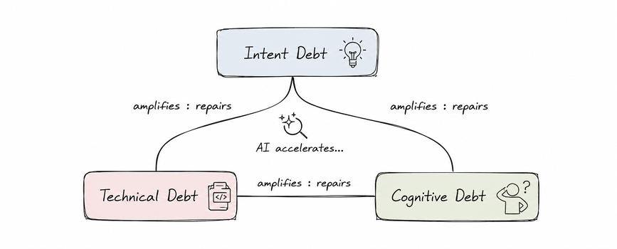

생성 AI가 소프트웨어 개발의 속도를 폭발적으로 높이고 있다. 작은 팀이 몇 년 전에는 상상도 못 할 속도로 기능을 출시한다. 그런데 이 속도 뒤에는 눈에 보이지 않지만 점점 커지는 비용이 있다. 이 글은 AI 코딩 도구를 쓰는 팀을 대상으로, 그 비용을 기술 부채, 인지 부채, 의도 부채의 셋으로 구분하고, 세 부채가 서로를 키우는 관계와 각 부채의 증상, 줄이는 방법을 정리한다.

Margaret-Anne Storey는 From Technical Debt to Cognitive and Intent Debt 논문에서 기술 부채(Technical Debt), 인지 부채(Cognitive Debt), 의도 부채(Intent Debt)라는 Triple Debt Model(3중 부채 모델)로 이 문제를 정리했다. AI를 리팩토링과 리뷰, 테스트 생성에 쓰면 기술 부채는 줄일 수 있지만, 같은 AI가 사람이 이해하는 속도보다 빨리 코드를 만들어 내면서 인지 부채와 의도 부채는 급속도로 쌓인다고 본다.

## 소프트웨어 시스템의 세 층

소프트웨어는 코드만으로 이루어지지 않는다. Storey는 세 층으로 나눈다.

- **목표와 의도(Intent)**: 이해관계자가 원하는 요구사항, 제약 조건, 사업 목적
- **코드와 구조**: 실제로 구현된 소스코드, 아키텍처, 인프라
- **공유 이해(Shared Understanding)**: 팀원들이 시스템이 어떻게 동작하고 어떻게 바꿔야 하는지에 관해 공유하는 정신 모델(mental model)

부채는 층마다 하나씩 생긴다.

| 층 | 부채 | 있는 곳 |
| --- | --- | --- |
| 코드와 구조 | Technical Debt | 코드 |
| 공유 이해 | Cognitive Debt | 개발자의 머릿속 |
| 목표와 의도 | Intent Debt | 문서, ADR, 테스트 같은 외부화된 지식 |

기술 부채는 Ward Cunningham이 1992년 OOPSLA 발표에서 처음 제안한 개념으로, 셋 중 가장 잘 알려져 있고 TDD, 리팩토링, 코드 리뷰처럼 관리 방법도 많다. 이 글은 AI 시대에 특히 빠르게 쌓이는 나머지 둘, 인지 부채와 의도 부채에 집중한다.



세 부채는 따로 쌓이지 않고 서로를 키운다. 시스템의 목적이 기록되어 있지 않으면 새로 온 팀원이 정확한 정신 모델을 만들 수 없으므로 의도 부채는 인지 부채를 낳는다. 반대로 시스템의 의도를 이해하지 못하는 개발자는 사양을 적거나 결정을 기록할 수 없으므로 인지 부채는 의도 부채를 낳는다. 시스템을 이해하지 못한 채 내리는 구현 결정은 나쁜 결정이기 쉬우므로 인지 부채는 기술 부채를 낳고, 지저분한 코드는 읽어서 이해하기 어려우므로 기술 부채는 다시 인지 부채를 키운다. 그림의 선이 양방향인 이유가 이것이고, 같은 이유로 하나를 갚으면 다른 둘을 갚기도 쉬워진다. 측정하기 쉬운 코드 층만 관리해서는 시스템의 건강을 지킬 수 없다.

## AI가 부채를 어떻게 바꾸는가

기술 부채에 관해서는 AI가 줄이는 쪽으로 작용할 수 있다. 자동 리팩토링, AI 보조 코드 리뷰, AI 생성 테스트를 기술 부채를 갚는 데 쓰면 코드 층의 유지 비용이 내려간다. 다만 이것은 AI를 그 방향으로 썼을 때의 이야기다.

인지 부채는 반대 방향으로 움직인다. 직접 코드를 쓸 때는 지저분하게라도 쓰는 동안 이해하려는 마찰이 생기는데, AI가 코드를 만들어 주면 개발자는 "작동하네?"에서 멈추고 그 마찰이 사라진다. Storey는 이 메커니즘을 Shaw와 Nave의 용어를 빌려 Cognitive Surrender(인지적 항복)라고 설명한다. AI 출력을 직관으로도 숙고로도 검토하지 않고 그대로 받아들이는 태도다. 린터나 타입 검사기에 정해진 작업을 맡기는 Cognitive Offloading(인지적 위임)과는 다르다. 위임은 합리적인 생산성 선택이지만, 항복은 비판적 관여 자체를 잃게 하고, Shaw와 Nave에 따르면 AI가 틀렸을 때도 자신감을 부풀린다. 그래서 팀은 이해를 잃고 있다는 사실을 잃은 뒤에야 안다.

의도 부채도 쌓이는 쪽이다. AI 에이전트가 코드를 다루려면 사람의 암묵지가 아니라 ADR, BDD 테스트, 도메인 모델 같은 명시적 의도가 필요한데, 그것이 없으면 에이전트는 잘못된 방향으로 최적화한다. 사람끼리라면 복도에서 물어 메울 수 있던 공백이 에이전트에게는 그대로 빈칸이다.

AI를 기술 부채를 갚는 방향으로 쓰지 않고 생성에만 쓰면 기술 부채도 함께 는다. 최근 실증 연구들이 그 규모를 보여 준다.

- 6,299개 GitHub 저장소에서 다섯 종의 AI 코딩 어시스턴트가 작성한 커밋 30만 2천 건을 분석한 2026년 연구(Debt Behind the AI Boom)는 AI가 도입한 이슈 가운데 22.7%가 저장소의 최신 버전까지 살아 있다고 보고했다. 도입된 이슈의 89.3%는 코드 냄새였다.
- CodeRabbit이 2025년 12월에 낸 보고서는 오픈소스 PR 470개(AI가 공동 작성한 320개, 사람만 작성한 150개)를 비교해, AI가 관여한 PR은 PR당 이슈가 10.83개로 사람만 작성한 PR의 6.45개보다 1.7배 많고, 보안 이슈는 최대 2.74배, 가독성 이슈는 3배 이상 많았다고 보고했다.
- Veracode의 2025년 GenAI Code Security Report는 100개 이상의 LLM에 80개 코딩 과제를 시켜 AI 생성 코드의 45%에 보안 취약점이 있었다고 보고했다.

세 연구가 측정한 것은 모두 코드 층의 이슈다. 그 가운데 첫 번째 연구의 잔존율이 인지 부채와 맞닿아 있다. 이슈가 최신 버전까지 살아남은 동안 그 코드를 이해하고 손본 사람이 없었다는 데서, 코드 층의 부채가 공유 이해의 공백과 함께 간다는 것을 읽을 수 있다.

## 인지 부채

인지 부채는 팀의 공유 이해가 침식되는 팀·프로젝트 수준의 부채다. 개발자들이 시스템이 어떻게 동작하는지, 왜 그렇게 설계되었는지, 어떻게 안전하게 바꿀 수 있는지에 관한 정신 모델을 잃어 가는 상태다. Storey는 이것을 Naur가 말한 "시스템의 이론(theory of the system)"이 약해지는 현상으로 설명한다.

증상은 이렇게 나타난다.

- 변경했을 때 예상하지 못한 결과가 생긴다.
- 변경을 꺼린다(Resistance to change). 시스템을 이해한다는 자신이 없기 때문이다.
- 새 팀원의 온보딩이 늦거나 예측할 수 없다. 문서가 있어도 그렇다.
- Bus Factor가 낮아진다. 특정 한두 명만 시스템을 이해하는 상태다.
- 팀의 Transactive Memory(누가 무엇을 아는지에 관한 공유 기억)가 사라진다.

Storey가 드는 대응은 사람 사이의 상호작용을 의도적으로 되살리는 쪽이다. 코드 리뷰를 버그 검출이 아니라 지식 공유의 자리로 쓰고, 자기가 쓰지 않은 코드를 설명하는 시스템 워크스루(System Walkthrough)와 페어 프로그래밍, 리트로스펙티브를 돌리며, 온보딩과 오프보딩 때 이해의 공백을 드러내는 대화를 한다. 코드 생성 비용이 싸졌으므로 이해가 끊긴 부분을 다시 구현하면서 이해를 복구하는 방법도 든다. AI 도구는 이해를 돕는 데 쓰되 이해에 드는 사람의 마찰을 완전히 대체하지 않게 한다는 것이 공통된 방향이다. 나는 그 마찰을 남기는 가장 싼 방법이 AI 출력을 머지하기 전에 "이 코드가 왜 이렇게 동작하는지"를 내 말로 설명해 보는 것이라고 본다. 설명이 막히는 부분이 바로 항복이 일어난 자리다.

## 의도 부채

의도 부채는 시스템의 목표, 제약 조건, 설계 결정의 근거(rationale)가 외부화되지 않거나 오래되어 사라진 상태다. 코드와 사람의 이해를 넘어 "왜 이 시스템을 이렇게 만들었는가"의 명시적 기록이 없는 것이다. Triple Debt Model에서 의도 부채는 문서, ADR, 테스트 같은 아티팩트에 있고, AI 에이전트가 참여하는 환경에서 특히 중요해진다.

아래 코드를 보자.

```python
if order.total_amount >= 50000 and order.destination_country in ["KR", "JP"]:
    apply_free_shipping(order)
```

개발자가 이 코드를 보면 "5만원 이상이면 한국과 일본은 배송비 무료"까지는 이해한다. 하지만 이 정책을 왜 만들었는지, 어떤 조건에서 바꿔도 되는지는 알 수 없다. 이것이 의도 부채다. AI 시대에는 아이디어가 티켓으로, 티켓이 프롬프트로, 프롬프트가 코드로 압축되는 동안 맥락이 대량으로 떨어져 나간다. 코드 생성 속도는 빨라졌지만 이해와 기록의 속도는 그대로다.

증상으로는 Behavior Drift(시스템의 동작이 이해관계자의 기대에서 서서히 멀어지는 것), AI 에이전트의 변경 실패, 성능·보안·접근성 같은 비기능 요구사항의 상실, 코드만으로는 바꿔도 되는지 판단할 수 없는 상황이 있다.

대응은 의도를 결정 순간에 기록하는 것이다. 설계 결정과 근거를 적는 Architectural Decision Records(ADR), 기대 동작을 예시로 적는 Behavior-Driven Development(BDD) 테스트, Domain-Driven Design의 유비쿼터스 언어, 코드와 함께 갱신되는 Living Documentation이 그 수단이다. Storey는 AI로 개발할 때 의도를 먼저 적고 코드를 만드는 Intent-first workflow와, 에이전트에게 플레이북과 제약 조건 같은 맥락을 충분히 주는 것을 권한다. 의도 부채는 나중에 갚기 어렵다. 결정한 사람이 떠나면 근거를 복원할 길이 없기 때문이다.

## 이론 구축으로 본 세 부채

Peter Naur가 1985년에 쓴 Programming as Theory Building이 이 문제를 오래전에 예고했다. 프로그래밍의 본질은 코드 작성이 아니라 이론 구축(Theory Building)이라는 주장이다. 여기서 이론이란 어떤 일을 지능적으로 수행할 뿐 아니라 그것을 설명하고, 질문에 답하고, 논쟁할 수 있게 하는 지식이고, 문서로 완전히 전달할 수 없는 암묵지(tacit knowledge)를 포함한다.

Naur는 프로그램의 이론을 가진 프로그래머가 할 수 있는 일을 셋으로 든다.

- **현실과 프로그램의 대응**: 프로그램이 다루는 현실의 어떤 요소가 프로그램의 어느 부분에 어떻게 대응하는지 설명할 수 있다.
- **각 부분의 정당화**: 프로그램의 각 부분이 왜 그렇게 되어 있는지, 즉 프로그램 텍스트를 뒷받침하는 근거를 댈 수 있다.
- **변경에 대한 건설적 대응**: 변경 요구가 들어왔을 때 프로그램의 어느 부분을 어떻게 고쳐야 하는지 판단할 수 있다.

세 부채는 이 셋이 사라진 모습으로 읽을 수 있다. 둘째 항목인 정당화가 기록되지 않은 것이 의도 부채이고, 첫째와 셋째를 할 수 있는 사람이 팀에서 사라지는 것이 인지 부채이며, 셋째 없이 이루어진 변경이 코드에 남긴 흔적이 기술 부채다. 개발자가 떠나면 코드가 남아 있어도 이론이 없으면 그 코드를 이해하고 진화시킬 수 없다. 개발자의 역할은 코드 생산자에서 시스템 이론의 구축자로 옮겨 가고 있다.

## 요약

AI는 기술 부채를 갚는 데 쓸 수 있지만, 같은 속도로 인지 부채와 의도 부채를 쌓는다. 이 비대칭이 AI 도구를 도입한 팀이 마주하는 진짜 위험이다. 세 부채는 서로를 키우므로 측정하기 쉬운 코드 층만 관리해서는 부족하다. 인지 부채에는 이해의 마찰을 되살리는 사람 사이의 상호작용으로, 의도 부채에는 결정 순간의 기록과 의도를 먼저 적는 작업 순서로 대응한다. 의도를 명시적으로 남기고 팀의 공유 지식을 계속 다시 세우는 일이 AI 시대 소프트웨어의 건강을 지킨다. 이 가운데 인지 부채를 "어떤 결정을 AI에게 넘겨도 되는가"라는 질문으로 이어 간 글은 [AI에게 어떤 의사결정을 맡길 수 있는가](https://www.mimul.com/blog/which-decisions-can-humans-delegate/)에서 따로 다루었다.

## 참조 사이트

- [From Technical Debt to Cognitive and Intent Debt: Rethinking Software Health in the Age of AI](https://arxiv.org/abs/2603.22106)
- [The WyCash Portfolio Management System](https://c2.com/doc/oopsla92.html)
- [Debt Behind the AI Boom: A Large-Scale Empirical Study of AI-Generated Code in the Wild](https://arxiv.org/abs/2603.28592)
- [State of AI vs Human Code Generation Report](https://www.coderabbit.ai/blog/state-of-ai-vs-human-code-generation-report)
- [2025 GenAI Code Security Report](https://www.veracode.com/blog/ai-generated-code-security-risks/)
- [Programming as Theory Building](https://pages.cs.wisc.edu/~remzi/Naur.pdf)
