리소스를 물리적으로 지우지 않고 상태만 바꿔 삭제된 것처럼 다루는 논리 삭제는, 삭제 플래그나 삭제일시 컬럼 하나만 추가하면 끝나는 간단한 문제처럼 보인다. 하지만 서비스가 커질수록 이 선택은 곳곳에서 대가를 요구한다. 이 글은 논리 삭제가 실무에서 부딪히는 문제를 네 가지로 정리하고, Immutable Data Model 관점에서 사용자 레코드를 지우지 않으면서 그 문제들을 풀어내는 설계 절차를 다룬다. 테이블 설계를 맡은 개발자가 "삭제 플래그를 둘까, 테이블을 나눌까"를 결정해야 할 때 참고할 수 있도록, 세 가지 상속 패턴과 제자리 익명화를 같은 문제 목록에 대고 비교한다.

## 논리 삭제의 문제

논리 삭제의 문제는 네 가지로 정리된다. 각 항목마다 어떤 문제가 왜 생기는지를 설명하고, 이 글에서 계속 쓸 사용자·게시글 테이블(users: user_id·name·email·user_status, posts: post_id·user_id·created_at)로 실제 쿼리가 어떻게 꼬이는지 보인다.

### 1. 모든 쿼리에 따라붙는 삭제 조건

액티브 사용자만 걸러내려면 모든 쿼리에 `WHERE user_status != 'deleted'` 같은 조건을 달아야 한다. 사용자와 게시글을 조인해 목록을 뽑는 쿼리 하나에도 조건이 필요하고, 서브쿼리나 집계 쿼리로 넘어가면 조건을 붙일 자리가 그만큼 늘어난다.

```sql
-- 게시글 목록에서 탈퇴한 사용자의 글을 걸러내려면
-- 조인한 사용자 테이블에 조건을 달아야 한다
SELECT p.post_id, p.created_at, u.name
FROM posts p
JOIN users u ON p.user_id = u.user_id
WHERE u.user_status != 'deleted';
```

문제는 이 조건을 빠뜨려도 쿼리가 멀쩡히 실행된다는 데 있다. 사용자 테이블에 논리 삭제가 적용되어 있다는 사실은 스키마만 봐서는 드러나지 않으므로, 새로 합류한 개발자나 리뷰어는 아래처럼 user_status 컬럼의 존재를 모른 채 쿼리를 짜기 쉽다. 이 실수는 액티브 사용자만 있는 테스트 데이터로는 걸리지 않고, 삭제된 사용자가 쌓인 운영 환경에서야 탈퇴 사용자의 게시글이 화면에 노출되는 형태로 발견된다. 그래서 테스트는 액티브 사용자와 삭제된 사용자를 모두 픽스처에 준비해 삭제된 사용자의 데이터가 결과에 섞이지 않는지 매번 확인해야 하고, 이 비용은 논리 삭제를 쓰는 테이블이 늘어날수록 같이 늘어난다.

```sql
-- user_status 컬럼의 존재를 모르고 짠 쿼리
-- 삭제된 사용자까지 그대로 조회된다
SELECT user_id, name, email
FROM users
WHERE user_id = 1234;
```

실무에서 흔한 대응은 액티브 사용자만 보이는 뷰를 만들거나, Hibernate의 @SQLRestriction이나 Rails의 default_scope 같은 ORM 전역 필터로 조건을 한곳에 모은다. 조건을 매번 쓰는 수고는 줄지만 조건이 눈에 보이지 않게 되므로, 이 쿼리가 삭제 행을 포함하는지를 코드만 봐서는 알 수 없는 상태로 바뀐다. 삭제 사용자까지 봐야 하는 관리자 화면에서는 필터를 다시 풀어야 하고, 전역 필터가 적용되지 않는 네이티브 쿼리나 배치에서는 원래 문제가 그대로 남는다. 조건을 데이터베이스가 강제하게 하려면 PostgreSQL의 행 수준 보안(Row-Level Security, 역할별로 읽을 수 있는 행을 정책으로 제한하는 기능)을 애플리케이션 역할에 걸면 된다. 정책은 네이티브 쿼리와 배치에도 적용되고, 삭제 사용자까지 봐야 하는 관리자 작업은 정책을 우회하는 별도 역할로 분리한다. 완화책 중에서는 가장 강하지만, 조건이 보이지 않는 곳으로 옮겨 간다는 점은 뷰나 전역 필터와 같아서 문제의 원인을 없애지는 못한다.

### 2. 고유 제약의 붕괴

메일주소처럼 사용자마다 유일해야 하는 컬럼도 논리 삭제 앞에서 무너진다. 탈퇴한 사용자의 메일주소는 테이블 안에 그대로 남아 있으므로, 같은 메일주소로 다시 가입하려는 사용자는 UNIQUE 제약 위반에 걸린다. 액티브 사용자만 대상으로 하는 부분 인덱스를 걸거나 삭제 시점에 메일주소 뒤에 표식을 붙여 값 자체를 바꿔버리는 우회도 가능하지만, 어느 쪽을 택하든 왜 이런 우회가 필요한지를 나중에 코드를 읽는 사람에게 설명해야 하는 부담이 남는다.

```sql
-- 탈퇴한 사용자의 이메일이 남아 있어 재가입 시 충돌한다
INSERT INTO users (name, email, user_status)
VALUES ('김철수', 'chulsoo@example.com', 'active');
-- ERROR: duplicate key value violates unique constraint

-- 액티브 사용자만 대상으로 하는 부분 인덱스로 우회한다
CREATE UNIQUE INDEX idx_users_email_active
ON users (email)
WHERE user_status = 'active';
```

### 3. 참조 무결성의 한계

게시글처럼 사용자를 참조하는 테이블과의 관계도 꼬인다. 게시글 테이블의 user_id 컬럼에 외래키 제약을 걸어 두면 참조 무결성은 지킬 수 있지만, 그 제약은 사용자 레코드가 물리적으로 존재하는지만 확인할 뿐 그 사용자가 액티브인지 삭제된 상태인지는 모른다. 삭제된 사용자를 가리키는 게시글을 화면에 어떻게 표시할지는 데이터베이스가 답을 주지 않으므로, 결국 애플리케이션 쪽에서 판단 로직을 따로 만들어야 한다.

```sql
-- FK 제약은 삭제 여부와 무관하게 통과한다
ALTER TABLE posts
ADD CONSTRAINT fk_posts_user
FOREIGN KEY (user_id) REFERENCES users (user_id);

-- 작성자가 삭제된 상태인지는 애플리케이션이 직접 판단해야 한다
SELECT p.post_id, p.created_at,
       CASE WHEN u.user_status = 'deleted'
            THEN '(탈퇴한 사용자)' ELSE u.name END AS author
FROM posts p
JOIN users u ON p.user_id = u.user_id;
```

자식 레코드를 부모와 함께 정리하는 쪽으로도 데이터베이스는 도움이 되지 않는다. `ON DELETE CASCADE`는 부모 행이 물리적으로 DELETE될 때만 반응하는데, 논리 삭제는 user_status 컬럼을 UPDATE할 뿐이므로 이 트리거가 걸리지 않는다. 그렇다고 자식을 전부 따라 지우는 것이 정답도 아니다. 사용자가 탈퇴해도 게시글은 다른 사용자가 계속 읽고 답글을 다는 콘텐츠라 남겨야 하지만, 로그인 세션이나 알림 설정은 같이 지워야 한다. 이렇게 삭제된 부모를 가진 자식을 어떻게 다룰지는 테이블마다 답이 다르고, 데이터베이스가 그중 어느 것도 강제하지 못하므로 애플리케이션이 테이블마다 처리 규칙을 정하고 빠짐없이 실행해야 한다. 관련 테이블이 늘어날수록 빠뜨리는 테이블도 늘어난다.

```sql
-- 사용자를 논리 삭제해도 CASCADE는 동작하지 않는다
UPDATE users SET user_status = 'deleted' WHERE user_id = 1234;

-- 게시글은 남기고 세션은 지우는 식의 규칙을
-- 애플리케이션이 테이블마다 직접 실행해야 한다
DELETE FROM sessions WHERE user_id = 1234;
```

### 4. 누적되는 삭제 레코드

삭제된 레코드는 지워지지 않고 쌓이기만 한다. 서비스를 몇 년 운영하다 보면 사용자 테이블 전체 100만 건 중 실제 액티브 사용자는 10만 건이고 나머지 90만 건은 삭제된 레코드인 상황도 드물지 않다. 다만 이 누적이 모든 쿼리를 느리게 만드는 것은 아니다. 메일주소로 한 명을 찾는 단건 조회는 B-tree 인덱스를 타므로 행 수가 10배가 되어도 탐색 깊이가 한 단계 늘어나는 정도에 그친다. 비용이 실제로 드러나는 곳은 액티브 사용자 집계나 리포트처럼 테이블을 넓게 읽는 쿼리, 삭제 행까지 담고 있는 인덱스의 크기, 그리고 백업이나 VACUUM 같은 운영 작업이다.

```sql
-- 액티브 사용자 수를 세는 집계는
-- 조건에 맞지 않는 삭제 행 90만 건까지 읽고 버린다
SELECT COUNT(*) FROM users WHERE user_status = 'active';
```

액티브 사용자만 대상으로 하는 부분 인덱스를 만들면 인덱스를 타는 쿼리에 한해 삭제 행을 건너뛸 수 있다. 하지만 이는 논리 삭제를 선택한 대가로 떠안는 추가 설계일 뿐이고, 부분 인덱스에 없는 컬럼으로 거는 조건이나 통계 쿼리에는 효과가 없다.

```sql
-- 액티브 사용자만 인덱싱해 집계와 조회의 스캔 범위를 줄인다
CREATE INDEX idx_users_active ON users (user_id)
WHERE user_status = 'active';
```

네 가지 문제의 원인은 두 가지다. 첫째, 삭제라는 사건을 사용자라는 리소스의 속성 하나로 표현했기 때문에, 외래키처럼 행의 존재만 보는 제약은 그 속성의 의미를 알 수 없고(3번), 속성을 읽는 쪽이 쿼리마다 의미를 해석해야 한다(1번). 둘째, 액티브 사용자와 삭제된 사용자를 한 테이블에 섞어 두었기 때문에, 고유 제약이 삭제 행까지 포함해 걸리고(2번) 삭제 행이 액티브 행과 같은 저장 공간에 쌓이며(4번) 조건을 빠뜨린 쿼리가 삭제 행을 그대로 읽는다(1번). 뒤에서 다루는 설계는 첫 번째 원인을 삭제 이벤트의 분리로, 두 번째 원인을 서브타입 테이블의 분리로 각각 대응한다. 그 출발점은 리소스와 이벤트를 구별해서 모델링하는 [Immutable Data Model](https://www.mimul.com/blog/immutable-data-model/)의 기본형이다. 지금부터 그 순서를 따라 사용자 리소스를 물리 삭제 없이 논리 삭제로 설계하는 과정을 설명한다.

## Immutable Data Model 기반 논리 삭제 설계

Immutable Data Model은 리소스와 이벤트를 구별해서 모델링한다. 사용자 등의 리소스에 논리 삭제를 적용할 때는 리소스 자체를 어떻게 다룰지, 삭제를 이벤트로 남길지, 서브타입을 어떤 방식으로 구현할지, 그리고 이벤트가 참조하는 리소스 상태를 어떻게 유지할지를 순서대로 검토한다.

### 리소스의 검토

먼저 사용자가 액티브 사용자와 삭제된 사용자로 취급이 다른지를 검토한다. 이 단계에서 물리 설계부터 고민하면 검토할 지점을 놓치기 쉬우니 주의하자. 취급이 다르지 않은 경우를 생각해 보자.

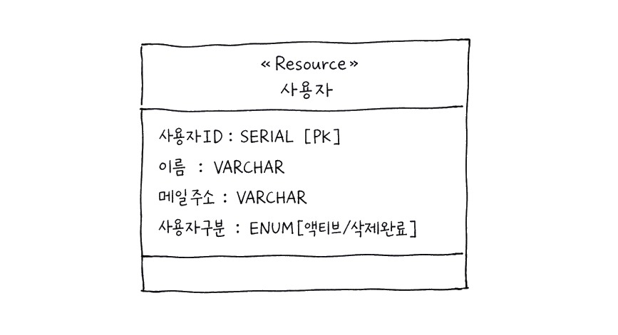

사용자구분이 액티브인지 삭제완료인지가 단순한 라벨에 불과하고, 행동도 속성도 아무것도 변하지 않는다면, 사용자의 속성으로 사용자구분을 가지면 된다. 이 패턴은 간과하기 쉽지만, 기존 Excel 업무를 그대로 웹으로 옮긴 시스템에서는 이것으로 충분한 경우도 있다. 다음으로 취급이 다른 경우인데, 그 차이를 알 수 있도록 서브타입으로 표현해 둔다.

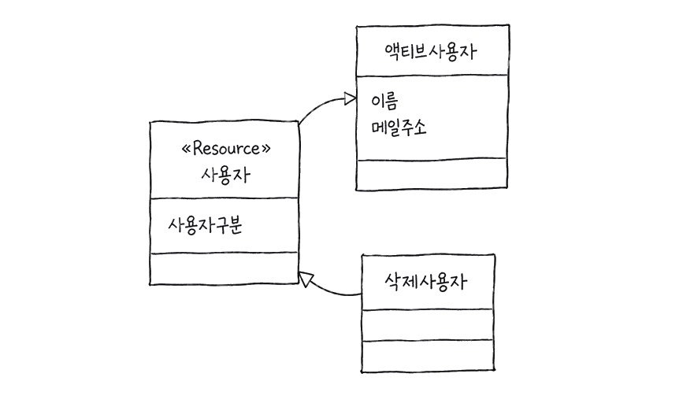

보통은 액티브 사용자만을 대상으로 하는 유스케이스가 많을 것이고, 삭제 사용자는 성명 등의 개인정보가 저장되어서는 안 된다는 식으로 속성에 차이가 있는 경우도 있다.

### 이벤트의 검토

삭제라는 사건을 업무 기록으로 남길 필요가 있는지 검토한다. 이 검토를 건너뛰고 리소스에 삭제일시 컬럼을 두는 것으로 끝내면 업무 이벤트를 놓친다.

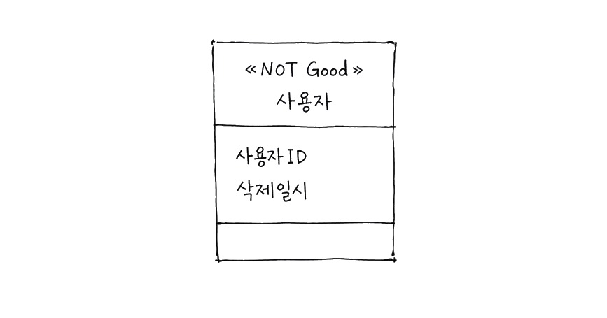

사용자의 삭제는 스스로 탈퇴하는 경우도 있고, 관리자가 강제탈퇴시키는 경우도 있다. 관리자가 강제탈퇴시킨 경우에는 그 이유도 기록해 두어야 할 수 있다. 삭제일시 하나로는 두 사건을 구별할 수 없고, 강제탈퇴 이유를 둘 자리도 없다. 또한 "뭔가 지우는 게 무서워서" 혹은 "지운 후 항의가 들어오면 되돌릴 수 있어야 한다" 같은 막연한 요구도 말로 정리해 모델로 만들어 둔다. "삭제 상태에서 버튼 한 번으로 원래대로 되돌리는 기능이 필요"와 같은 명확한 요구가 없는 한, 자진탈퇴 이벤트에 삭제 시점의 속성을 두면 대체로 충분하다.

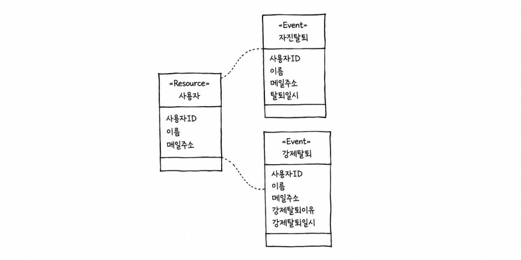

여기서 자진탈퇴·강제탈퇴 이벤트가 이름·메일주소를 그대로 복사해 가지는 점과, 앞서 삭제 사용자 서브타입에 개인정보를 두지 않기로 한 결정이 모순처럼 보일 수 있다. 하지만 리소스는 항상 최신 상태만 표현하고 이벤트는 특정 시점에 일어난 사실을 그대로 보존하는 것이 Immutable Data Model의 원칙이므로, 삭제 시점의 개인정보를 이벤트에 남기는 것과 삭제 사용자 리소스에서 개인정보를 제거하는 것은 서로 다른 차원의 결정이다. 다만 삭제 이벤트에 남은 개인정보도 보존 기간이 지나면 처리해야 한다. 이름·메일주소 컬럼을 NULL로 바꾸는 마스킹 배치를 설계에 포함시키고, 이 배치가 이벤트 행을 갱신하는 유일한 예외라는 점을 모델 설명에 적어 둔다. Immutable Data Model에서 이벤트는 갱신하지 않는 것이 원칙이므로, 예외를 명시해 두지 않으면 나중에 코드를 읽는 사람이 원칙이 깨진 것으로 오해한다.

삭제 플래그인가 삭제일시인가라는 마커 논의도 결국 같은 문제로 귀결된다. Immutable Data Model 관점에서는 어느 쪽이든 삭제라는 사건을 리소스의 속성으로 욱여넣는 방식이라는 점에서 다르지 않으므로, 사용자 엔티티에는 두 마커 중 어느 것도 두지 않는다.

### 리소스 서브타입의 구현

다음은 서브타입의 구현 방법을 결정한다. 객체지향 모델에서는 상속으로 자연스럽게 표현되는 관계가 관계형 테이블에는 대응하는 개념이 없다. 이 간극을 객체-관계 임피던스 불일치(object-relational impedance mismatch, 객체 모델과 관계형 모델이 데이터를 서로 다른 방식으로 표현해서 생기는 차이)라 부르는데, 상속은 그 차이가 가장 뚜렷하게 드러나는 지점이다. 상속 계층을 테이블로 옮기는 방향은 계층 전체를 테이블 하나로 뭉치거나, 서브타입마다 독립된 테이블로 쪼개거나, 공통 속성과 고유 속성을 부모·자식 테이블로 나누는 세 가지이고, 어느 쪽을 택하든 정규화 수준, 조인 비용, NULL 컬럼, 참조 무결성 중 무엇을 얻고 무엇을 내줄지가 달라진다. 사용자·액티브사용자·삭제사용자의 관계도 이 문제의 한 사례이므로, 아래 세 패턴이 구현 수단의 후보가 된다. 세 이름은 [Martin Fowler의 Patterns of Enterprise Application Architecture(2002)](https://martinfowler.com/eaaCatalog/inheritanceMappers.html)에서 정의한 Single Table Inheritance, Concrete Table Inheritance, Class Table Inheritance를 따른다.

먼저 밝혀 둘 것이 있다. 업계에서 가장 흔한 구현은 삭제 플래그에 부분 인덱스와 ORM 스코프를 얹는 방식이고, 사용자처럼 개인정보를 가진 엔티티에서는 행을 남긴 채 이름·메일주소를 지우는 제자리 익명화가 그 뒤를 잇는다. 이 글이 권하는 테이블 분리는 그 관행이 남기는 문제를 애플리케이션 규칙이 아니라 테이블 구조로 없애려는 설계이고, 새로 설계하는 핵심 리소스를 전제로 한다. 이미 운영 중인 시스템이나 게시글·댓글처럼 변동이 잦은 자식 테이블에서는 플래그 방식이 더 가벼운 선택인 경우가 많다.

각 패턴은 앞서 정리한 네 가지 문제 중 무엇을 해결하고 무엇을 남기는지가 다르다. 패턴마다 구조와 삭제 처리 SQL을 먼저 보고, 마지막에 표 하나로 비교한다. SQL에서는 그림의 테이블 이름을 users, active_users, deleted_users, user_versions, posts로 옮겨 쓴다.

#### 싱글 테이블 상속 (JPA `SINGLE_TABLE` 전략)

하나의 사용자 테이블로 정리하는 패턴이다.

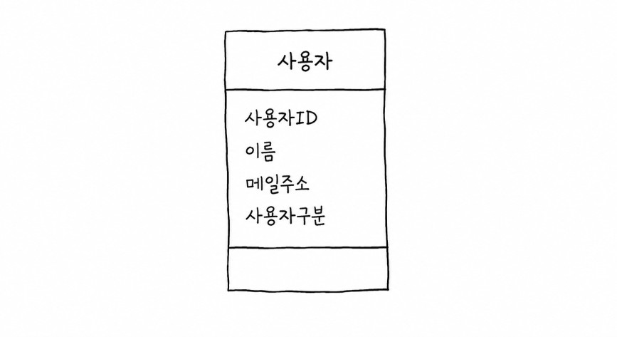

삭제 처리는 사용자구분 컬럼을 갱신하는 UPDATE 한 문장으로 끝난다.

```sql
UPDATE users SET user_status = 'deleted' WHERE user_id = 1234;
```

삭제 사용자까지 포함해 검색할 때 테이블 하나만 읽으면 되고 삭제 처리도 가장 단순하다. 그 대신 앞서 정리한 네 가지 문제가 모두 그대로 남는다. 모든 쿼리에 삭제 조건이 필요하고, 액티브 사용자 범위에서만 유일해야 하는 메일주소에 UNIQUE 제약을 그대로 걸 수 없으며, 삭제 사용자가 늘어날수록 같은 테이블에 쌓인다. 자주 보는 삭제 플래그 구현이 바로 이 패턴이다. 여기까지의 검토를 거쳐 장단점을 이해한 뒤 삭제 플래그를 선택하는 것은 문제가 없지만, 이 형태만을 패턴으로 기억하는 것은 피해야 한다.

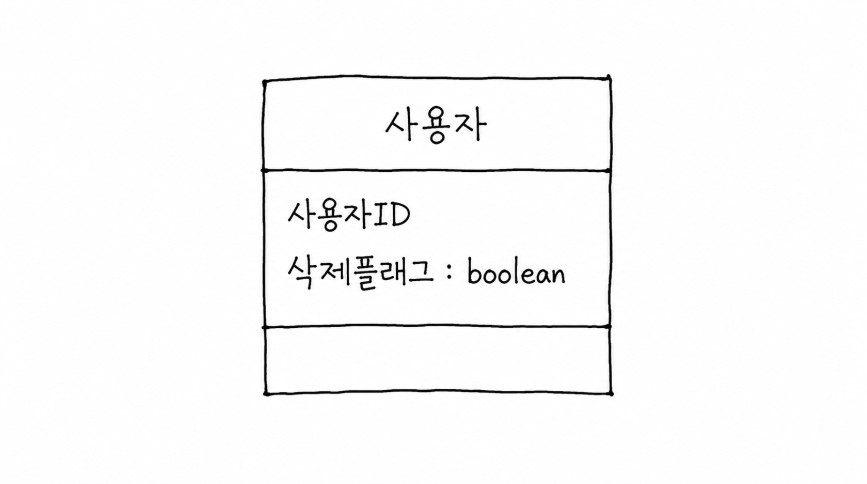

삭제 플래그를 포함해 싱글 테이블 상속으로 구현하면 쿼리마다 부담이 생기므로, 사용자처럼 쿼리에서 빈번히 쓰이는 테이블에서는 피하는 것이 좋다.

싱글 테이블 상속에서 사용자 엔티티에 한해 쓸 수 있는 변형이 제자리 익명화(anonymization in place)다. 삭제 시 사용자구분을 바꾸면서 이름과 메일주소를 같은 문장에서 NULL로 지운다.

```sql
UPDATE users
SET user_status = 'deleted', name = NULL, email = NULL
WHERE user_id = 1234;
```

메일주소가 NULL이 되므로 UNIQUE 제약을 부분 인덱스 없이 그대로 유지할 수 있고, 행이 남으므로 게시글의 FK도 그대로다. 개인정보 보호 규정이 요구하는 삭제를 사용자 행을 지우지 않고 충족하는 방식이라, Discourse의 사용자 익명화 기능이나 Reddit의 [deleted] 작성자 표시가 이 형태다. 테이블 분리가 얻는 효과 중 고유 제약과 참조 무결성 두 가지를 UPDATE 한 문장으로 얻는 셈이라 기존 시스템에 적용하기 가장 쉽다. 다만 삭제 조건 누락과 누적 문제는 그대로 남고, 사용자 테이블에서 삭제 시점의 정보가 사라지므로 삭제 이벤트에 이름·메일주소를 복사해 두는 설계가 전제된다.

#### 구체 테이블 상속 (JPA `TABLE_PER_CLASS` 전략)

각각의 서브타입을 독립된 테이블로 구현하는 패턴이다.

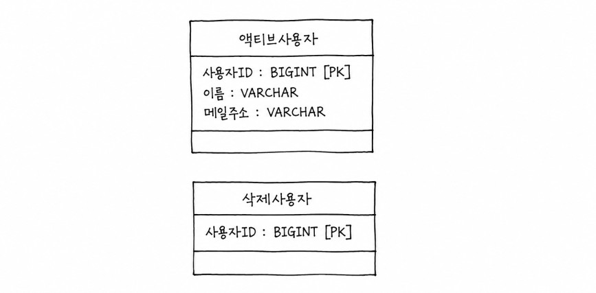

삭제 처리는 한 트랜잭션 안에서 삭제사용자 테이블에 행을 넣고 액티브사용자 테이블에서 행을 지우는 두 단계가 된다.

```sql
BEGIN;
INSERT INTO deleted_users (user_id)
SELECT user_id FROM active_users WHERE user_id = 1234;
DELETE FROM active_users WHERE user_id = 1234;
COMMIT;
```

액티브 사용자만 다루는 쿼리는 액티브사용자 테이블만 읽으면 되므로 삭제 조건이 필요 없고, 메일주소 UNIQUE 제약은 액티브사용자 테이블에 그대로 걸 수 있으며, 삭제 사용자가 늘어도 액티브 테이블의 크기에는 영향이 없다. 삭제 사용자에 개인정보를 두지 않는 요구도 테이블 구조만으로 충족된다. "삭제하면 다른 테이블로 옮겨 아카이브하고 원래 테이블에서 지운다"는 흔한 접근은 이 패턴의 일종이다.

대신 두 가지를 잃는다. 양쪽 사용자를 횡단적으로 검색하려면 UNION이 필요하고, 게시글 같은 이벤트가 참조할 사용자가 두 테이블 중 어느 쪽에도 있을 수 있어 게시글의 사용자ID에 외래키 제약을 걸 수 없다.

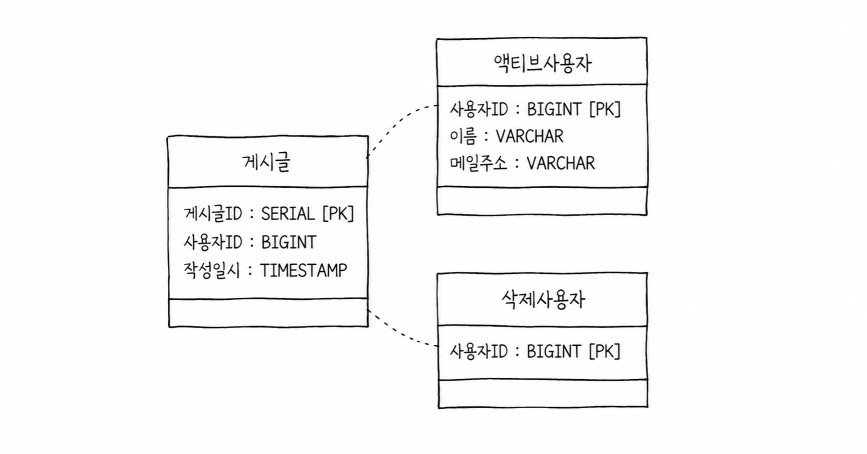

이것을 이유로 싱글 테이블 상속으로 바로 돌아가는 경우가 있지만, 그것은 성급한 판단이다. 이 정도 이유라면 대체로 다음 클래스 테이블 상속으로 구현하는 것이 좋다. 애초에 이벤트와 관련되는 리소스가 최신 상태여야 하는지도 따로 검토해야 하는데, 이것은 "이벤트와의 관련" 절에서 다룬다.

#### 클래스 테이블 상속 (JPA `JOINED` 전략)

공통 부분을 부모 테이블에, 서브타입 고유의 부분을 자식 테이블로 분리하는 패턴이다.

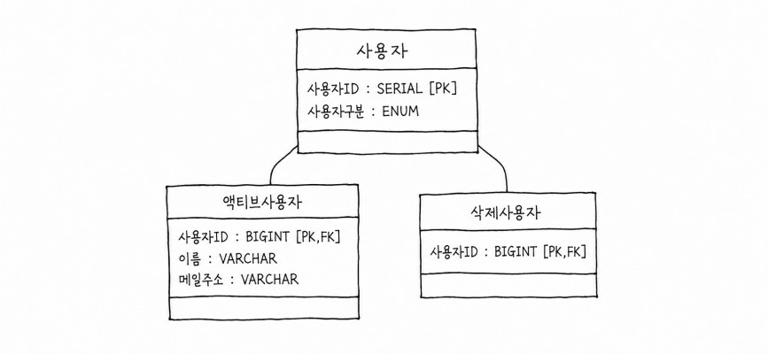

부모인 사용자 테이블에는 사용자ID와 사용자구분만 남기고, 이름·메일주소처럼 액티브 사용자에게만 있는 속성은 액티브사용자 테이블에 둔다. 삭제 처리는 세 테이블을 건드린다.

```sql
BEGIN;
DELETE FROM active_users WHERE user_id = 1234;
UPDATE users SET user_status = 'deleted' WHERE user_id = 1234;
INSERT INTO deleted_users (user_id) VALUES (1234);
COMMIT;
```

이 패턴이 네 가지 문제에 어떻게 답하는지 보면 기본값으로 삼을 이유가 분명해진다. 액티브 전용 쿼리는 액티브사용자 테이블만 읽으므로 삭제 조건이 필요 없다. 메일주소 UNIQUE 제약은 액티브사용자 테이블에 그대로 건다. 게시글의 사용자ID는 부모인 사용자 테이블을 가리키므로 외래키 제약이 유지되고, 사용자가 삭제되어도 부모 행은 남아 있어 제약이 깨지지 않는다. 삭제 사용자는 부모 테이블에만 쌓이는데, 부모 테이블은 ID와 구분 두 컬럼뿐이라 누적 비용이 작다. 횡단 검색은 부모 테이블 하나로 끝나고, 휴면 사용자 같은 새 서브타입을 추가하기도 쉽다. 사용자 레코드 자체는 지워지지 않고 서브타입 행만 액티브에서 삭제로 옮겨 가므로, 이 글이 말하는 "물리 삭제 없는 논리 삭제"는 정확히는 부모 행을 지우지 않는 설계를 가리킨다.

남는 과제는 두 가지다. 첫째, O/R 매퍼로 상속 매핑을 쓰면 조인이 자동 생성되어 쿼리를 제어하기 어려워지는 경우가 있다. 둘째, 한 사용자가 액티브사용자와 삭제사용자 양쪽에 동시에 존재하는 상태를 데이터베이스가 기본으로는 막지 못한다. 위 트랜잭션에서 DELETE를 빠뜨려도 나머지 두 문장이 성공하기 때문이다. 이 배타성은 자식 테이블에 사용자구분 컬럼을 두고 복합 외래키로 부모와 묶으면 데이터베이스 수준에서 보장할 수 있다.

```sql
-- 부모는 (사용자ID, 사용자구분) 조합을 유일하게 유지한다
ALTER TABLE users ADD CONSTRAINT uq_users_id_status
UNIQUE (user_id, user_status);

-- 자식은 자기 구분값을 상수로 고정하고 복합 FK로 부모를 참조한다
CREATE TABLE active_users (
  user_id     BIGINT PRIMARY KEY,
  user_status VARCHAR(16) NOT NULL DEFAULT 'active'
              CHECK (user_status = 'active'),
  name        VARCHAR(100) NOT NULL,
  email       VARCHAR(255) NOT NULL UNIQUE,
  FOREIGN KEY (user_id, user_status)
    REFERENCES users (user_id, user_status)
);
```

삭제사용자 테이블도 같은 방식으로 구분값을 'deleted'로 고정한다. 이렇게 두면 부모의 사용자구분을 'deleted'로 바꾸는 순간 액티브사용자에 남아 있는 행의 외래키가 깨지므로, 액티브 행을 먼저 지우지 않은 삭제 처리는 트랜잭션 안에서 실패한다. 복합 외래키를 받으려면 부모 쪽에 그 조합의 UNIQUE 제약이 있어야 하는데, 주요 RDBMS 모두 지원한다.

세 패턴과 제자리 익명화를 앞서 정리한 문제에 대고 비교하면 다음과 같다.

| 비교 항목 | 싱글 테이블 상속 | 제자리 익명화 | 구체 테이블 상속 | 클래스 테이블 상속 |
|---|---|---|---|---|
| 삭제 조건 누락 | 모든 쿼리에 조건 필요 | 모든 쿼리에 조건 필요 | 액티브 테이블만 읽음 | 액티브 테이블만 읽음 |
| 고유 제약 | 부분 인덱스로 우회 | NULL로 지워 UNIQUE 유지 | 액티브 테이블에 UNIQUE | 액티브 테이블에 UNIQUE |
| 참조 무결성 | FK 유지, 상태는 모름 | FK 유지, 상태는 모름 | FK 불가 | 부모 테이블에 FK 유지 |
| 삭제 레코드 누적 | 한 테이블에 쌓임 | 한 테이블에 쌓임 | 액티브 테이블과 분리 | 부모(ID·구분)에만 쌓임 |
| 횡단 검색 | 테이블 하나 | 테이블 하나 | UNION | 부모 테이블 |
| 삭제 처리 | UPDATE 한 문장 | UPDATE 한 문장 | 두 테이블, 한 트랜잭션 | 세 테이블, 배타 제약 추가 |

새로 설계하는 핵심 리소스라면 클래스 테이블 상속이 기본값이다. 이미 운영 중인 사용자 테이블에서 고유 제약과 FK만 급하다면 제자리 익명화가 가장 적은 변경으로 그 둘을 푼다. 삭제 사용자를 다시 조회할 일이 거의 없고 아카이브 성격이 강하다면 구체 테이블 상속이, Excel 업무를 옮긴 수준의 작은 시스템이라 네 문제가 체감되지 않는다면 싱글 테이블 상속이 각각 더 가벼운 선택이 된다.

누적 문제는 테이블 분리와 별개로, 논리 삭제를 영구 상태로 두지 않는 방식으로도 줄일 수 있다. 삭제 후 일정 기간은 복구 가능한 상태로 두고, 기간이 지나면 배치가 삭제 행을 물리적으로 지운다. 메일 서비스의 휴지통이나 GitHub가 삭제한 저장소를 90일간 복구할 수 있게 하는 것이 이 모델이다. 삭제 이벤트는 그대로 남으므로 Immutable Data Model과 충돌하지 않고, 앞서 나온 "지운 후 항의가 들어오면 되돌릴 수 있어야 한다"는 요구와 누적 문제를 배치 하나로 같이 처리한다. 효과가 큰 곳은 사용자 행 전체가 남는 싱글 테이블 상속과 제자리 익명화, 그리고 삭제사용자 테이블이 커지는 구체 테이블 상속이다. 클래스 테이블 상속에서는 부모 행이 게시글 FK의 대상이라 지울 수 없으므로, 누적은 ID와 구분만 가진 부모 행으로 받아들인다.

### 이벤트와의 관련

"사용자ID가 예를 들어 게시글과 결합되어 있고, 게시글은 다른 회원들이 계속 열람하고 답글도 달려 있어 쉽게 삭제할 수 없으므로, 사용자 테이블에서 삭제할 수 없다"라는 문제도 있다. 게시글이 참조하는 사용자 정보가 항상 최신 상태여야 하는지부터 검토할 필요가 있다.

#### 항상 최신 리소스 상태를 참조하는 경우

게시글과 같은 콘텐츠 이벤트에서는 흔치 않지만, 이벤트가 참조하는 리소스가 최신 상태이면 좋은 업무도 있다. 가령 게시글에 표시할 작성자 닉네임이 회원의 이름 변경 이력과 상관없이 항상 최신 정보를 따라가는 경우, 단순히 게시글이 사용자ID를 가지면 된다.

싱글 테이블 상속의 경우:

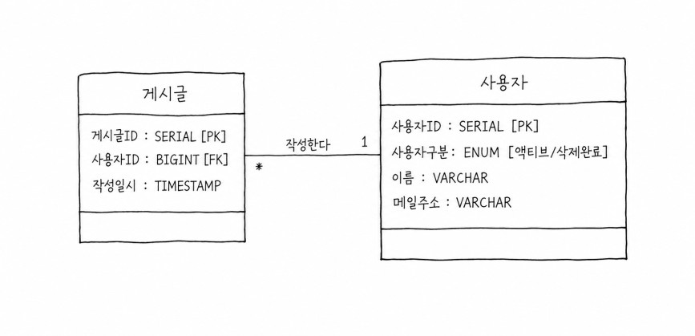

클래스 테이블 상속의 경우:

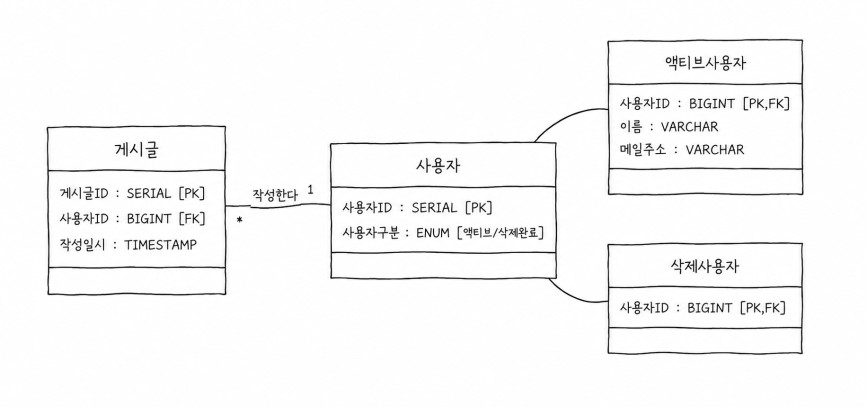

앞서 말한 대로 구체 테이블 상속에서는 FK 제약을 둘 수 없다. 그것도 허용할 수 없다면 다음 절의 버전 관리(시점 기준) 방식으로 옮기면 되는데, 게시글이 사용자 테이블 대신 사용자버전 테이블을 참조하고 사용자버전 행은 사용자가 삭제되어도 지워지지 않으므로 FK가 유지되기 때문이다. 다만 그 대가로 게시글은 더 이상 최신 상태를 자동으로 따라가지 않고 작성 시점의 버전에 고정된다. FK 제약과 최신 상태 추적을 둘 다 포기할 수 없다면 클래스 테이블 상속을 유지하고, 최신 추적 요구 자체를 재검토할 수 있다면 버전 관리 방식으로 전환한다.

#### 이벤트 시점의 리소스 상태를 유지하는 경우

게시글 작성 시점의 사용자 정보를 그대로 참조할 수 있어야 하는 경우에는, 다음 두 가지 방법을 생각해볼 수 있다. 예를 들어 익명 게시판인데 작성 후 닉네임을 바꿔도 예전 게시글에는 작성 당시의 닉네임이 그대로 남아 있어야 하는 요구가 여기에 해당한다.

1. 게시글 엔티티에 그 시점에서 사용자의 속성을 복사하여 갖게 한다.
2. 사용자 엔티티를 버전 관리(시점 기준)한다.

##### 스냅샷 방식

게시글 엔티티에 그 시점의 사용자 속성을 복사해서 갖게 한다.

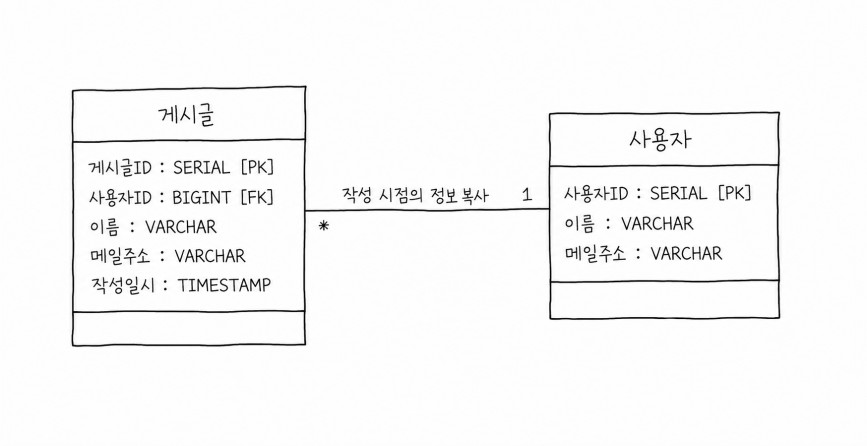

작성 시점의 사용자 정보가 게시글 안에 그대로 남으므로 사용자가 삭제되어도 게시글 표시에 영향이 없고, 구현도 가장 단순하다. 대신 한 명이 게시글을 여러 개 쓰면 같은 이름과 메일주소가 그 수만큼 복사되어 저장 용량을 압박하고, 복사할 속성이 늘어날수록 이벤트 엔티티의 컬럼이 비대해진다. 개인정보가 게시글마다 흩어지므로 이벤트 검토 절에서 말한 마스킹 배치의 대상도 그만큼 넓어진다.

##### 버전 관리(시점 기준)

버전 관리는 사용자 정보가 바뀔 때마다 기존 행을 고치는 대신 새 행을 추가해서 버전을 남기는 방식이다. 가입 직후 이름이 "철수"인 상태로 게시글을 쓰면 그 게시글은 1번 버전을 참조한다. 이후 철수가 이름을 "민수"로 바꾸면 사용자버전 테이블에 2번 버전 행이 새로 생기고, 액티브사용자 테이블이 가리키는 최신 버전 값도 2번으로 갱신된다. 이 시점에서 이미 쓰여 있던 게시글은 여전히 1번 버전을 참조하므로 "철수"라는 이름이 그대로 보이고, 이후 새로 쓰는 게시글은 2번 버전을 참조해 "민수"라는 이름이 보인다.

이를 테이블로 옮기면 다음과 같다.

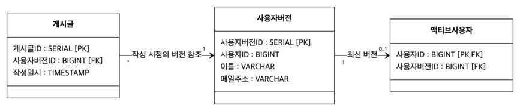

그림에서는 클래스 테이블 상속의 부모인 사용자 테이블을 생략했다. 사용자버전의 사용자ID는 그 부모 테이블을 참조하고, 액티브사용자의 사용자버전ID는 사용자버전을 참조한다. 두 참조가 이렇게 한 방향으로만 흐르므로 신규 가입은 사용자, 사용자버전, 액티브사용자 순서로 넣으면 되고 순환 참조는 생기지 않는다. 이름 변경은 사용자버전에 행을 추가하고 액티브사용자의 최신 버전 포인터를 옮기는 두 문장이다.

```sql
BEGIN;
-- 새 버전 행을 추가한다 (2번 버전이 생성된다)
INSERT INTO user_versions (user_id, name, email)
VALUES (1234, '민수', 'chulsoo@example.com');
-- 액티브사용자가 가리키는 최신 버전을 옮긴다
UPDATE active_users SET user_version_id = 2 WHERE user_id = 1234;
COMMIT;
```

즉, 게시글과 같은 이벤트와 관련되는 것은 버전을 가진 테이블이며, 다른 유스케이스에서 사용자 정보를 참조하는 경우는 액티브사용자와 사용자버전을 JOIN하여 사용한다. 사용자ID로 사용자가 식별되는 쿼리는 액티브사용자가 사용자ID를 PK로 가지므로 인덱스 하나로 바로 해당 행을 찾아, 성능상의 단점도 특별히 생각할 필요가 없다.

사용자 정보의 변경 내역이 빠짐없이 남고, 게시글 작성 시점의 사용자 정보를 정확히 복원할 수 있으며, 스냅샷처럼 복사본을 만들지 않는다. 대신 사용자 정보를 바꿀 때마다 위와 같은 버전 추가 로직이 애플리케이션에 필요하다. 이 로직은 RDBMS의 시스템 버전 관리 테이블(SQL:2011 temporal table, 행이 바뀔 때마다 이전 버전을 데이터베이스가 자동으로 보관하는 기능)로 대체할 수 있다. MariaDB, SQL Server, Db2는 테이블 옵션 하나로 이전 버전을 보관하고 `FOR SYSTEM_TIME AS OF` 구문으로 특정 시점의 행을 조회하게 해 주며, PostgreSQL은 확장으로 비슷한 기능을 얻는다. 다만 자동 보관되는 이력은 시각으로 조회하는 구조라, 게시글이 특정 버전을 외래키로 가리키는 위 설계와는 참조 방식이 다르다. 이벤트가 버전 행을 직접 참조해야 하면 직접 구현한 사용자버전 테이블이 필요하고, 시점 조회만으로 충분하면 시스템 버전 관리가 더 적은 코드로 같은 효과를 낸다.

사용자를 횡단적으로 검색하는 경우에는, 사용자버전 테이블의 스캔이나 인덱스의 RANGE 스캔이 필요하게 되므로, 성능에 주의해서 설계해야 한다. 이를 피하려고 액티브사용자 테이블에 이름이나 메일주소 속성을 중복해 갖게 하면 검색은 빨라지지만, "사용자버전"은 이력의 의미를 띠게 된다. 그러나 이벤트 테이블과 리소스의 이력이 서로 관련되는 것은 의미론적으로 이해하기 어려워지므로, 설계상은 어디까지나 버전이라고 부르는 것을 추천한다. 이력이라는 이름은 지금은 유효하지 않은 과거 상태라는 함의를 갖는데, 액티브 사용자가 가리키는 최신 행도 같은 테이블의 한 행일 뿐이라 그 함의가 맞지 않다.

버전 관리와 같은 목적을 다른 형태로 이루는 설계도 있다. 사용자 행마다 유효 시작·종료 시각(valid_from, valid_to)을 두고 삭제를 종료 시각 설정으로 표현하는 유효 기간 방식은 이력 테이블과 Data Vault 설계에서 관용적으로 쓰인다. 액티브 행은 종료 시각이 무한대인 행이므로 그 조건의 부분 UNIQUE 인덱스로 고유 제약도 해결된다. 싱글 테이블을 사용자구분으로 리스트 파티셔닝하면 테이블을 나누지 않고도 액티브 파티션만 작게 유지되지만, 파티션 테이블의 UNIQUE에는 파티션 키가 포함되어야 해서 메일주소 고유 제약은 여전히 부분 인덱스에 기댄다. Immutable Data Model을 끝까지 밀면 액티브사용자 테이블 자체가 이벤트에서 재구성되는 읽기 모델이 되는 이벤트 소싱에 이른다. 이 글의 설계는 그 중간, 즉 리소스 테이블을 유지하면서 삭제만 이벤트로 분리한 지점에 있다.

## 논리 삭제 설계를 위한 의사결정 흐름

지금까지 살펴본 검토 순서를 하나의 흐름으로 정리하면 다음과 같다.

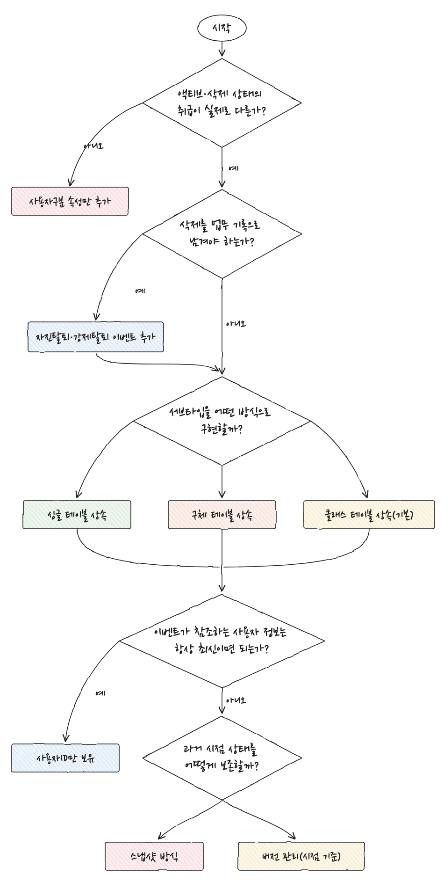

논리 삭제 설계는 한 번에 하나의 질문만 붙잡고 순서대로 풀어가는 문제다. 먼저 액티브 상태와 삭제 상태의 취급이 실제로 다른지부터 확인하고, 다르지 않다면 서브타입 없이 사용자구분 속성 하나로 끝난다. 다르다면 삭제라는 사건을 업무 기록으로 남길지 판단해, 남긴다면 자진탈퇴·강제탈퇴 같은 이벤트를 추가하고 리소스에는 삭제일시 같은 이벤트성 속성을 두지 않는다. 이벤트를 남기든 남기지 않든 서브타입은 싱글·구체·클래스 테이블 상속 중 하나로 구현해야 하는데, 특별한 제약이 없다면 횡단 검색과 FK 제약을 모두 살릴 수 있는 클래스 테이블 상속이 기본값이 된다. 마지막으로 게시글 같은 이벤트가 참조하는 사용자 정보가 항상 최신이면 되는지, 아니면 이벤트 시점의 상태를 보존해야 하는지에 따라 단순 참조, 스냅샷, 버전 관리(시점 기준) 중 하나를 고른다.

## 참조 사이트

- [Single Table Inheritance](https://martinfowler.com/eaaCatalog/singleTableInheritance.html)
- [Class Table Inheritance](https://martinfowler.com/eaaCatalog/classTableInheritance.html)
- [Concrete Table Inheritance](https://martinfowler.com/eaaCatalog/concreteTableInheritance.html)
- [MariaDB System-Versioned Tables](https://mariadb.com/kb/en/system-versioned-tables/)
- [PostgreSQL Row Security Policies](https://www.postgresql.org/docs/current/ddl-rowsecurity.html)
