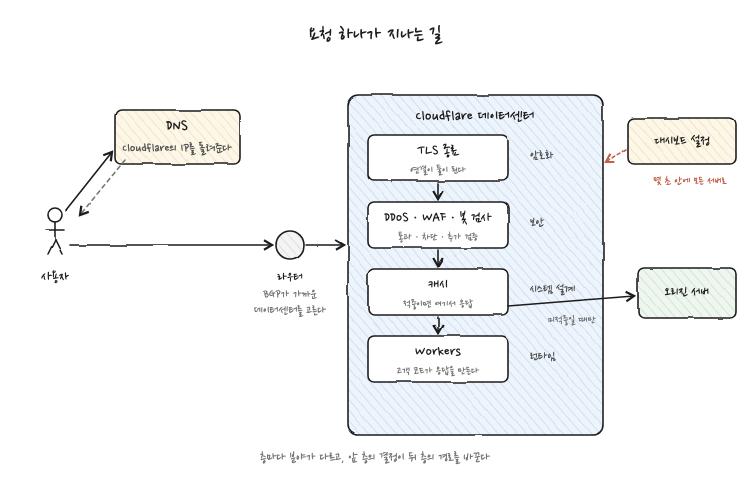
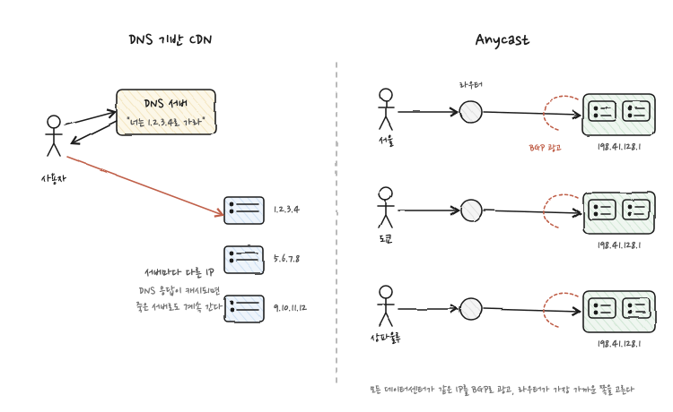
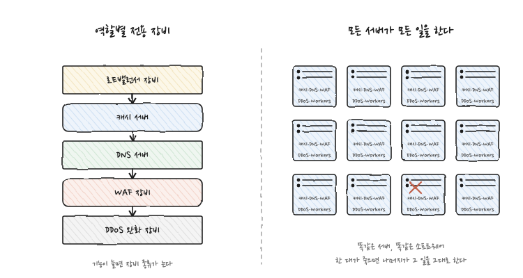
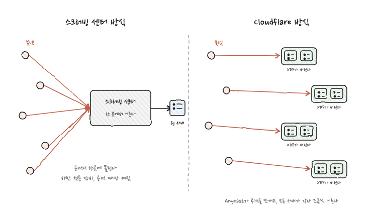
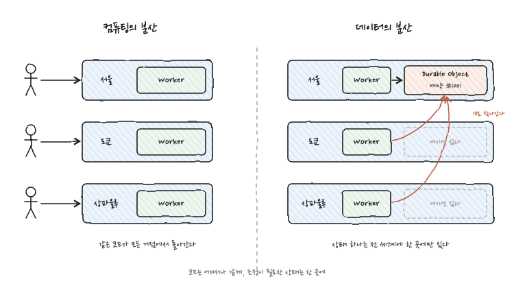

Cloudflare는 2026년 기준으로 전체 웹사이트의 20% 이상이 지나가는 인터넷 기반 시설이다. 그런데 이 회사가 기술적으로 무엇을 어떻게 만들었는지는 바깥에서 이해하기가 유난히 어렵다. 이 글은 그 기술의 출발점에 있던 사람, 세 번째 공동창업자 Lee Holloway의 설계 결정을 따라가며 Cloudflare의 구조를 설명한다. Anycast와 "모든 서버가 모든 일을 한다"는 두 가지 결정이 왜 나왔고 그 위에 무엇이 쌓였는지, 그리고 그가 떠난 뒤 후임자들이 그 철학을 어떻게 이어갔는지를 다룬다. 네트워크 인프라를 직접 다루지 않는 개발자도 읽을 수 있도록 BGP나 XDP 같은 용어는 나올 때마다 풀어 쓴다. 기술 투자를 "이번 분기 비용"으로만 평가하는 자리에 앉아 본 엔지니어와 관리자를 염두에 두고 썼다.

## 들어가며, Cloudflare는 왜 이해하기 어려운가

Cloudflare를 처음 접하는 사람은 대개 CDN(콘텐츠 전송 네트워크) 회사나 DDoS 방어 회사로 분류한다. 둘 다 틀리지는 않지만 둘 다 전체를 설명하지 못한다. 이 회사는 2026년 4월 기준으로 125개 넘는 나라, 330개 넘는 도시에 거점을 두고, [외부 연결 용량이 500Tbps를 넘는 네트워크](https://blog.cloudflare.com/500-tbps-of-capacity/)를 운영한다. 그 네트워크 위에서 캐시, DNS, 방화벽, DDoS 완화, 서버리스 컴퓨팅, 기업용 제로트러스트 접속, 객체 저장소까지 한 묶음으로 판다. Cloudflare는 거점을 도시 단위로 세고, 이 글에서 거점과 데이터센터는 같은 뜻으로 쓴다.

이 모든 제품의 출발점은 리버스 프록시(사용자 대신 뒤쪽 서버에 연결해 주는 중계 서버) 하나다. 도메인의 DNS를 Cloudflare에 맡기고 레코드를 [프록시 상태](https://developers.cloudflare.com/dns/proxy-status/)로 두면, 사용자의 DNS 조회에는 원래 서버(오리진)의 IP 대신 Cloudflare의 IP가 돌아온다. 브라우저는 Cloudflare 서버와 연결을 맺고, 그 서버가 사용자를 대신해 오리진에 연결한다. 개념은 이 두 문장으로 끝나는데, 요청 하나가 실제로 지나는 길을 따라가 보면 왜 이해가 어려운지가 보인다. DNS 응답을 받은 브라우저가 패킷을 보내면 수백 개 데이터센터 중 어디에 닿을지는 인터넷의 라우터들이 BGP로 정한다. 닿은 서버는 브라우저와 TLS 연결을 맺고, 오리진과는 별도의 TLS 연결을 맺는다. 연결이 하나가 아니라 둘이라서 오리진 쪽 암호화와 인증서 검증을 어느 수준으로 할지가 따로 [설정 항목](https://developers.cloudflare.com/ssl/origin-configuration/ssl-modes/)이 된다. 그다음 DDoS 완화, WAF(웹 애플리케이션 방화벽), 봇 탐지, 요청 속도 제한이 차례로 요청을 검사해 통과, 차단, 추가 검증 중 하나를 고른다. 통과한 요청은 캐시를 조회해 적중이면 오리진에 가지 않고 바로 응답하고, 아니면 오리진에 요청을 넘긴다. 고객이 Workers에 코드를 올려 두었다면 그 코드가 같은 서버 안에서 요청을 받아 직접 응답을 만들거나, 오리진 대신 Cloudflare의 저장소에 묻는다.

어려움은 단계의 수가 아니라 단계 사이의 관계에서 온다. WAF가 차단하면 캐시는 조회되지 않고, 캐시가 적중하면 오리진은 요청이 있었다는 사실조차 모르며, Workers가 응답을 만들면 캐시와 오리진을 둘 다 건너뛸 수 있다. 한 층의 결정이 다음 층의 실행 경로를 바꾸므로 한 층만 따로 떼어 이해하기 어렵다. 여기에 두 가지가 더 겹친다. 첫 번째는 이 모든 일이 한 리전의 서버 묶음이 아니라 수백 개 거점의 어느 서버에서나 똑같이 일어나야 하고, 대시보드에서 바꾼 규칙 하나가 몇 초 안에 그 서버 전부에 닿아야 한다는 점이다. 설정을 만드는 쪽(컨트롤 플레인)과 트래픽을 처리하는 쪽(데이터 플레인)이 분리돼 있고, 둘 사이의 전파가 그 자체로 하나의 분산 시스템이다. 두 번째는 컴퓨팅의 분산과 데이터의 분산이 서로 다른 문제라는 점이다. 코드는 모든 거점에서 돌아가지만 그 코드가 읽고 쓰는 상태는 모든 거점에 있을 수 없고, 어느 거점의 쓰기가 다른 거점에 언제 보이는지는 저장소마다 다르다. 그래서 Cloudflare를 CDN 회사로 보면 Workers가 설명되지 않고, 서버리스 회사로 보면 Anycast와 WAF가 설명되지 않으며, 보안 회사로 보면 저장소 제품이 설명되지 않는다. 네트워크, 보안, 분산 시스템, 운영체제, 언어 런타임, 데이터베이스라는 여섯 분야가 요청 하나 안에서 만나는 시스템이라서 기존 카테고리 어느 하나로도 전체가 잡히지 않는다.

이해를 어렵게 만드는 요인이 하나 더 있다. 이 구조를 처음 그린 사람이 거의 알려지지 않았다는 사실이다. Cloudflare의 얼굴은 CEO Matthew Prince와 공동창업자 Michelle Zatlyn이고, 기술 쪽에서는 여러 해 CTO를 지낸 John Graham-Cumming이 블로그와 강연으로 자주 등장한다. 그런데 이 회사에는 [세 번째 공동창업자](https://techcrunch.com/2019/08/15/cloudflare-has-a-third-cofounder-lee-holloway-whos-credited-with-making-the-company-what-is-today)가 있고, 2019년 상장 서류에서 두 창업자는 플랫폼을 설계한 사람으로 그를 지목했다. 그 사람이 Lee Holloway다. 나는 이 글을 쓰기 전까지 Cloudflare 블로그를 10년 가까이 읽으면서도 그의 이름을 제대로 기억하지 못했다. 그만큼 그는 무대 뒤에 있었다.

이 글은 그 여섯 분야를 전부 다루지 않는다. 요청이 어느 데이터센터로 가느냐(Anycast)와 그 데이터센터 안의 서버가 어떻게 생겼느냐(모든 서버가 모든 일을 하는 구조)라는 두 층에 집중한다. 둘 다 Holloway가 설계한 플랫폼의 기반이고, 보안과 컴퓨팅과 저장소 층은 전부 이 둘 위에 올라가 있기 때문이다.

## 1. Lee Holloway, 비전을 인프라로 바꾼 사람

### 세 번째 공동창업자

Holloway와 Prince의 인연은 Cloudflare보다 먼저다. Prince가 유타주 파크시티에서 운영하던 스팸 방지 회사 Unspam Technologies에서 Holloway는 수석 소프트웨어 아키텍트로 일하며 Prince의 집 지하실에 살았다. 처음에는 월급 대신 숙식을 받는 조건이었다. 이 회사에서 Holloway와 동료 엔지니어들이 사이드 프로젝트로 시작한 것이 Project Honey Pot이다. 웹을 돌아다니며 이메일 주소를 긁어가는 스팸 봇을 추적해 데이터를 모으는 공개 프로젝트였는데, 하는 일은 추적과 공개뿐이었고 막지는 못했다. Prince가 하버드 경영대학원을 마칠 무렵 동급생 Michelle Zatlyn과 함께 떠올린 사업 아이디어가 여기서 나왔다. Honey Pot으로 스패머와 해커를 알아보는 데서 그치지 말고, 전 세계에 서버망을 깔고 웹사이트의 트래픽을 그 서버망으로 지나가게 해서 악성 요청을 걸러내자는 구상이었다. 다른 회사의 제안을 받고 있던 Holloway는 한 시간 넘는 설명을 듣고 그 자리에서 합류를 결정했다.

2009년 셋이 회사를 세웠을 때 Prince와 Zatlyn이 가진 것은 사업 계획과 냅킨 위의 스케치였고, 그것을 실제로 돌아가는 시스템으로 바꾼 사람이 Holloway였다. 초기 Cloudflare에서 그는 "상주하는 천재"로 불렸다. 헤드폰으로 데스메탈을 틀어 놓고 몇 시간이고 코드를 쏟아내는 사람이었고, 2010년 9월 TechCrunch Disrupt에서 서비스를 공개할 때도 무대에는 서지 않은 채 발표 당일까지 버그를 잡았다. 공개 한 달 만에 1만 개 사이트가 들어오자 그는 "알았더라면 데이터센터를 다섯 개가 아니라 여덟 개로 시작했을 텐데"라고 말했다. 2014년 9월, 모든 고객에게 무료로 HTTPS를 제공하는 Universal SSL을 내놓을 때의 장면이 있다. 그는 9월 말까지 필요한 소프트웨어를 만들겠다고 약속해 놓고 Prince의 진행 상황 질문을 무시하다가, 출시 전날 일요일에 후드를 눌러쓰고 헤드폰을 낀 채 자리에 앉았다. 당시 엔지니어였던 John Graham-Cumming은 그 모습을 "아무도 감히 말을 걸지 못했다. 후드를 쓰고 완전히 몰입해서 이 시스템에 뇌수술을 하고 있었다"고 회상한다. 밤늦게 그는 일어나 다 끝났다고 말하고 자리를 떴고, 다른 엔지니어들이 바로 코드 리뷰에 들어갔다. 다음 날 모든 고객이 한꺼번에 암호화를 얻었고, Graham-Cumming의 표현으로 "암호화된 웹의 크기가 하룻밤 사이에 두 배가 됐다". 그 스케치에서 출발한 시스템은 [2020년 Wired 기사](https://www.wired.com/story/lee-holloway-devastating-decline-brilliant-young-coder/) 시점에 직원 1,200명, 유료 고객 8만 3천 곳, 전체 인터넷 요청의 10% 이상을 처리하는 규모가 됐고, Wired는 "그가 그린 아키텍처의 상당 부분이 지금도 그대로 자리를 지키고 있다"고 썼다.

### "실패는 반드시 일어난다"는 설계 철학

그의 철학을 한 문장으로 요약하면 "실패는 반드시 일어난다"이다. 서버는 고장 나고, 데이터센터는 공격받고, 회선은 끊긴다. 그 전제를 받아들이면 설계의 방향이 정해진다. 고장을 막으려고 비싸고 튼튼한 장비를 사는 대신, 어느 하나가 죽어도 나머지가 그 자리를 바로 메우는 구조를 만든다. 이 철학이 가장 직접적으로 드러나는 곳은 모든 서버가 모든 일을 하는 구조이지만, Anycast도 같은 생각을 바탕으로 만들어졌다고 할 수 있다. 두 결정이 같은 답을 내는 과정은 3절의 장애 상황에서 확인된다.

### 무대 뒤에 있었던 엔지니어

Holloway는 2016년 7월 회사를 떠났다. 몇 해 전부터 성격과 행동이 달라졌고, 2017년에 행동변이형 전두측두엽 치매라는 진단을 받았다. 30대에 발병하는 경우가 드문 병이다. 송별회에서 Prince는 눈물을 흘리며 감사 인사를 했고, 2020년 Wired가 그의 이야기를 긴 기사로 다루면서 그의 이름이 업계 밖에까지 알려졌다.

회사가 이 엔지니어를 어떻게 기억했는지는 상장 서류에 남아 있다. 2019년 9월 뉴욕 증권거래소에서 상장 종을 울린 사람은 Prince와 Zatlyn이었지만, [상장 서류](https://www.sec.gov/Archives/edgar/data/1477333/000119312519222176/0001193125-19-222176-index.htm)에 두 사람이 쓴 창업자 서한은 세 번째 공동창업자를 "우리 플랫폼을 설계하고 초기 기술팀을 모아 이끈 천재"라고 소개했다. 상장 프로젝트의 코드명은 Project Holloway였고, 그는 회사 지분의 3.2%를 보유했다. 상장 당일 거래소에서 그의 아내 Kristin Holloway에게 동료들은 한 명씩 다가와 "Lee가 여기 있어야 하는데"라고 말했다. 그의 공식 직함은 CTO가 아니었다. 상장 서류도 직함 대신 그가 한 일을 적었다. 이 글의 제목이 그를 CTO라고 적은 것은 직함이 아니라 회사의 기술 전체를 설계하고 초기 기술팀을 이끈 역할을 가리킨다. 회사의 얼굴은 경영자였지만, 그 회사가 무엇 위에 서 있는지는 상장 서류가 기록했다. 나는 이 기록에서 엔지니어의 존재감은 직함이 아니라 비즈니스를 지탱하는 기술에서 나온다고 읽었고, 그래서 그가 내린 두 가지 결정이 지금의 Cloudflare를 지탱하는 근간이라고 생각한다.

## 2. 첫 번째 결정, Anycast로 인터넷 자체를 로드밸런서로 만들다

### Anycast란 무엇인가?

인터넷에서 서버 하나에는 보통 IP 주소 하나가 붙는다. 이 방식을 유니캐스트라고 부른다. 주소가 고유하니 세계 어디서 요청을 보내든 라우터들은 같은 기계로 패킷을 보낸다. 서울에서 보내든 상파울루에서 보내든 댈러스의 그 서버 한 대로 간다. Anycast는 이 전제를 뒤집는다. 여러 대의 기계가 같은 IP 주소를 공유하고, 요청은 네트워크 경로상 가장 가까운 기계로 간다. 서울 사용자는 서울의 서버로, 상파울루 사용자는 상파울루의 서버로 가는데, 둘이 바라보는 주소는 같다.

이것이 가능한 이유는 인터넷의 라우팅 프로토콜 BGP(경계 경로 프로토콜) 때문이다. 인터넷은 수만 개의 자율 시스템(통신사, 클라우드, 대학처럼 자기 네트워크를 스스로 운영하는 단위)이 서로 연결된 집합이고, 각 자율 시스템은 BGP로 이웃에게 "이 주소 대역은 내 쪽으로 보내면 닿는다"고 알린다(BGP 용어로는 경로 광고, advertise). 라우터는 여러 경로 알림 중에서 경로가 짧은 쪽을 고른다. 같은 주소 대역을 전 세계 수백 개 데이터센터에서 동시에 알리면, 각 지역의 라우터는 자기한테 가장 가까운 Cloudflare 데이터센터로 가는 경로를 고르게 된다. 별도의 장치가 사용자를 배정하는 것이 아니라, 인터넷의 라우터들이 평소 하던 대로 가까운 경로를 고르는 행위 자체가 부하 분산이 된다. 긴급 전화번호에 비유할 수 있다. 전국 어디서 112를 눌러도 번호는 같지만 연결되는 곳은 가장 가까운 경찰서다. 발신자가 경찰서 주소를 알 필요가 없고, 어느 경찰서가 문을 닫아도 번호는 그대로 다음 경찰서로 연결된다.

### DNS 기반 CDN과 무엇이 다른가

Cloudflare 이전의 CDN은 대부분 DNS로 사용자를 배정했다. 사용자가 도메인 이름을 조회하면 CDN의 DNS 서버가 조회한 쪽의 위치를 추정해 "너는 이 서버 IP로 가라"고 알려 준다. 서버마다 IP가 다르고, 어느 IP를 돌려줄지 DNS가 결정한다. 안내 데스크에서 창구 번호를 받아 가는 방식이다. 이 방식에는 두 가지 구조적인 약점이 있다. 첫 번째는 DNS 응답의 캐시다. 한번 받은 창구 번호를 리졸버(DNS 조회를 대신 해 주는 서버)가 한동안 기억하기 때문에 그 서버가 막혀도 사용자는 한동안 그쪽으로 계속 간다. 두 번째는 위치 추정의 오차다. DNS 서버가 보는 것은 사용자가 아니라 리졸버의 주소라서, 사용자가 도쿄에 있어도 리졸버가 싱가포르에 있으면 싱가포르 서버를 받는다.

Anycast에는 이 두 약점이 없다. 어느 서버로 갈지는 DNS가 아니라 패킷이 실제로 흐르는 순간 라우터가 정하고, 데이터센터 하나가 장애가 나서 경로 알림을 거두면 라우터는 그 즉시 다음으로 가까운 경로를 고른다. 캐시된 IP가 문제가 되지 않는 이유는 IP 자체가 어디서나 같기 때문이다. 대신 다른 약점이 있다. BGP가 고르는 짧은 경로가 지연이 가장 낮은 경로와 항상 일치하지는 않고, 경로가 바뀌는 순간 진행 중이던 TCP 연결이 다른 데이터센터로 옮겨가 끊길 수 있다. 이 약점은 거점을 촘촘히 깔고 현지 네트워크와 직접 연결할수록 줄어든다. 중간 네트워크를 거치지 않으면 경로가 바뀌는 일 자체가 줄기 때문이다. 2011년 Prince가 쓴 [Anycast 입문 글](https://blog.cloudflare.com/a-brief-anycast-primer/)에는 "데이터센터 하나를 통째로 내려도 트래픽은 자동으로 다음으로 가까운 데이터센터로 흐른다"는 문장이 있다. 그때 Cloudflare의 데이터센터는 12곳이었다.

### 속도와 내장애성을 동시에 얻은 이유

이 같은 결정에는 두 가지 이점(속도와 내장애성)이 있다. 속도 쪽은 직관적이다. 라우터가 경로 길이로 데이터센터를 고르므로 사용자는 네트워크상 가장 가까운 거점에 닿는다. 내장애성 쪽은 조금 더 설명이 필요하다. DDoS 공격은 전 세계에 흩어진 봇넷이 한 주소로 트래픽을 퍼붓는 공격이다. 유니캐스트라면 그 트래픽이 전부 서버 한 대, 데이터센터 한 곳으로 몰린다. Anycast에서는 봇 하나하나가 각자 가장 가까운 Cloudflare 데이터센터로 가기 때문에, 공격 트래픽이 봇넷의 지리적 분포를 따라 전 세계 데이터센터로 저절로 쪼개진다. 공격자가 10개 나라의 봇으로 때리면 10개 나라의 데이터센터가 각자 대략 10분의 1씩 받는 구조다. 봇의 분포가 고르지 않으면 쏠림은 생기지만 한곳으로 전부 몰리는 일은 없다. [2011년 글](https://blog.cloudflare.com/a-brief-anycast-primer/)의 표현으로는 "분산된 봇넷의 서비스 거부 트래픽은 우리 데이터센터 각각이 한 부분씩 흡수한다". 공격을 막기 위해 따로 뭔가를 한 것이 아니라, 평소 사용자를 가까운 곳으로 보내는 바로 그 메커니즘이 공격도 쪼갠다.

### 검증되지 않은 기술에 회사의 기반을 건 선택

2009년 무렵 Anycast는 DNS 루트 서버 같은 곳에서 쓰이던 기술이었지만, HTTP 트래픽을 통째로 프록시하는 서비스를 Anycast 위에 올리는 일은 흔하지 않았다. Prince 자신도 [2011년 글](https://blog.cloudflare.com/a-brief-anycast-primer/)에서 "Anycast는 구현하기 쉽지 않다"고 썼다. 검증된 DNS 방식을 따랐다면 창업 초기의 위험과 비용은 분명히 줄었을 것이다. 데이터센터 다섯 곳으로 시작하는 회사가 굳이 라우팅 프로토콜 수준에서 모험을 할 이유는 없었다.

그런데 그 선택을 "지금 당장 싸고 안전한가"가 아니라 "이 위에 무엇을 쌓을 수 있는가"로 보면 계산이 달라진다. 무료 DDoS 방어는 공격이 Anycast로 저절로 쪼개진다는 성질 없이는 성립하지 않는다. Workers와 제로트러스트는 DNS 배정 방식 위에서도 만들 수 있지만(Akamai와 Fastly도 엣지 컴퓨팅을 제공한다), 어느 거점이 죽어도 라우팅이 즉시 다음 거점으로 넘어가는 성질이 있어야 "어디서나 같은 서비스"를 운영 부담 없이 약속할 수 있다. 라우팅 방식은 나중에 바꾸려면 네트워크 전체를 다시 설계해야 하는 결정이기도 하다. 창업 시점의 Anycast 채택은 비용 관점에서 보면 손해였고 역량 관점에서 보면 이후 15년 동안 나온 Cloudflare 제품의 토대였다.

## 3. 두 번째 결정, 모든 서버가 모든 일을 한다

### 역할별 전용 장비 방식과 균질한 구조의 차이

네트워크 서비스를 만드는 전통적인 방식은 역할별로 장비를 두는 방식이다. 앞단에 로드밸런서 장비, 그 뒤에 캐시 서버, DNS 서버, 방화벽 장비, DDoS 완화 장비를 따로 세운다. 장비마다 그 일에 특화된 하드웨어와 소프트웨어가 들어가고, 기능이 하나 늘면 장비가 한 종류 는다. Holloway는 데이터센터 내부를 이렇게 짜지 않았다. Cloudflare는 이 구조를 "모든 서버가 모든 서비스를 실행한다(every server can run every service)"는 말로 부른다. 2020년 [새 서버 세대를 소개하는 글](https://blog.cloudflare.com/cloudflares-gen-x-servers-for-an-accelerated-future/)은 설계 목표를 "모든 도시의 모든 서버가 모든 서비스를 실행하게 하는 것"이라고 적었고, 같은 해 [네트워크를 설명하는 글](https://blog.cloudflare.com/our-network-cloudflare-one/)은 "모든 제품이 모든 서버에"라는 절 제목 아래 "Cloudflare의 모든 서비스는 전체 네트워크에 걸쳐 표준화돼 있다"고 설명한다. 이 글에서는 이 구조를 줄여서 균질한 구조라고 부른다. 데이터센터 안의 서버는 전부 같은 리눅스에 같은 소프트웨어 묶음을 올린 똑같은 서버들이고, 어느 한 대든 캐시, DNS, WAF, DDoS 완화, 나중에는 Workers까지 모든 역할을 할 수 있다.

식당 주방에 비유하면 차이가 분명해진다. 전용 장비 방식은 튀김 담당, 면 담당, 디저트 담당이 따로 있는 주방이다. 각자 자기 일은 빠르지만 튀김 담당이 결근하면 그날 튀김 메뉴는 없다. 새 메뉴를 넣으려면 그 메뉴 담당을 새로 뽑아야 한다. 균질한 구조는 모든 요리사가 모든 메뉴를 만들 수 있는 주방이다. 한 명이 빠져도 메뉴는 그대로이고, 새 메뉴는 레시피를 모두에게 나눠 주는 것으로 끝난다.

이 구조를 셀 기반 아키텍처(cell-based architecture)와 같은 것으로 읽기 쉬운데, 겹치는 부분과 다른 부분을 나누어 두는 편이 낫다. 셀 기반 아키텍처는 [AWS가 정리한 패턴](https://docs.aws.amazon.com/wellarchitected/latest/reducing-scope-of-impact-with-cell-based-architecture/what-is-a-cell-based-architecture.html)이다. 큰 배는 선체 안을 물이 통하지 않는 칸막이벽(격벽)으로 여러 칸으로 나눠, 한 칸에 구멍이 나도 물이 그 칸에만 차고 배 전체는 가라앉지 않게 만든다. AWS 문서는 이 패턴을 그 격벽에 빗댄다. 워크로드를 통째로 복제한 독립 단위를 셀이라 부르고, 각 셀은 다른 셀과 상태를 공유하지 않으며 전체 요청의 일부만 맡는다. 고객 ID 같은 분할 키로 어느 요청이 어느 셀로 갈지 정하는 얇은 라우팅 층을 앞에 두고, 셀 열 개가 요청을 나눠 맡고 있을 때 한 셀이 고장 나면 나머지 90%의 요청은 영향을 받지 않는다는 식으로 장애의 범위를 좁힌다. 이 용어는 AWS 문서보다 훨씬 오래됐다. 2012년 High Scalability가 ["Cell Architectures"라는 글](https://highscalability.com/cell-architectures/)에서 셀을 "한 샤드의 모든 작업을 혼자 처리할 수 있는 설치본"으로 정의하며 든 사례가 [Tumblr의 대시보드](https://highscalability.com/gone-fishin-tumblr-architecture-15-billion-page-views-a-mont/)다. Tumblr는 사용자를 셀에 배정하고, 셀마다 HBase 클러스터와 서비스 클러스터, Redis 캐시를 따로 두어 "셀 사이의 통신 없이 대시보드 요청을 처리하는 데 필요한 모든 데이터"를 셀 안에 갖게 했다. 한 셀의 장애가 다른 셀에 번지지 않고, 셀 단위로 소프트웨어 버전을 달리해 올릴 수 있다는 점이 그 설계의 이유였다. [Slack이 2023년에 가용 영역 하나를 셀 하나로 삼아 옮겨 간 사례](https://slack.engineering/slacks-migration-to-a-cellular-architecture/)는 같은 생각의 최근 판이다.

셀 단위 하나가 전체 스택을 다 갖추고 있다는 외형은 Cloudflare의 데이터센터와 같다. 하지만, Cloudflare 셀 기반 아키텍처의 다른점은 기존의 셀 기반 아키텍처는 고객을 특정 셀에 고정해 격리하는 설계이고, Cloudflare는 어느 사용자든 어느 데이터센터든 갈 수 있게 해서 격리가 아니라 "어디서나 동일"을 목표로 삼는다. 셀 하나가 죽으면 그 셀의 고객이 영향을 받는 것을 감수하는 쪽과, 죽은 데이터센터의 트래픽을 BGP로 옆 데이터센터에 넘겨 영향 자체를 없애려는 쪽의 차이다. 엣지 서버가 대체로 상태를 갖지 않는 프록시라서 상태를 셀 안에 가둘 필요가 없다는 점이 이 차이를 가능하게 한다.

### 요청 하나가 서버 안에서 지나가는 길

실제 서버 안에서 요청이 어떻게 처리되는지를 보면 "모든 서버가 모든 일을 한다"가 구호가 아니라는 점이 보인다. Marek Majkowski가 [2019년에 정리한 글](https://blog.cloudflare.com/cloudflare-architecture-and-how-bpf-eats-the-world/)을 따라가 보자. 데이터센터의 라우터는 들어온 패킷을 ECMP(같은 목적지로 가는 경로가 여럿일 때 패킷을 나눠 보내는 방식)로 최소 16대의 서버에 흩뿌린다. 패킷이 서버의 네트워크 카드에 닿으면 가장 먼저 XDP가 받는다. XDP는 리눅스 커널이 패킷을 본격적으로 처리하기 전, 네트워크 드라이버 단계에서 작은 프로그램을 실행하게 해 주는 장치다. 여기서 DDoS 공격 패킷은 이미 버려지고, 살아남은 패킷은 같은 단계에서 돌아가는 4계층 로드밸런서가 데이터센터 안의 적절한 서버로 넘긴다. 그다음 리눅스 네트워크 스택과 iptables 방화벽을 지나고, 마지막으로 TLS와 HTTP를 처리하는 프록시, DNS 서버, Workers 런타임 같은 응용 계층에 닿는다. TLS 종료부터 WAF와 봇 검사, 캐시, 오리진 연결까지의 응용 단계는 전부 이 마지막 프록시 안에서 일어나고, 3·4계층 DDoS 완화만 그보다 앞선 XDP 단계에서 끝난다. 커널이 패킷을 거르고 나누는 일과 프록시가 요청을 검사하고 응답하는 일이 같은 서버, 같은 리눅스 위에서 층만 달리해 돌아간다.

서버 앞의 라우터를 빼면 이 경로에는 전용 하드웨어가 없다. DDoS 완화는 전용 장비가 아니라 서버마다 커널 안에서 돌아가는 프로그램이고, 로드밸런서도 서버 안의 소프트웨어다. 그리고 커널 단계와 응용 단계가 서로 다른 서버에서 처리될 수 있다. 서버 A의 XDP가 받아서 서버 B의 프록시가 처리하고, 그 서버가 죽으면 다음 패킷은 서버 C로 간다.

### 장애가 났을 때 벌어지는 일

이 구조에서 서버 한 대가 죽으면 무슨 일이 일어나는지 따라가면 Holloway의 "실패는 반드시 일어난다"가 어떻게 구현됐는지 보인다. 전용 장비 방식에서 DDoS 완화 장비가 죽으면 그 데이터센터는 방어 능력을 잃는다. 장비를 이중화해도 두 대가 같이 죽는 경우는 남는다. 균질한 구조에서는 죽은 서버가 하던 일이 특별하지 않다. 나머지 서버가 똑같은 소프트웨어를 돌리고 있으므로 라우터의 ECMP가 죽은 서버를 빼고 나머지에 패킷을 나누면 끝이다. 데이터센터 전체가 죽으면 이번에는 Anycast가 같은 일을 한 단계 위에서 한다. 그 데이터센터가 알리던 BGP 경로가 사라지고 트래픽은 다음으로 가까운 데이터센터로 흐른다. 서버 층의 균질함과 네트워크 층의 Anycast가 겹쳐서, 어느 수준의 고장이든 "나머지가 그 자리를 메운다"는 같은 답이 나온다. 단순한 구조가 강인한 이유는 특별한 부품이 없어서 특별한 고장도 없기 때문이다.

### 거점이 아니라 설정이 잘못됐을 때

하지만 이 강점은 고장이 한 서버, 한 거점에 머문다는 전제 위에 있다. 모든 서버가 같은 소프트웨어와 같은 설정으로 돌아간다는 성질은, 잘못된 소프트웨어와 잘못된 설정도 모든 서버에서 똑같이 돌아가게 만든다. 설정이 서버에 닿는 길부터가 분산 시스템이다. 대시보드나 API에서 규칙을 만드는 컨트롤 플레인과 그 규칙으로 트래픽을 처리하는 데이터 플레인은 분리돼 있고, 둘 사이를 잇는 것이 모든 엣지 서버에 복제된 키-값 저장소 Quicksilver다. [2020년 글](https://blog.cloudflare.com/introducing-quicksilver-configuration-distribution-at-internet-scale/)에 따르면 변경 하나가 수 초 안에 200개 도시의 모든 서버에 닿고, 각 데이터센터는 중앙과 끊겨도 서비스를 계속할 수 있도록 설정 전체를 로컬에 갖는다. 하루 2.5조 번의 읽기를 받아내는 이 저장소 덕에 규칙 변경이 즉시 전 세계에 적용되는데, 그 속도가 그대로 잘못된 규칙의 전파 속도이기도 하다.

Cloudflare가 이 대가를 치른 사례가 두 번 있다. [2019년 7월 2일](https://blog.cloudflare.com/details-of-the-cloudflare-outage-on-july-2-2019/), WAF 규칙 하나에 들어간 정규식이 입력을 되짚어 재시도하는 역추적을 과도하게 일으켜 HTTP 트래픽을 처리하는 전 세계 모든 CPU 코어를 점유했고, 27분 동안 Cloudflare를 지나는 웹사이트가 멈췄다. 규칙은 위협에 빨리 대응해야 한다는 이유로 다른 소프트웨어가 거치던 단계적 배포를 건너뛰고 Quicksilver를 타고 수 초 만에 전 네트워크로 퍼지는 경로를 쓰고 있었다. [2025년 11월 18일](https://blog.cloudflare.com/18-november-2025-outage/)에는 데이터베이스 권한 변경 하나가 Bot Management의 특징(봇 판별에 쓰는 요청의 속성) 파일을 만드는 쿼리에 중복 행을 섞어 파일 크기를 두 배로 키웠다. 프록시는 특징 수를 200개로 제한하고 있었는데(실제 사용은 60개 남짓), 한도를 넘은 파일을 읽은 새 프록시가 처리되지 않은 오류로 멈췄다. 이 파일은 5분마다 다시 만들어져 전 세계 모든 서버에 배포되므로, 핵심 트래픽이 정상으로 돌아오기까지 세 시간 넘게 걸렸다. 두 장애 모두 공격이 아니었고 거점 장애도 아니었다. Anycast가 트래픽을 넘겨 줄 "살아 있는 옆 거점"이 없는 종류의 실패였다.

Cloudflare의 대응은 구조를 바꾸는 쪽이 아니었다. 2019년의 사후 보고서는 규칙 배포도 다른 소프트웨어처럼 단계적으로 하겠다고 약속했고, 2025년 5월에 공개한 [상태 기반 배포(Health Mediated Deployments)](https://blog.cloudflare.com/safe-change-at-any-scale/)는 새 버전을 서버 집합을 나눠 조금씩 내보내면서 오류율 같은 서비스 지표를 보고, 지표가 나빠지면 사람이 알아차리기 전에 이전 버전으로 되돌린다. 2025년 11월 장애 뒤에 시작한 ["Code Orange: Fail Small"](https://blog.cloudflare.com/code-orange-fail-small-complete/)은 2026년 5월에 완료를 알렸는데, 소프트웨어 릴리스에만 적용되던 이 방식을 설정 변경까지 넓혀 설정도 묶음으로 포장해 점진 배포와 자동 롤백을 거치게 했고, Workers 런타임은 무료 고객 트래픽부터 배포하도록 고객 집단을 나눴다. 서버는 여전히 어디서나 같지만, 같아지는 시점에 시간차를 두어 실패가 작게 끝나게 한다. Holloway의 전제가 하드웨어 고장을 향한 것이었다면, 그가 떠난 뒤의 Cloudflare는 같은 전제를 소프트웨어와 설정의 실패까지 넓혀 적용했다.

## 4. 경쟁사와의 비교로 보는 설계의 차이

경쟁사를 깎아내리려는 비교가 아니다. 설계 철학이 다르면 확장하는 방식이 달라진다는 점을 보려는 것이고, 각 회사의 방식은 각자의 출발점에서는 합리적인 선택이었다.

### Akamai, DNS 기반 부하 분산의 출발점

1998년에 창업한 Akamai는 CDN이라는 범주를 사실상 만든 회사다. 사용자의 DNS 조회가 어디서 왔는지 보고 그 지역에 최적인 엣지 서버의 IP를 돌려주는 방식으로, DNS 기반 배정의 원형이다. 이 방식은 세밀한 제어가 가능하다는 장점이 있다. 어느 사용자를 어느 서버로 보낼지 DNS 응답으로 정밀하게 조정할 수 있다. 대신 DNS 캐시 지연과 리졸버 위치 추정의 오차라는 구조적 한계도 함께 갖는다. Akamai가 각 지역에 최적화된 IP를 돌려주는 접근이었다면, Cloudflare는 인터넷 자체를 부하 분산 장치로 쓰는 접근이다.

### AWS CloudFront, 리전 집중형과 단일 글로벌 분산

AWS의 설계는 리전이 중심이다. 개발자는 어느 리전의 어느 가용 영역에 자원을 둘지 명시적으로 고르고, 가용성을 높이려면 여러 영역에 걸쳐 중복 구성을 직접 짜야 한다. CloudFront는 그 위에 얹힌 CDN으로, 리전별 엣지 로케이션에서 콘텐츠를 캐시한다. 잘 만들어진 설계이고 AWS의 다른 서비스와 결합할 때 강하다. Cloudflare는 처음부터 리전 개념 없이 하나의 네트워크로 설계됐다. 개발자가 리전을 고르지 않는다. 코드와 설정은 전체 네트워크에 한꺼번에 배포되고, 어느 거점에서 실행되는지는 사용자 위치에 따라 Anycast가 정한다. 국소적인 장애에 강한 대신, 특정 지역에 데이터를 고정해야 하는 요구에는 별도의 장치가 필요하다. AWS의 높은 데이터 전송(이그레스) 요금에 맞서 Cloudflare가 전송 요금 없는 객체 저장소 R2를 내놓은 것도 이 구조 차이에서 나온 전략이다.

### Fastly, 소수의 대형 거점과 다수의 분산 거점

2010년대에 떠오른 Fastly는 빠른 엣지 캐시와 프로그래밍 가능한 엣지에 강점을 둔 현대적인 CDN이다. 거점 수는 Cloudflare보다 훨씬 적지만 거점 하나하나가 대용량 고성능 서버를 갖추고 북미와 유럽의 주요 지점에 집중돼 있다. 거점이 적으면 캐시 적중률이 높아지고 운영이 단순해진다는 이점이 있다. Fastly도 Anycast를 쓰므로 Cloudflare와의 차이는 라우팅 방식이 아니라 거점의 수와 배치다. Cloudflare는 반대 방향으로 갔다. 거점을 훨씬 많이, 훨씬 넓게 깔고 주요 인터넷 익스체인지(여러 네트워크가 한곳에 모여 직접 트래픽을 주고받는 접속 지점)에 적극적으로 피어링(중간 사업자 없이 네트워크끼리 직접 연결)해서 사용자와의 물리적 거리를 줄였다. Fastly가 아직 닿지 않은 신흥 시장에도 일찍 들어갔다.

### 설계 철학의 차이를 한눈에

| 항목 | Akamai | AWS CloudFront | Fastly | Cloudflare |
|---|---|---|---|---|
| 사용자 배정 | DNS 응답으로 서버 IP 선택 | DNS + 리전별 엣지 | Anycast, 소수 거점 | Anycast, BGP가 가장 가까운 거점 선택 |
| 거점 전략 | 다수 거점, 지역 최적화 | 리전 중심, 엣지는 보조 | 소수의 대형 거점 | 다수의 소형 거점, 단일 네트워크 |
| 장애 시 동작 | DNS 응답 갱신 (캐시 지연) | 사용자가 다중 영역 구성 | BGP 경로가 다음 거점으로 (Cloudflare와 같은 방식) | BGP 경로가 즉시 다음 거점으로 |
| 새 기능 추가 | 제품별 (EdgeWorkers 등 엣지 프로그램 포함) | 리전별 서비스 출시 | 엣지 프로그램 | 소프트웨어 배포로 전체 네트워크에 |

장애 시 동작 줄이 이 글의 논지와 가장 직접 닿는다. 세 경쟁사의 서버 구성과 기능 추가 방식은 공개 자료가 적어 Cloudflare 줄만큼 확신을 갖고 적지 못했다. 장애가 났을 때와 기능을 더할 때의 동작 방식은 설계 철학에서 바로 따라 나온다.

## 5. 아키텍처가 제품이 되는 순간

### 무료 DDoS 방어, 네트워크 전체가 하나의 스크러빙 센터

전통적인 DDoS 방어는 스크러빙 센터(공격 트래픽을 걸러내는 전용 시설) 방식이다. 공격이 감지되면 그 고객의 트래픽을 특정 지역에 있는 대형 세탁 시설로 끌어와서 공격 패킷을 걸러낸 뒤 깨끗한 트래픽만 원래 서버로 보낸다. 평소에는 꺼져 있다가 공격 때만 켜지고, 그 시설은 수백 Gbps를 회선 속도로 처리해야 하므로 비싸고 특수한 하드웨어가 들어간다. 그래서 이 방어는 오랫동안 비싼 유료 서비스였고, 공격이 커질수록 청구서도 커졌다.

Cloudflare에는 스크러빙 센터가 없다. Anycast와 균질한 구조, 두 결정이 합쳐지면 네트워크 전체가 스크러빙 센터가 되기 때문이다. Anycast가 공격 트래픽을 전 세계 데이터센터로 쪼개고, 각 데이터센터 안에서는 ECMP가 그것을 다시 모든 서버로 나누며, 서버마다 커널 안의 XDP 프로그램이 공격 패킷을 버린다. [2017년 글](https://blog.cloudflare.com/no-scrubs-architecture-unmetered-mitigation/)의 표현으로는 "모든 서버가 완화에 참여하게 하고, DDoS 공격을 데이터센터와 그 안의 서버들에 부하 분산한다". 이 방어는 공격 때만 켜지는 것이 아니라 스택에 내장돼 항상 켜져 있고, 방어에 쓰이는 것은 "우리 서비스 전체를 처리하는 바로 그 서버, 그 프로세서, 그 코어"다. 특수 하드웨어가 없으니 방어 용량은 네트워크 용량과 같다.

이 구조가 [2017년 9월의 결정](https://blog.cloudflare.com/unmetered-mitigation/)을 가능하게 했다. Cloudflare는 요금제와 공격 규모에 관계없이 DDoS 완화를 무제한, 무과금으로 제공한다고 선언했다. 무료 요금제 사용자도 포함이다. 당시 네트워크 용량은 약 15Tbps였고, 3분마다 새로운 공격을 하나씩 막고 있었다. Prince는 "공격받는 고객에게 더 큰 청구서를 보내는 것은 솔직히 말해 비뚤어진 일"이라고 썼다. 기술을 비용으로만 보면 무료 제공은 손실이다. 그런데 전용 장비 비용이 따로 들지 않고 평소 용량 안에서 공격을 흡수하는 구조라면 무료 제공은 손실이 아니라 시장을 넓히는 무기가 된다. [2025년에는 35초 동안 31.4Tbps를 퍼부은 역대 최대 공격](https://blog.cloudflare.com/ddos-threat-report-2025-q4/)을 사람 개입 없이 자동으로 막았고, 같은 해 시간당 평균 5,000건 넘는 공격을 같은 방식으로 처리했다.

### Workers, 지구 전체에 배포하는 엣지 컴퓨팅

[2017년 9월에 나온 Workers](https://blog.cloudflare.com/introducing-cloudflare-workers/)는 Cloudflare의 서버에서 고객의 JavaScript를 실행하는 서비스다. 개발자가 코드를 올리면 그 코드는 당시 117곳의 데이터센터, 지금은 330개 넘는 도시의 모든 거점에 배포된다. 사용자의 요청은 Anycast로 가장 가까운 서버에 닿고, 그 서버가 해당 코드를 바로 실행한다. 개발자는 코드를 한 곳에 쓰지만 실행은 사용자 옆에서 일어난다.

이 제품은 균질한 구조 없이는 나올 수 없었다. 모든 서버가 똑같은 소프트웨어를 돌리는 구조이기 때문에 Workers 런타임을 추가하는 일은 "모든 서버에 소프트웨어 하나를 더 올린다"로 끝난다. Cloudflare는 Workers를 내놓으며 "엣지 네트워크를 프로그래밍 가능하게 만든다"고 했는데, 그 말은 엣지 네트워크가 이미 범용 서버로 이루어져 있었기에 할 수 있는 말이었다. [2026년 Cloudflare 자신의 회고](https://blog.cloudflare.com/500-tbps-of-capacity/)에는 이런 문장이 있다. "네트워크의 모든 서버에서 코드를 실행하는 것은 전체 스택을 우리가 통제한 데서 자연스럽게 따라온 결과였다."

"모든 서버에 소프트웨어 하나를 더 올린다"는 말이 성립하려면 조건이 하나 더 있다. 고객 수백만의 코드가 같은 서버에서 공존해야 한다. 고객마다 컨테이너나 가상 머신을 띄우면 서버 한 대가 감당할 고객 수가 수십에서 수백에 그치고, 수백 개 거점 전부에 모든 고객의 코드를 두는 일은 비용 때문에 불가능해진다. Cloudflare가 고른 답은 V8 isolate다. Chrome의 JavaScript 엔진 V8이 탭 하나하나를 격리하는 데 쓰는 단위를 그대로 가져와, 프로세스 하나 안에서 수백에서 수천 개의 isolate를 돌리고 각 isolate에 고객 한 명의 코드를 둔다. [2018년 글](https://blog.cloudflare.com/cloud-computing-without-containers/)의 수치로 isolate는 5밀리초에 시작하고, 런타임을 공유하므로 코드 하나의 메모리 부담은 Lambda의 빈 Node 함수가 35MB를 쓰는 데 비해 3MB 남짓이다. 컨테이너였다면 Workers는 거점마다 컴퓨팅 전용 서버를 세우는 제품이 됐을 가능성이 크고, 그러면 균질한 구조가 깨진다. isolate는 균질한 구조를 깨지 않고 고객 코드를 모든 서버에 올리게 해 준 기술적 다리다. 대신 isolate의 격리는 컨테이너의 격리와 같지 않다. Node.js의 파일 시스템 접근이나 네이티브 모듈은 쓸 수 없고, 서버 메모리에 상태를 오래 두는 패턴도 성립하지 않는다.

### 코드가 어디서나 돌아가면 상태는 어디에 두는가

코드가 모든 거점에서 돌아가면 다음 질문이 따라온다. 그 코드가 읽고 쓰는 상태는 어디에 있는가. 같은 사용자의 첫 요청은 서울에서, 다음 요청은 도쿄에서 처리될 수 있으니 서버 메모리에 둔 상태는 다음 요청에 없다. Cloudflare는 이 문제에 용도별로 다른 답을 내놓았고, 서로 대체재가 아니다.

| 저장소 | 데이터 모델 | 상태가 있는 곳 | 맞는 용도 |
|---|---|---|---|
| Workers KV (2018년) | 키-값 | 모든 거점에 복제. 한곳의 쓰기가 다른 곳에 바로 보이지 않음 | 설정처럼 드물게 바뀌고 자주 읽는 데이터 |
| Durable Objects (2020년) | ID로 식별되는 상태 객체 | 객체 하나가 전 세계에 단 한 곳. 사용자 가까이 만들어지고 필요하면 이동 | 예약 정원, 채팅방처럼 동시 요청을 한 지점에서 조정해야 하는 상태 |
| R2 (2021년 발표) | 객체 저장소 | 하나의 지역에 저장 | 파일, 이미지 |
| D1 (2022년 발표) | SQLite 기반 관계형 | 하나의 데이터베이스 위치 | 관계형 업무 데이터 |

이 중 Durable Objects는 균질한 구조와 반대 방향의 선택이라 눈에 띈다. 모든 서버가 어디서나 같다는 원칙 위에, 특정 객체는 단 한 곳에만 둔다는 예외를 얹었다. 채팅방 하나, 수업 하나의 예약 정원처럼 동시 요청을 한 줄로 세워야 하는 상태는 복제하면 오히려 틀리기 때문이다. [2020년 글](https://blog.cloudflare.com/introducing-workers-durable-objects/)은 이것을 "상태를 잘게 쪼개는 서버리스"라고 불렀다. 컴퓨팅은 어디서나 같게, 상태는 조정이 필요한 단위마다 한 곳에. 컴퓨팅의 분산과 데이터의 분산은 다른 문제이고, 제품 설계에서는 이렇게 나뉜다.

### 제로트러스트와 Cloudflare One, VPN 장비가 필요 없어진 이유

기업 네트워크 보안의 오랜 모델은 성과 해자다. 회사 네트워크라는 성 안은 믿고, 성 밖은 믿지 않으며, 그 경계에 방화벽과 VPN 장비를 세운다. 밖에서 일하는 직원은 VPN으로 성 안에 들어온 뒤에야 사내 시스템에 닿는다. 이 모델은 모바일, SaaS, 퍼블릭 클라우드, 재택근무로 무너졌다. 지킬 성벽이 어디인지가 흐려졌기 때문이다. 제로트러스트는 네트워크 위치로 신뢰를 주지 않고 모든 접속을 매번 인증하는 모델이다. 2014년 Google의 [BeyondCorp 논문](https://research.google/pubs/beyondcorp-a-new-approach-to-enterprise-security/)이 출발점이다.

[2020년 10월에 나온 Cloudflare One](https://blog.cloudflare.com/introducing-cloudflare-one/)은 이 모델을 Cloudflare 네트워크 위에서 서비스로 제공한다. 직원의 접속은 VPN 장비가 아니라 가장 가까운 Cloudflare 서버로 가고, 그 서버가 신원을 확인하고 정책을 검사한 뒤 사내 시스템으로 이어 준다. Prince는 이 제품을 설명하며 Cloudflare의 설계 원칙을 한 문장으로 적었다. "우리 네트워크를 이루는 어느 도시의 어느 서버든 우리 서비스 전부를 실행할 수 있다." 모든 거점의 모든 서버가 인증과 검사를 할 수 있기 때문에, 직원이 어디에 있든 가까운 곳에서 같은 보안이 적용된다. VPN 장비가 필요 없어진 데는 두 층이 있다. 모델 수준에서는 제로트러스트가 성벽이라는 개념 자체를 없앴고, 구현 수준에서는 VPN 장비가 하던 인증과 검사를 전 세계 수백 거점의 범용 서버가 대신할 수 있었다. Cloudflare의 기반이 기여한 쪽은 두 번째다.

무료 DDoS 방어, Workers, Cloudflare One은 서로 다른 시장을 겨냥한 서로 다른 제품이지만, 셋 다 같은 기반 위에 소프트웨어를 하나씩 더 올린 결과다.

## 6. Holloway 이후, 후임자들은 그의 철학을 어떻게 이어갔나

Holloway가 떠난 뒤의 Cloudflare를 후임자들의 인물 소개로 쓰면 그가 남긴 설계와의 연결이 끊긴다. 대신 두 결정이 그 뒤의 손에서 어떻게 커졌는지를 따라가면 그가 남긴 것이 무엇인지가 분명해진다. 기술 조직의 방향을 정하는 자리는 2012년 무렵 프로그래머로 합류한 John Graham-Cumming이 여러 해 CTO로 맡았다. 그가 기술을 이끄는 동안 Workers와 Cloudflare One이 나왔고, 1절의 Universal SSL 밤샘을 Wired에 증언한 사람도 그다. [2025년 3월 그는 이사회로 옮기며](https://blog.cloudflare.com/three-chapters-at-cloudflare-programmer-to-cto-to-board-of-directors/) 오래 함께 일한 Dane Knecht에게 CTO 자리를 넘겼다. 철학의 사업 쪽 절반, 즉 같은 기능을 무료 요금제까지 내려 보내는 결정은 공동창업자 Prince의 몫이었고, 5절에서 인용한 두 선언이 그의 글이다. 이어서 그 리더십 아래에서 설계를 실제로 키운 네 줄기를 본다.

### Kenton Varda, 균질한 구조를 컴퓨팅 플랫폼으로 넓히다

[2017년 9월 Workers를 소개한 글](https://blog.cloudflare.com/introducing-cloudflare-workers/)을 쓴 사람이 Kenton Varda다. Google에서 Protocol Buffers를 다시 설계하고 Cap'n Proto를 만든 그는 컨테이너 기반 샌드박스를 다루던 배경에서 출발해, Workers의 기술을 이끌며 고객 코드를 모든 서버에 올리는 방법으로 컨테이너가 아닌 V8 isolate를 골랐다. 5절에서 본 대로 그 선택이 균질한 구조를 깨지 않고 Workers를 가능하게 했다. [2020년에는 Durable Objects](https://blog.cloudflare.com/introducing-workers-durable-objects/)로 "객체 하나는 전 세계에 한 곳"이라는 상태 모델을 더했고, [2022년에는 Workers 런타임 workerd를 오픈소스로 공개했다](https://blog.cloudflare.com/workerd-open-source-workers-runtime/). 내가 보기에 그의 작업은 Holloway의 두 번째 결정을 가장 멀리까지 밀고 간 사례다. "모든 서버가 모든 서비스를 실행한다"에서 서비스의 범위가 Cloudflare의 것만이 아니라 고객의 코드까지 넓어졌기 때문이다.

### Pingora 팀, 모든 서버가 돌리는 프록시의 심장을 교체하다

들어가며와 3절에서 본 요청의 응용 단계는 프록시 안에서 일어난다. 그 가운데 오리진과 연결하는 부분을 맡던 프록시를 Cloudflare는 오랫동안 NGINX 위에 얹어 썼는데, [2022년 9월 Yuchen Wu와 Andrew Hauck이 Rust로 새로 만든 Pingora로 바꿨다고 밝혔다](https://blog.cloudflare.com/how-we-built-pingora-the-proxy-that-connects-cloudflare-to-the-internet/). 글에 따르면 Pingora는 오리진과 통신하는 거의 모든 HTTP 요청을 처리하며 하루 1조 건을 넘고, 같은 트래픽에서 이전 프록시보다 CPU를 약 70%, 메모리를 약 67% 덜 쓴다. NGINX를 버린 이유는 구조였다. 프로세스를 늘려 확장하면 오리진 연결 풀이 프로세스마다 흩어져 재사용률이 떨어지는데, Pingora는 스레드로 확장해 연결 풀을 공유한다. [2024년에는 프레임워크로 오픈소스화됐다](https://blog.cloudflare.com/pingora-open-source/). 이 작업이 계승의 사례인 이유는 바꾼 것과 바꾸지 않은 것의 대비에 있다. 모든 서버가 같은 프록시를 돌린다는 구조는 그대로 두고 오리진 쪽 프록시의 내부만 갈아 끼웠다. 소프트웨어 하나를 바꾸면 네트워크 전체가 바뀐다는 3절의 논리가 방어 기능 추가뿐 아니라 심장부 교체에도 그대로 적용됐다.

### Marek Majkowski, 커널에서 전용 하드웨어를 대체하다

"모든 서버가 모든 일을 한다"는 결정이 10년 뒤 어떻게 열매를 맺었는지 보여주는 사람이 Marek Majkowski다. 그가 맡은 작업은 DDoS 방어와 패킷 처리를 리눅스 커널 안에서 최대한 빠르게 하는 것이었다. 그 중심에 eBPF와 XDP가 있다. eBPF는 커널을 다시 컴파일하지 않고도 커널 안에서 작은 프로그램을 안전하게 실행하게 해 주는 장치이고, XDP는 그 프로그램을 네트워크 드라이버 단계, 즉 패킷이 도착하는 가장 이른 지점에 붙이는 방식이다. 패킷이 커널의 나머지 부분을 건드리기 전에 버릴 수 있으니 CPU를 거의 쓰지 않고 초당 수백만 패킷을 떨어뜨릴 수 있다.

[2018년 11월에 공개된 L4Drop](https://blog.cloudflare.com/l4drop-xdp-ebpf-based-ddos-mitigations/)이 이 작업의 결실이다. 이전에는 Floodgate라는 도구가 특정 네트워크 카드 제조사의 기술에 기대어 패킷을 걸렀는데, 새 카드가 그 기술을 지원하지 않게 되면서 수명이 다했다. L4Drop은 공격 탐지 시스템이 만든 규칙을 eBPF 프로그램으로 컴파일해 XDP에서 실행한다. 특정 하드웨어에 묶이지 않고, 임계값을 넘을 때만 켜지는 것이 아니라 항상 켜져 있으며, 여러 CPU에서 동시에 돌아간다. 공개된 실제 공격 그래프에서 서버 한 대가 초당 800만 패킷을 떨어뜨리는 동안 CPU 사용률은 약 10%만 올랐다. 이 작업으로 Cloudflare는 고가의 전용 하드웨어에 의존하지 않고 범용 서버와 소프트웨어로 움직이는 서비스가 됐다. 내가 보기에 이 대목이 Holloway의 결정과 가장 직접적으로 이어지는 연결고리다. 모든 서버가 범용 리눅스 서버였기 때문에 커널 기술 하나가 네트워크 전체의 방어 능력을 한 번에 끌어올릴 수 있었다. 같은 흐름의 운영 쪽 끝이 [2021년에 공개된 dosd](https://blog.cloudflare.com/deep-dive-cloudflare-autonomous-edge-ddos-protection/)다. 모든 엣지 서버에서 돌아가는 이 탐지 데몬은 자기에게 들어오는 패킷과 HTTP 요청을 스스로 분석해 공격이라고 판단하면 중앙의 합의를 기다리지 않고 그 자리에서 완화 규칙을 만들어 XDP 단계에 밀어 넣는다. 공개 당시 수치로 3·4계층 공격의 98.6%를 이 데몬이 탐지했다. 균질한 서버가 여기에서는 스스로 판단하는 서버가 됐다.

### Anycast 쪽 계승, 거점을 촘촘하게 깐 사람들

세 줄기가 전부 두 번째 결정 위의 일이라면, 첫 번째 결정인 Anycast는 소프트웨어가 아니라 거점과 회선으로 이어졌다. Anycast는 거점이 많을수록, 그리고 각 거점이 현지 네트워크와 직접 연결돼 있을수록 효과가 커진다. 라우터가 "가장 가까운 거점"을 고를 때 그 거점이 실제로 가까워야 하기 때문이다. 2014년 3월에 합류한 IPv6와 BGP 전문가 Martin J. Levy가 이 확장을 이끌었고, [2016년 1월 Cloudflare는 100번째 인터넷 익스체인지에 가입했다](https://blog.cloudflare.com/think-global-peer-local-peer-with-cloudflare-at-100-internet-exchange-points/). 당시 75곳 넘는 거점 거의 전부가 현지 익스체인지 가까이에 있었고, 일부 거점에서는 나가는 트래픽의 90% 이상이 익스체인지를 통해 직접 전달됐다. 피어링을 직접 하면 지연이 줄 뿐 아니라, DDoS 트래픽이 중간 네트워크를 거치지 않고 가장 짧은 경로로 Cloudflare에 닿아 다른 네트워크의 혼잡을 줄인다. 그는 [2021년 초 회사를 떠나 은퇴했다](https://www.lonap.net/about/team/martin.levy). 거점을 늘리는 일이 네트워크 엔지니어 한 사람의 일은 아니었다. 한때 네트워크 엔지니어가 [Tom Paseka](https://cloudflare.tv/event/bveXG8gk) 한 명뿐이던 회사는 인프라 조직을 따로 꾸렸고, 그 조직을 이끈 [Nitin Rao](https://datacenterdynamics.com/en/profile/nitinrao)가 재직하는 동안 거점은 23개 도시에서 190개 넘는 도시로 늘었다. [2020년 새 서버 세대를 소개하며](https://blog.cloudflare.com/cloudflares-gen-x-servers-for-an-accelerated-future/) "모든 도시의 모든 서버가 모든 서비스를 실행한다"는 설계 목표를 적은 글도 그가 썼다. 이 줄기의 사람들은 소프트웨어 아키텍트가 아니지만, 라우터가 고르는 "가장 가까운 거점"을 실제로 가깝게 만든 일 없이는 Anycast라는 결정은 종이 위의 설계에 머물렀다.

### 네 줄기가 공유한 전제

네 줄기의 작업은 분야가 전부 다르다. 런타임, 프록시, 커널, 네트워크. 그런데 넷 모두 같은 두 가지 성질 위에서 일했고, 그 대응은 아래 표가 정리한다. 작업 대부분은 Holloway가 떠난 2016년 이후에 나왔지만, 어느 것도 두 결정을 뒤집지 않고 그 위에 쌓였다.

| 인물 | 영역 | 키운 결정 | 대표 작업 |
|---|---|---|---|
| Lee Holloway | 설계 | 두 결정 모두 | 2009년 창업 설계, 2014년 Universal SSL |
| John Graham-Cumming, Dane Knecht | 기술 리더십 | 두 결정 모두 | 2012년 합류, CTO 재임, 2025년 승계 |
| Kenton Varda | 런타임 | 균질한 구조 | 2017년 Workers, 2020년 Durable Objects, 2022년 workerd |
| Yuchen Wu, Andrew Hauck | 프록시 | 균질한 구조 | 2022년 Pingora |
| Marek Majkowski | 커널 | 균질한 구조 | 2018년 L4Drop |
| Martin J. Levy, Nitin Rao, Tom Paseka | 네트워크와 인프라 | Anycast | 2016년 100번째 익스체인지 가입, 거점 확장 |

## 맺으며, 그가 한 일과 후임자들이 이어간 것

그가 한 일은 코드나 장비를 만든 것이 아니라 기술을 쌓아 올릴 기반을 만든 일이다. 2009년의 Cloudflare가 Anycast와 균질한 서버 구조를 당장의 비용으로 평가했다면 둘 다 고르지 않았을 가능성이 크다. 검증된 DNS 방식이 더 싸고 안전했고, 역할별 전용 장비가 더 익숙했다. 두 결정은 그 시점에 돈으로 환산되지 않았다. 대신 이후 10년의 제품과 방어 기술이 그 위에 쌓였다. 그 기반은 물론 약점도 함께 물려줬다. 같은 것이 어디서나 돌아간다는 성질은 잘못된 설정도 어디서나 돌아가게 하고, 그 대가를 2019년과 2025년에 치렀다. 그래도 Cloudflare는 구조를 바꾸지 않고 배포에 시간차를 두는 쪽을 골랐다. 기반을 바꾸는 대신 그 위에 안전장치라는 층을 하나 더 올렸다.

사람은 떠나도 아키텍처는 남는다. Varda가 고객 코드를 모든 서버에 올리고, Pingora 팀이 프록시의 심장을 갈아 끼우고, Majkowski가 방어 하드웨어를 커널 프로그램으로 바꾸고, Levy와 인프라 조직이 거점을 현지 네트워크에 직접 붙인 일은 전부 그 두 결정 위에서 이루어졌다. 누구도 두 결정을 다시 내릴 필요가 없었고, 철학이 이어졌다는 말은 그 사실을 가리킨다.

솔직히 이 글을 쓰면서 가장 오래 생각한 대목이 있다. Holloway가 그 결정을 내릴 때 15년 뒤의 제품군을 내다봤을 리는 없다. 그가 가진 것은 "실패는 반드시 일어난다"는 전제와, 그 전제에서 일관되게 따라 나오는 설계뿐이었다. 결과적으로 그 일관성이 이후의 모든 제품이 기댈 토대가 됐다. 기술 결정을 내리는 자리에서 비용만 먼저 따졌다면 Anycast도, 균질한 구조도, 무료 DDoS 방어도 나올 수 없었다. 비용의 질문 옆에 "이 위에 무엇을 쌓을 수 있느냐"를 함께 두는 일, 그것이 Holloway가 한 일의 핵심이고 후임자들이 이어간 철학이라고 나는 생각한다.

## 참조 사이트

- [The Devastating Decline of a Brilliant Young Coder](https://www.wired.com/story/lee-holloway-devastating-decline-brilliant-young-coder/)
- [Cloudflare has a third cofounder, Lee Holloway, who's credited with making the company what it is today](https://techcrunch.com/2019/08/15/cloudflare-has-a-third-cofounder-lee-holloway-whos-credited-with-making-the-company-what-is-today)
- [Cloudflare, Inc. Form S-1 (2019), SEC EDGAR](https://www.sec.gov/Archives/edgar/data/1477333/000119312519222176/0001193125-19-222176-index.htm)
- [A Brief Primer on Anycast](https://blog.cloudflare.com/a-brief-anycast-primer/)
- [Cloudflare architecture and how BPF eats the world](https://blog.cloudflare.com/cloudflare-architecture-and-how-bpf-eats-the-world/)
- [Cloudflare's Gen X: Servers for an Accelerated Future](https://blog.cloudflare.com/cloudflares-gen-x-servers-for-an-accelerated-future/)
- [Our network: Cloudflare One](https://blog.cloudflare.com/our-network-cloudflare-one/)
- [Reducing the Scope of Impact with Cell-Based Architecture, AWS](https://docs.aws.amazon.com/wellarchitected/latest/reducing-scope-of-impact-with-cell-based-architecture/what-is-a-cell-based-architecture.html)
- [Cell Architectures, High Scalability](https://highscalability.com/cell-architectures/)
- [Tumblr Architecture - 15 Billion Page Views A Month, High Scalability](https://highscalability.com/gone-fishin-tumblr-architecture-15-billion-page-views-a-mont/)
- [Slack's Migration to a Cellular Architecture](https://slack.engineering/slacks-migration-to-a-cellular-architecture/)
- [No Scrubs: The Architecture That Made Unmetered Mitigation Possible](https://blog.cloudflare.com/no-scrubs-architecture-unmetered-mitigation/)
- [Unmetered Mitigation: DDoS Protection Without Limits](https://blog.cloudflare.com/unmetered-mitigation/)
- [2025 Q4 DDoS threat report: A record-setting 31.4 Tbps attack](https://blog.cloudflare.com/ddos-threat-report-2025-q4/)
- [Introducing Cloudflare Workers](https://blog.cloudflare.com/introducing-cloudflare-workers/)
- [Cloud Computing without Containers](https://blog.cloudflare.com/cloud-computing-without-containers/)
- [Workers Durable Objects Beta: A New Approach to Stateful Serverless](https://blog.cloudflare.com/introducing-workers-durable-objects/)
- [Introducing Quicksilver: Configuration Distribution at Internet Scale](https://blog.cloudflare.com/introducing-quicksilver-configuration-distribution-at-internet-scale/)
- [How we built Pingora, the proxy that connects Cloudflare to the Internet](https://blog.cloudflare.com/how-we-built-pingora-the-proxy-that-connects-cloudflare-to-the-internet/)
- [Open sourcing Pingora](https://blog.cloudflare.com/pingora-open-source/)
- [Introducing workerd: the Open Source Workers runtime](https://blog.cloudflare.com/workerd-open-source-workers-runtime/)
- [Proxy status, Cloudflare Docs](https://developers.cloudflare.com/dns/proxy-status/)
- [SSL/TLS encryption modes, Cloudflare Docs](https://developers.cloudflare.com/ssl/origin-configuration/ssl-modes/)
- [BeyondCorp: A New Approach to Enterprise Security, Google Research](https://research.google/pubs/beyondcorp-a-new-approach-to-enterprise-security/)
- [Introducing Cloudflare One](https://blog.cloudflare.com/introducing-cloudflare-one/)
- [L4Drop: XDP DDoS Mitigations](https://blog.cloudflare.com/l4drop-xdp-ebpf-based-ddos-mitigations/)
- [A deep-dive into Cloudflare's autonomous edge DDoS protection](https://blog.cloudflare.com/deep-dive-cloudflare-autonomous-edge-ddos-protection/)
- [Think Global, Peer Local: Peer with Cloudflare at 100 Internet Exchange Points](https://blog.cloudflare.com/think-global-peer-local-peer-with-cloudflare-at-100-internet-exchange-points/)
- [500 Tbps of capacity: 16 years of scaling our global network](https://blog.cloudflare.com/500-tbps-of-capacity/)
- [Three chapters at Cloudflare: Programmer to CTO to Board of Directors](https://blog.cloudflare.com/three-chapters-at-cloudflare-programmer-to-cto-to-board-of-directors/)
- [Details of the Cloudflare outage on July 2, 2019](https://blog.cloudflare.com/details-of-the-cloudflare-outage-on-july-2-2019/)
- [Cloudflare outage on November 18, 2025](https://blog.cloudflare.com/18-november-2025-outage/)
- [Scaling with safety: Cloudflare's approach to global service health metrics and software releases](https://blog.cloudflare.com/safe-change-at-any-scale/)
- [Code Orange: Fail Small is complete](https://blog.cloudflare.com/code-orange-fail-small-complete/)
- [Martin Levy, LONAP](https://www.lonap.net/about/team/martin.levy)
- [Nitin Rao, DCD profile](https://datacenterdynamics.com/en/profile/nitinrao)
- [Tom Paseka's 10-year journey at Cloudflare, Cloudflare TV](https://cloudflare.tv/event/bveXG8gk)
