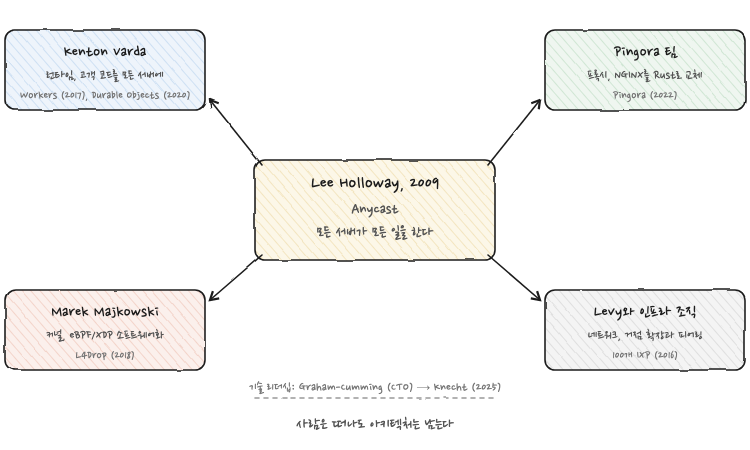

Cloudflare는 2026년 기준으로 전체 웹사이트의 20% 넘게가 지나가는 인터넷 기반 시설이다. 그런데 이 회사가 기술적으로 무엇을 어떻게 만들었는지는 바깥에서 이해하기가 유난히 어렵다. 이 글은 그 기술의 출발점에 있던 사람, 세 번째 공동창업자 Lee Holloway의 설계 결정을 따라가며 Cloudflare의 구조를 설명한다. Anycast와 "모든 서버가 모든 일을 한다"는 두 가지 결정이 왜 나왔고, 그 위에 어떤 제품이 쌓였으며, 그가 떠난 뒤 누가 그 철학을 이어갔는지를 다룬다. 네트워크 인프라를 직접 다루지 않는 개발자도 읽을 수 있도록 BGP나 XDP 같은 용어는 나올 때마다 풀어 쓴다. 기술 투자를 "이번 분기 비용"으로만 평가하는 자리에 앉아 본 엔지니어와 관리자를 염두에 두고 썼다.

## 들어가며, Cloudflare는 왜 이해하기 어려운가

Cloudflare를 처음 접하는 사람은 대개 CDN(콘텐츠 전송 네트워크) 회사나 DDoS 방어 회사로 분류한다. 둘 다 틀리지는 않지만 둘 다 전체를 설명하지 못한다. 이 회사는 2026년 4월 기준으로 125개 넘는 나라, 330개 넘는 도시에 거점을 두고, 외부 연결 용량이 500Tbps를 넘는 네트워크를 운영한다. 그 네트워크 위에서 캐시, DNS, 방화벽, DDoS 완화, 서버리스 컴퓨팅, 기업용 제로트러스트 접속, 객체 저장소까지 한 묶음으로 판다. AWS나 Azure 같은 클라우드가 거대한 데이터센터를 리전(지역)과 가용 영역으로 나눠 운영하는 것과 달리, Cloudflare는 수백 개의 작은 거점을 하나의 통합된 네트워크로 운영한다. 기존 카테고리에 들어맞지 않는 독자적인 클라우드를 만든 셈이라 기존 틀로는 설명이 안 된다.

이해를 어렵게 만드는 요인이 하나 더 있다. 이 구조를 처음 그린 사람이 거의 알려지지 않았다는 사실이다. Cloudflare의 얼굴은 CEO Matthew Prince와 공동창업자 Michelle Zatlyn이고, 기술 쪽에서는 오랫동안 CTO를 지낸 John Graham-Cumming이 블로그와 강연으로 자주 등장한다. 그런데 이 회사에는 세 번째 공동창업자가 있고, 2019년 상장 서류에서 두 창업자는 플랫폼을 설계한 사람으로 그를 지목했다. 그 사람이 Lee Holloway다. 나는 이 글을 쓰기 전까지 Cloudflare 블로그를 10년 가까이 읽으면서도 그의 이름을 제대로 기억하지 못했다. 그만큼 그는 무대 뒤에 있었다.

## 1장 Lee Holloway, 비전을 인프라로 바꾼 사람

### 세 번째 공동창업자

Holloway와 Prince의 인연은 Cloudflare보다 먼저다. Prince가 2004년 유타주 파크시티에 세운 스팸 방지 회사 Unspam Technologies에서 Holloway는 Prince의 집 지하실에 살며 소프트웨어를 만들었다. 처음에는 월급 대신 숙식을 받는 조건이었다. 이 회사에서 Holloway와 동료 엔지니어들이 사이드 프로젝트로 시작한 것이 Project Honey Pot이다. 웹을 기어다니며 이메일 주소를 긁어가는 스팸 봇을 추적해 데이터를 모으는 공개 프로젝트였는데, 하는 일은 추적과 공개뿐이었고 막지는 못했다. Prince가 하버드 경영대학원을 마칠 무렵 동급생 Michelle Zatlyn과 함께 떠올린 사업 아이디어가 여기서 나왔다. Honey Pot으로 스패머와 해커를 알아보는 데서 그치지 말고, 전 세계에 서버망을 깔고 웹사이트의 트래픽을 그 서버망으로 지나가게 해서 악성 요청을 걸러내자는 구상이었다. 다른 회사의 제안을 받고 있던 Holloway는 한 시간 넘는 설명을 듣고 그 자리에서 합류를 결정했다.

2009년 셋이 회사를 세웠을 때 Prince와 Zatlyn이 가진 것은 사업 계획과 냅킨 위의 스케치였고, 그것을 실제로 돌아가는 시스템으로 바꾼 사람이 Holloway였다. 초기 Cloudflare에서 그는 "상주하는 천재"로 불렸다. 헤드폰으로 데스메탈을 틀어 놓고 몇 시간이고 코드를 쏟아내는 사람이었고, 2010년 9월 TechCrunch Disrupt에서 서비스를 공개할 때도 무대에는 서지 않은 채 발표 당일까지 버그를 잡았다. 공개 한 달 만에 1만 개 사이트가 들어오자 그는 "알았더라면 데이터센터를 다섯 개가 아니라 여덟 개로 시작했을 텐데"라고 말했다. 2014년 9월, 모든 고객에게 무료로 HTTPS를 제공하는 Universal SSL을 내놓을 때의 장면은 그의 천재성을 가장 잘 보여준다. 그는 9월 말까지 필요한 소프트웨어를 만들겠다고 약속해 놓고 Prince의 진행 상황 질문을 무시하다가, 출시 전날 일요일에 후드를 눌러쓰고 헤드폰을 낀 채 자리에 앉았다. 당시 엔지니어였던 John Graham-Cumming은 그 모습을 "아무도 감히 말을 걸지 못했다. 후드를 쓰고 완전히 몰입해서 이 시스템에 뇌수술을 하고 있었다"고 회상한다. 밤늦게 그는 일어나 다 끝났다고 말하고 자리를 떴고, 다른 엔지니어들이 바로 코드 리뷰에 들어갔다. 다음 날 모든 고객이 한꺼번에 암호화를 얻었고, Graham-Cumming의 표현으로 "암호화된 웹의 크기가 하룻밤 사이에 두 배가 됐다". 냅킨 위의 스케치에서 출발한 시스템은 2020년 Wired 기사 시점에 직원 1,200명, 유료 고객 8만 3천 곳, 전체 인터넷 요청의 10% 넘게를 처리하는 규모가 됐고, Wired는 "그가 그린 아키텍처의 상당 부분이 지금도 그대로 자리를 지키고 있다"고 썼다.

### "실패는 반드시 일어난다"는 설계 철학

이 글에서 그를 다루는 이유는 일화가 아니라 그가 내린 설계 결정 때문이다. 원문이 그의 철학을 한 문장으로 요약하는 말이 "실패는 반드시 일어난다"이다. 서버는 고장 나고, 데이터센터는 공격받고, 회선은 끊긴다. 그 전제를 받아들이면 설계의 방향이 정해진다. 고장을 막으려고 비싸고 튼튼한 장비를 사는 대신, 어느 하나가 죽어도 나머지가 그 자리를 바로 메우는 구조를 만든다. 원문이 이 철학을 붙인 대상은 모든 서버가 모든 일을 하는 구조이지만, 뒤에서 볼 Anycast도 같은 전제로 읽을 수 있다. 두 결정이 어떻게 같은 목표를 향하는지는 3장에서 장애 상황을 따라가며 확인한다.

### 무대 뒤에 있었던 엔지니어

Holloway는 2016년 7월 회사를 떠났다. 몇 해 전부터 성격과 행동이 달라졌고, 2017년에 행동변이형 전두측두엽 치매라는 진단을 받았다. 30대에 발병하는 경우가 드문 병이다. 송별회에서 Prince는 눈물을 흘리며 감사 인사를 했고, 2020년 Wired가 그의 이야기를 긴 기사로 다루면서 그의 이름이 업계 밖까지 알려졌다. 이 글은 투병 이야기를 더 다루지 않는다.

대신 짚어 둘 것은 회사가 이 엔지니어를 어떻게 기억했는가다. 2019년 9월 뉴욕 증권거래소에서 상장 종을 울린 사람은 Prince와 Zatlyn이었지만, 상장 서류에 두 사람이 쓴 창업자 서한은 세 번째 공동창업자를 "우리 플랫폼을 설계하고 초기 기술팀을 모아 이끈 천재"라고 소개했다. 상장 프로젝트의 코드명은 Project Holloway였고, 그의 신탁은 회사 지분의 3.2%를 보유했다. 상장 당일 거래소 바닥에서 사진을 찍던 직원 11번 Kristin Holloway에게 동료들은 한 명씩 다가와 "Lee가 여기 있어야 하는데"라고 말했다. 회사의 얼굴은 경영자였지만, 그 회사가 무엇 위에 서 있는지를 안에서는 모두가 알고 있었다. 엔지니어가 회사 안에서 갖는 존재감이 직함이나 노출이 아니라 그가 내린 결정이 얼마나 오래 살아남느냐로 정해진다는 것을, 이 회사는 상장 서류에 글로 남겼다. 이제 그 결정 두 가지를 본다.

## 2장 첫 번째 결정, Anycast로 인터넷 자체를 로드밸런서로 만들다

### Anycast란 무엇인가

인터넷에서 서버 하나에는 보통 IP 주소 하나가 붙는다. 이 방식을 유니캐스트라고 부른다. 주소가 고유하니 세계 어디서 요청을 보내든 라우터들은 같은 기계로 패킷을 보낸다. 서울에서 보내든 상파울루에서 보내든 댈러스의 그 서버 한 대로 간다. Anycast는 이 전제를 뒤집는다. 여러 대의 기계가 같은 IP 주소를 공유하고, 요청은 네트워크 경로상 가장 가까운 기계로 간다. 서울 사용자는 서울의 서버로, 상파울루 사용자는 상파울루의 서버로 가는데, 둘이 바라보는 주소는 같다.

이것이 가능한 이유는 인터넷의 라우팅 프로토콜 BGP(경계 경로 프로토콜) 때문이다. 인터넷은 수만 개의 자율 시스템(통신사, 클라우드, 대학처럼 자기 네트워크를 스스로 운영하는 단위)이 서로 연결된 집합이고, 각 자율 시스템은 BGP로 이웃에게 "이 주소 대역은 내 쪽으로 보내면 닿는다"고 광고한다. 라우터는 여러 광고 중에서 경로가 짧은 쪽을 고른다. 같은 주소 대역을 전 세계 수백 개 데이터센터에서 동시에 광고하면, 각 지역의 라우터는 자기한테 가장 가까운 Cloudflare 데이터센터의 광고를 고르게 된다. 별도의 장치가 사용자를 배정하는 것이 아니라, 인터넷의 라우터들이 평소 하던 대로 가까운 경로를 고르는 행위 자체가 부하 분산이 된다. 긴급 전화번호에 비유할 수 있다. 전국 어디서 112를 눌러도 번호는 같지만 연결되는 곳은 가장 가까운 경찰서다. 발신자가 경찰서 주소를 알 필요가 없고, 어느 경찰서가 문을 닫아도 번호는 그대로 다음 경찰서로 연결된다.

### DNS 기반 CDN과 무엇이 다른가

Cloudflare 이전의 CDN은 대부분 DNS로 사용자를 배정했다. 사용자가 도메인 이름을 조회하면 CDN의 DNS 서버가 조회한 쪽의 위치를 추정해 "너는 이 서버 IP로 가라"고 알려 준다. 서버마다 IP가 다르고, 어느 IP를 돌려줄지 DNS가 결정한다. 안내 데스크에서 창구 번호를 받아 가는 방식이다. 이 방식에는 두 가지 구조적인 약점이 있다. 첫 번째는 DNS 응답의 캐시다. 한번 받은 창구 번호를 리졸버(DNS 조회를 대신 해 주는 서버)가 한동안 기억하기 때문에 그 서버가 막혀도 사용자는 한동안 그쪽으로 계속 간다. 두 번째는 위치 추정의 오차다. DNS 서버가 보는 것은 사용자가 아니라 리졸버의 주소라서, 사용자가 도쿄에 있어도 리졸버가 싱가포르에 있으면 싱가포르 서버를 받는다.

Anycast에는 이 두 약점이 없다. 어느 서버로 갈지는 DNS가 아니라 패킷이 실제로 흐르는 순간 라우터가 정하고, 데이터센터 하나가 광고를 멈추면 라우터는 그 즉시 다음으로 가까운 광고를 고른다. 캐시된 IP가 문제가 되지 않는 이유는 IP 자체가 어디서나 같기 때문이다. 대신 다른 약점이 있다. BGP가 고르는 짧은 경로가 지연이 가장 낮은 경로와 항상 일치하지는 않고, 경로가 바뀌는 순간 진행 중이던 TCP 연결이 다른 데이터센터로 옮겨가 끊길 수 있다. 이 약점은 거점을 촘촘히 깔고 현지 네트워크와 직접 연결할수록 줄어드는데, 그 이야기는 6장에서 한다. 2011년 Prince가 쓴 Anycast 입문 글에는 "데이터센터 하나를 통째로 내려도 트래픽은 자동으로 다음으로 가까운 데이터센터로 흐른다"는 문장이 있다. 그때 Cloudflare의 데이터센터는 12곳이었다.

### 속도와 내장애성을 동시에 얻은 이유

같은 결정에서 두 가지 이득이 함께 나온다. 속도 쪽은 직관적이다. 라우터가 경로 길이로 데이터센터를 고르므로 사용자는 네트워크상 가장 가까운 거점에 닿는다. 내장애성 쪽은 조금 더 설명이 필요하다. DDoS 공격은 전 세계에 흩어진 봇넷이 한 주소로 트래픽을 퍼붓는 공격이다. 유니캐스트라면 그 트래픽이 전부 서버 한 대, 데이터센터 한 곳으로 몰린다. Anycast에서는 봇 하나하나가 각자 가장 가까운 Cloudflare 데이터센터로 가기 때문에, 공격 트래픽이 봇넷의 지리적 분포를 따라 전 세계 데이터센터로 저절로 쪼개진다. 공격자가 10개 나라의 봇으로 때리면 10개 나라의 데이터센터가 각자 대략 10분의 1씩 받는 구조다. 봇의 분포가 고르지 않으면 쏠림은 생기지만 한곳으로 전부 몰리는 일은 없다. 2011년 글의 표현으로는 "분산된 봇넷의 서비스 거부 트래픽은 우리 데이터센터 각각이 한 부분씩 흡수한다". 공격을 막기 위해 따로 뭔가를 한 것이 아니라, 평소 사용자를 가까운 곳으로 보내는 바로 그 메커니즘이 공격도 쪼갠다.

### 비용 대 역량, 검증되지 않은 기술에 회사의 기반을 건 선택

2009년 무렵 Anycast는 DNS 루트 서버 같은 곳에서 쓰이던 기술이었지만, HTTP 트래픽을 통째로 프록시하는 서비스를 Anycast 위에 올리는 일은 흔하지 않았다. Prince 자신도 2011년 글에서 "Anycast는 구현하기 쉽지 않다"고 썼다. 검증된 DNS 방식을 따랐다면 창업 초기의 위험과 비용은 분명히 줄었을 것이다. 데이터센터 다섯 곳으로 시작하는 회사가 굳이 라우팅 프로토콜 수준에서 모험을 할 이유는 없었다.

그런데 그 선택을 "지금 당장 싸고 안전한가"가 아니라 "이 위에 무엇을 쌓을 수 있는가"로 보면 계산이 달라진다. 뒤에서 볼 무료 DDoS 방어는 공격이 Anycast로 저절로 쪼개진다는 성질 없이는 성립하지 않는다. Workers와 제로트러스트는 DNS 배정 방식 위에서도 만들 수 있지만(Akamai와 Fastly도 엣지 컴퓨팅을 제공한다), 어느 거점이 죽어도 라우팅이 즉시 다음 거점으로 넘어가는 성질이 있어야 "어디서나 같은 서비스"를 운영 부담 없이 약속할 수 있다. 라우팅 방식은 나중에 바꾸려면 네트워크 전체를 다시 설계해야 하는 결정이기도 하다. 창업 시점의 Anycast 채택은 비용으로 보면 손해였고 역량으로 보면 이후 15년치 제품의 토대였다.

## 3장 두 번째 결정, 모든 서버가 모든 일을 한다

### 역할별 전용 장비 방식과 균질한 구조의 차이

네트워크 서비스를 만드는 전통적인 방식은 역할별로 장비를 두는 방식이다. 앞단에 로드밸런서 장비, 그 뒤에 캐시 서버, DNS 서버, 방화벽 장비, DDoS 완화 장비를 따로 세운다. 장비마다 그 일에 특화된 하드웨어와 소프트웨어가 들어가고, 기능이 하나 늘면 장비가 한 종류 는다. Holloway는 데이터센터 내부를 이렇게 짜지 않았다. Cloudflare는 이 구조를 "모든 서버가 모든 서비스를 실행한다(every server can run every service)"는 말로 부른다. 2020년 새 서버 세대를 소개하는 글은 설계 목표를 "모든 도시의 모든 서버가 모든 서비스를 실행하게 하는 것"이라고 적었고, 같은 해 네트워크를 설명하는 글은 "모든 제품이 모든 서버에"라는 절 제목 아래 "Cloudflare의 모든 서비스는 전체 네트워크에 걸쳐 표준화돼 있다"고 설명한다. 이 글에서는 이 구조를 줄여서 균질한 구조라고 부른다. 데이터센터 안의 서버는 전부 같은 리눅스에 같은 소프트웨어 묶음을 올린 똑같은 기계이고, 어느 한 대든 캐시, DNS, WAF(웹 애플리케이션 방화벽), DDoS 완화, 나중에는 Workers까지 모든 역할을 할 수 있다.

식당 주방에 비유하면 차이가 분명해진다. 전용 장비 방식은 튀김 담당, 면 담당, 디저트 담당이 따로 있는 주방이다. 각자 자기 일은 빠르지만 튀김 담당이 결근하면 그날 튀김 메뉴는 없다. 새 메뉴를 넣으려면 그 메뉴 담당을 새로 뽑아야 한다. 균질한 구조는 모든 요리사가 모든 메뉴를 만들 수 있는 주방이다. 한 명이 빠져도 메뉴는 그대로이고, 새 메뉴는 레시피를 모두에게 나눠 주는 것으로 끝난다.

### 요청 하나가 서버 안에서 지나가는 길

실제 서버 안에서 요청이 어떻게 처리되는지를 보면 "모든 서버가 모든 일을 한다"가 구호가 아니라는 점이 보인다. Marek Majkowski가 2019년에 정리한 글을 따라가 보자. 데이터센터의 라우터는 들어온 패킷을 ECMP(같은 목적지로 가는 경로가 여럿일 때 패킷을 나눠 보내는 방식)로 최소 16대의 서버에 흩뿌린다. 패킷이 서버의 네트워크 카드에 닿으면 가장 먼저 XDP가 받는다. XDP는 리눅스 커널이 패킷을 본격적으로 처리하기 전, 네트워크 드라이버 단계에서 작은 프로그램을 실행하게 해 주는 장치다. 여기서 DDoS 공격 패킷은 이미 버려지고, 살아남은 패킷은 같은 단계에서 돌아가는 4계층 로드밸런서가 데이터센터 안의 적절한 서버로 넘긴다. 그다음 리눅스 네트워크 스택과 iptables 방화벽을 지나고, 마지막으로 TLS와 HTTP를 처리하는 프록시, DNS 서버, Workers 런타임 같은 응용 계층에 닿는다.

이 경로에는 어느 단계에도 전용 하드웨어가 없다. DDoS 완화는 전용 장비가 아니라 서버마다 커널 안에서 돌아가는 프로그램이고, 로드밸런서도 서버 안의 소프트웨어다. 그리고 한 요청이 거치는 다섯 단계가 각각 다른 서버에서 처리될 수 있다. 서버 A의 XDP가 받아서 서버 B의 프록시가 처리하고, 그 서버가 죽으면 다음 패킷은 서버 C로 간다.

### 장애가 났을 때 벌어지는 일

이 구조에서 서버 한 대가 죽으면 무슨 일이 일어나는지 따라가면 Holloway의 "실패는 반드시 일어난다"가 어떻게 구현됐는지 보인다. 전용 장비 방식에서 DDoS 완화 장비가 죽으면 그 데이터센터는 방어 능력을 잃는다. 장비를 이중화해도 두 대가 같이 죽는 경우는 남는다. 균질한 구조에서는 죽은 서버가 하던 일이 특별하지 않다. 나머지 서버가 똑같은 소프트웨어를 돌리고 있으므로 라우터의 ECMP가 죽은 서버를 빼고 나머지에 패킷을 나누면 끝이다. 데이터센터 전체가 죽으면 이번에는 Anycast가 같은 일을 한 단계 위에서 한다. 그 데이터센터의 BGP 광고가 사라지고 트래픽은 다음으로 가까운 데이터센터로 흐른다. 서버 층의 균질함과 네트워크 층의 Anycast가 겹쳐서, 어느 수준의 고장이든 "나머지가 그 자리를 메운다"는 같은 답이 나온다. 단순한 구조가 강인한 이유는 특별한 부품이 없어서 특별한 고장도 없기 때문이다.

### 비용 대 역량, 장비를 사는 회사와 능력을 쌓는 회사

전용 장비 방식은 기능이 늘 때마다 비용이 는다. 새 기능 하나는 새 장비 한 종류이고, 그 장비를 데이터센터 수만큼 사서 깔아야 한다. 거점이 300곳이면 장비 하나를 300번 사야 한다. 균질한 구조에서는 새 기능이 소프트웨어다. 한 번 만들면 배포로 전체 네트워크에 퍼진다. 거점이 늘어도 소프트웨어는 같은 것을 한 번 더 설치할 뿐이다. 이 차이가 10년 뒤 어떻게 열매를 맺었는지는 6장의 Majkowski 이야기에서 다시 본다. 여기서는 선택의 성격만 짚어 둔다. 장비를 사는 회사는 기능을 살 때마다 돈을 내고, 능력을 쌓는 회사는 한 번 만든 능력 위에 다음 능력을 올린다.

## 4장 경쟁사와의 비교로 보는 설계의 차이

경쟁사를 깎아내리려는 비교가 아니다. 설계 철학이 다르면 확장하는 방식이 달라진다는 점을 보려는 것이고, 각 회사의 방식은 각자의 출발점에서는 합리적인 선택이었다.

### Akamai, DNS 기반 부하 분산의 출발점

1998년에 창업한 Akamai는 CDN이라는 범주를 사실상 만든 회사다. 사용자의 DNS 조회가 어디서 왔는지 보고 그 지역에 최적인 엣지 서버의 IP를 돌려주는 방식으로, 2장에서 본 DNS 기반 배정의 원형이다. 이 방식은 세밀한 제어가 가능하다는 장점이 있다. 어느 사용자를 어느 서버로 보낼지 DNS 응답으로 정밀하게 조정할 수 있다. 대신 DNS 캐시 지연과 리졸버 위치 추정의 오차라는 구조적 한계도 함께 갖는다. Akamai가 각 지역에 최적화된 IP를 돌려주는 접근이었다면, Cloudflare는 인터넷 자체를 부하 분산 장치로 쓰는 접근이다.

### AWS CloudFront, 리전 집중형과 단일 글로벌 분산

AWS의 설계는 리전이 중심이다. 개발자는 어느 리전의 어느 가용 영역에 자원을 둘지 명시적으로 고르고, 가용성을 높이려면 여러 영역에 걸쳐 중복 구성을 직접 짜야 한다. CloudFront는 그 위에 얹힌 CDN으로, 리전별 엣지 로케이션에서 콘텐츠를 캐시한다. 잘 만들어진 설계이고 AWS의 다른 서비스와 결합할 때 강하다. Cloudflare는 처음부터 단일한 글로벌 분산 클라우드로 설계됐다. 개발자가 리전을 고르지 않는다. 코드와 설정은 전체 네트워크에 한꺼번에 배포되고, 어느 거점에서 실행되는지는 사용자 위치에 따라 Anycast가 정한다. 국소적인 장애에 강한 대신, 특정 지역에 데이터를 고정해야 하는 요구에는 별도의 장치가 필요하다. AWS의 높은 데이터 전송(이그레스) 요금에 맞서 Cloudflare가 전송 요금 없는 객체 저장소 R2를 내놓은 것도 이 구조 차이에서 나온 전략이다.

### Fastly, 소수의 대형 거점과 다수의 분산 거점

2010년대에 떠오른 Fastly는 빠른 엣지 캐시와 프로그래밍 가능한 엣지에 강점을 둔 현대적인 CDN이다. 거점 수는 Cloudflare보다 훨씬 적지만 거점 하나하나가 대용량 고성능 서버를 갖추고 북미와 유럽의 주요 지점에 집중돼 있다. 거점이 적으면 캐시 적중률이 높아지고 운영이 단순해진다는 이점이 있다. Fastly도 Anycast를 쓰므로 Cloudflare와의 차이는 라우팅 방식이 아니라 거점의 수와 배치다. Cloudflare는 반대 방향으로 갔다. 거점을 훨씬 많이, 훨씬 넓게 깔고 주요 인터넷 익스체인지(여러 네트워크가 한곳에 모여 직접 트래픽을 주고받는 접속 지점)에 적극적으로 피어링해서 사용자와의 물리적 거리를 줄였다. Fastly가 아직 닿지 않은 신흥 시장에도 일찍 들어갔다.

### 설계 철학의 차이를 한눈에

| 항목 | Akamai | AWS CloudFront | Fastly | Cloudflare |
|---|---|---|---|---|
| 사용자 배정 | DNS 응답으로 서버 IP 선택 | DNS + 리전별 엣지 | Anycast, 소수 거점 | Anycast, BGP가 가장 가까운 거점 선택 |
| 거점 전략 | 다수 거점, 지역 최적화 | 리전 중심, 엣지는 보조 | 소수의 대형 거점 | 다수의 소형 거점, 단일 네트워크 |
| 장애 시 동작 | DNS 응답 갱신 (캐시 지연) | 사용자가 다중 영역 구성 | 다른 거점으로 재배정 | BGP 경로가 즉시 다음 거점으로 |
| 새 기능 추가 | 서비스별 인프라 확장 | 서비스별 인프라 확장 | 엣지 프로그램 | 소프트웨어 배포로 전체 네트워크에 |

표의 마지막 두 줄이 이 글의 논지다. 세 경쟁사의 서버 구성은 공개 자료가 적어 표에 넣지 않았다. 어느 회사도 틀리지 않았지만, 장애가 났을 때와 기능을 더할 때의 동작 방식은 설계 철학에서 바로 따라 나온다.

## 5장 아키텍처가 제품이 되는 순간

### 무료 DDoS 방어, 네트워크 전체가 하나의 스크러빙 센터

전통적인 DDoS 방어는 스크러빙 센터 방식이다. 공격이 감지되면 그 고객의 트래픽을 특정 지역에 있는 대형 세탁 시설로 끌어와서 공격 패킷을 걸러낸 뒤 깨끗한 트래픽만 원래 서버로 보낸다. 평소에는 꺼져 있다가 공격 때만 켜지고, 그 시설은 수백 Gbps를 회선 속도로 처리해야 하므로 비싸고 특수한 하드웨어가 들어간다. 그래서 이 방어는 오랫동안 비싼 유료 서비스였고, 공격이 커질수록 청구서도 커졌다.

Cloudflare에는 스크러빙 센터가 없다. 2장과 3장의 두 결정이 합쳐지면 네트워크 전체가 스크러빙 센터가 되기 때문이다. Anycast가 공격 트래픽을 전 세계 데이터센터로 쪼개고, 각 데이터센터 안에서는 ECMP가 그것을 다시 모든 서버로 나누며, 서버마다 커널 안의 XDP 프로그램이 공격 패킷을 버린다. 2017년 글의 표현으로는 "모든 서버가 완화에 참여하게 하고, DDoS 공격을 데이터센터와 그 안의 서버들에 부하 분산한다". 이 방어는 공격 때만 켜지는 것이 아니라 스택에 내장돼 항상 켜져 있고, 방어에 쓰이는 것은 "우리 서비스 전체를 처리하는 바로 그 서버, 그 프로세서, 그 코어"다. 특수 하드웨어가 없으니 방어 용량은 네트워크 용량과 같다.

이 구조가 2017년 9월의 결정을 가능하게 했다. Cloudflare는 요금제와 공격 규모에 관계없이 DDoS 완화를 무제한, 무과금으로 제공한다고 선언했다. 무료 요금제 사용자도 포함이다. 당시 네트워크 용량은 약 15Tbps였고, 3분마다 새로운 공격을 하나씩 막고 있었다. Prince는 "공격받는 고객에게 더 큰 청구서를 보내는 것은 솔직히 말해 비뚤어진 일"이라고 썼다. 기술을 비용으로만 보면 무료 제공은 손실이다. 그런데 방어에 추가 비용이 들지 않는 구조라면 무료 제공은 손실이 아니라 시장을 넓히는 무기가 된다. 2025년에는 35초 동안 31.4Tbps를 퍼부은 공격을 그날 막은 5,000건 넘는 공격 중 하나로 처리했다.

### Workers, 지구 전체에 배포하는 엣지 컴퓨팅

2017년 9월에 나온 Workers는 Cloudflare의 서버에서 고객의 JavaScript를 실행하는 서비스다. 개발자가 코드를 올리면 그 코드는 당시 117곳, 지금은 330곳 넘는 모든 거점에 배포된다. 사용자의 요청은 Anycast로 가장 가까운 서버에 닿고, 그 서버가 해당 코드를 바로 실행한다. 개발자는 코드를 한 곳에 쓰지만 실행은 사용자 옆에서 일어난다. 원문은 이것을 "지구 전체에 배포하는" 효과라고 표현한다.

이 제품이 3장의 구조 없이는 나올 수 없었다는 점이 중요하다. 모든 서버가 똑같은 소프트웨어를 돌리는 구조이기 때문에 Workers 런타임을 추가하는 일은 "모든 서버에 소프트웨어 하나를 더 올린다"로 끝난다. 전용 장비 방식이었다면 컴퓨팅 전용 서버를 거점마다 새로 깔아야 했을 가능성이 크다. Cloudflare는 Workers를 내놓으며 "엣지 네트워크를 프로그래밍 가능하게 만든다"고 했는데, 그 말은 엣지 네트워크가 이미 범용 서버로 이루어져 있었기에 할 수 있는 말이었다. 2026년 Cloudflare 자신의 회고에는 이런 문장이 있다. "네트워크의 모든 서버에서 코드를 실행하는 것은 전체 스택을 우리가 통제한 데서 자연스럽게 따라온 결과였다."

### 제로트러스트와 Cloudflare One, VPN 장비가 필요 없어진 이유

기업 네트워크 보안의 오랜 모델은 성과 해자다. 회사 네트워크라는 성 안은 믿고, 성 밖은 믿지 않으며, 그 경계에 방화벽과 VPN 장비를 세운다. 밖에서 일하는 직원은 VPN으로 성 안에 들어온 뒤에야 사내 시스템에 닿는다. 이 모델은 모바일, SaaS, 퍼블릭 클라우드, 재택근무로 무너졌다. 지킬 성벽이 어디인지가 흐려졌기 때문이다. 제로트러스트는 네트워크 위치로 신뢰를 주지 않고 모든 접속을 매번 인증하는 모델이다. 2014년 Google의 BeyondCorp 논문이 출발점이다.

2020년 10월에 나온 Cloudflare One은 이 모델을 Cloudflare 네트워크 위에서 서비스로 제공한다. 직원의 접속은 VPN 장비가 아니라 가장 가까운 Cloudflare 서버로 가고, 그 서버가 신원을 확인하고 정책을 검사한 뒤 사내 시스템으로 이어 준다. Prince는 이 제품을 설명하며 Cloudflare의 설계 원칙을 한 문장으로 적었다. "우리 네트워크를 이루는 어느 도시의 어느 서버든 우리 서비스 전부를 실행할 수 있다." 모든 거점의 모든 서버가 인증과 검사를 할 수 있기 때문에, 직원이 어디에 있든 가까운 곳에서 같은 보안이 적용된다. VPN 장비가 필요 없어진 데는 두 층이 있다. 모델 수준에서는 제로트러스트가 성벽이라는 개념 자체를 없앴고, 구현 수준에서는 VPN 장비가 하던 인증과 검사를 전 세계 수백 거점의 범용 서버가 대신할 수 있었다. Cloudflare의 기반이 기여한 쪽은 두 번째다.

### 비용 대 역량, 기능 하나하나가 아니라 기반 위에 쌓이는 제품군

무료 DDoS 방어, Workers, Cloudflare One은 서로 다른 시장을 겨냥한 서로 다른 제품이지만, 셋 다 같은 기반 위에 소프트웨어를 하나씩 더 올린 결과다. 기술을 비용으로 보는 회사는 제품마다 그 제품의 인프라를 따로 사고, 기술을 역량으로 쌓은 회사는 같은 기반 위에 제품을 올린다.

## 6장 천재 이후, 설계 철학은 어떻게 계승되었나

Holloway가 떠난 뒤의 Cloudflare를 후계자 소개로 쓰면 그의 관점이 사라진다. 대신 같은 설계 철학이 네트워크, 커널, 제품, 운영이라는 각 분야로 뻗어나간 과정으로 읽으면 그가 남긴 것이 무엇인지가 분명해진다.

### Martin J. Levy, 기반을 세계 규모로 확장한 네트워크 전도사

Anycast는 거점이 많을수록, 그리고 각 거점이 현지 네트워크와 직접 연결돼 있을수록 효과가 커진다. 라우터가 "가장 가까운 거점"을 고를 때 그 거점이 실제로 가까워야 하기 때문이다. 원문에 따르면 2014년에 합류한 Martin J. Levy는 IPv6와 BGP의 전문가로, 이 확장을 이끌었다. 2016년 1월 Cloudflare는 100번째 인터넷 익스체인지에 가입했고, 당시 75곳 넘는 거점 거의 전부가 현지 익스체인지 가까이에 있었다. 일부 거점에서는 나가는 트래픽의 90% 넘게가 익스체인지를 통해 직접 전달됐다. 피어링을 직접 하면 지연이 줄 뿐 아니라, DDoS 트래픽이 중간 네트워크를 거치지 않고 가장 짧은 경로로 Cloudflare에 닿아 다른 네트워크의 혼잡을 줄인다. Holloway가 그린 Anycast가 종이 위의 설계에서 300개 도시의 물리적 네트워크가 된 과정에 그의 이름이 있다. 그는 이후 은퇴했다.

### Marek Majkowski, eBPF와 XDP로 전용 하드웨어를 소프트웨어로 대체

3장에서 본 "모든 서버가 모든 일을 한다"가 10년 뒤 어떻게 열매를 맺었는지 보여주는 사람이 Marek Majkowski다. 원문이 그의 공으로 꼽는 작업은 DDoS 방어와 패킷 처리를 리눅스 커널 안에서 최대한 빠르게 하는 것이었다. 그 중심에 eBPF와 XDP가 있다. eBPF는 커널을 다시 컴파일하지 않고도 커널 안에서 작은 프로그램을 안전하게 실행하게 해 주는 장치이고, 3장에서 본 XDP는 그 프로그램을 패킷이 도착하는 가장 이른 지점에 붙이는 방식이다. 패킷이 커널의 나머지 부분을 건드리기 전에 버릴 수 있으니 CPU를 거의 쓰지 않고 초당 수백만 패킷을 떨어뜨릴 수 있다.

2018년 11월에 공개된 L4Drop이 이 작업의 결실이다. 이전에는 Floodgate라는 도구가 특정 네트워크 카드 제조사의 기술에 기대어 패킷을 걸렀는데, 새 카드가 그 기술을 지원하지 않게 되면서 수명이 다했다. L4Drop은 공격 탐지 시스템이 만든 규칙을 eBPF 프로그램으로 컴파일해 XDP에서 실행한다. 특정 하드웨어에 묶이지 않고, 임계값을 넘을 때만 켜지는 것이 아니라 항상 켜져 있으며, 여러 CPU에서 동시에 돌아간다. 공개된 실제 공격 그래프에서 서버 한 대가 초당 800만 패킷을 떨어뜨리는 동안 CPU 사용률은 약 10%만 올랐다. 원문의 표현을 빌리면 이 작업이 Cloudflare를 "고가의 전용 하드웨어에 의존하지 않고 범용 서버와 소프트웨어로 움직이는 서비스"로 진화시켰다. 내가 보기에 이 대목이 Holloway의 결정과 가장 직접적으로 이어지는 연결고리다. 모든 서버가 범용 리눅스 서버였기 때문에 커널 기술 하나가 네트워크 전체의 방어 능력을 한 번에 끌어올릴 수 있었다.

### John Graham-Cumming, 내부 기술을 제품으로 개방

2012년 무렵 합류해 13년 넘게 일하고 2025년 3월 CTO에서 물러나 이사회로 옮긴 John Graham-Cumming의 공헌은 기술 전략과 제품화다. 원문은 그의 공으로 내부 플랫폼 기술을 Workers라는 제품으로 바깥에 연 일과, 팬데믹의 원격 근무 수요에 맞춰 Cloudflare One을 내놓은 일을 꼽는다. 두 제품 모두 그의 재직 기간에 나왔다. 5장에서 본 대로 두 제품은 Holloway의 기반이 있었기에 가능했지만, 기반이 있다고 제품이 저절로 나오지는 않는다. 내부에서만 쓰던 능력을 바깥 개발자가 쓸 수 있는 형태로 다듬고 그것이 CDN 회사가 아닌 범용 분산 클라우드로 가는 길이라고 판단한 사람이 필요했다. 1장의 Universal SSL 밤샘을 Wired에 증언한 사람도 그다.

### Omer Yoachimik, 공격을 무인으로 흡수하는 DDoS 운영

원문이 전하는 이력으로는 이스라엘군 정보 부대 출신이고 지금은 DDoS 방어 제품을 맡고 있는 Omer Yoachimik의 영역은 운영이다. 2021년 3월 그가 설명한 dosd는 Cloudflare의 모든 엣지 서버에서 돌아가는 탐지 데몬이다. 각 서버가 자기에게 들어오는 패킷과 HTTP 요청을 스스로 분석하고, 공격이라고 판단하면 중앙의 합의를 기다리지 않고 그 자리에서 완화 규칙을 만들어 커널의 XDP 단계에 밀어 넣는다. 이전의 Gatebot은 네트워크 중앙에서 전체를 보며 큰 공격을 조율하는 시스템이었고, dosd는 그것을 보완해 작고 국지적인 공격을 서버 단위에서 즉시 처리한다. 공개 당시 수치로 3·4계층 공격의 98.6%를 dosd가 탐지했다. 모든 서버가 방어 장치이면서 각자 판단까지 하는 구조이기 때문에, 역대 최대급 공격도 사람이 개입하지 않고 흡수된다. 3장의 균질한 서버가 6장에 와서는 스스로 판단하는 서버가 됐다.

### 사람은 떠나도 아키텍처는 남는다

네 사람의 작업은 분야가 전부 다르다. 피어링과 거점 확장, 커널 프로그래밍, 제품 전략, 보안 운영. 그런데 넷 모두 같은 두 가지 성질 위에서 일했다. Levy는 Anycast가 효과를 내도록 거점을 가깝게 깔았고, Majkowski는 모든 서버가 범용이라는 점을 이용해 하드웨어를 소프트웨어로 바꿨으며, Graham-Cumming은 그 범용 서버의 능력을 제품으로 열었고, Yoachimik은 그 서버 하나하나에 판단 능력을 넣었다.

## 7장 무대 뒤의 설계자는 Cloudflare에만 있지 않았다

Holloway 같은 인물이 Cloudflare에만 있었던 것은 아니다. 회사의 얼굴은 경영자였지만 그 회사의 기술적 토대를 실제로 쌓은 엔지니어가 따로 있고, 그 이름이 바깥에 거의 알려지지 않은 사례가 해외에는 여럿 있다. 여기서는 소개만 하고, 각 인물의 설계 결정이 회사에 무엇을 남겼는지는 조사를 더 해서 별도의 글로 다룰 생각이다.

**Shel Kaphan, Amazon**: 1994년 Jeff Bezos가 뽑은 첫 번째 직원이다. 초기 Amazon 사이트를 공동으로 만들고 상품 리뷰 시스템을 썼으며, 1999년 CTO 직함으로 회사를 떠났다. 회사가 커지면서 그의 일이 새로 들어온 기술 관리자 둘에게 나뉘었고, 그는 그 과정을 "내 일이 쪼개졌다"고 회고한다. Bezos는 그를 "Amazon 역사상 가장 중요한 사람"이라고 부른 적이 있다.

**Bob Miner, Oracle**: Larry Ellison과 함께 1977년 Oracle을 세운 공동창업자이자 수석 엔지니어다. Ellison이 고객을 상대하는 동안 Miner는 소프트웨어 개발을 맡았고, 초기 Oracle 데이터베이스의 핵심 코드를 썼다. 버전 3의 대부분을 혼자 짰다는 기록이 남아 있다. 1994년 암으로 세상을 떠났고, 이후 Oracle의 이야기는 거의 Ellison의 이야기로만 전해진다.

**Curtis Priem, Nvidia**: 1993년 Jensen Huang, Chris Malachowsky와 함께 Nvidia를 세우고 2003년까지 CTO를 지냈다. Sun Microsystems에서 그래픽 칩을 만들던 경력을 바탕으로 창업 초기 아키텍처를 맡았다. 개인적인 문제로 2003년에 회사를 떠났고 2006년까지 지분을 대부분 처분했다. Fortune은 2024년에 그를 "잊힌 공동창업자"라고 불렀다.

**Danny Lewin, Akamai**: 4장에서 본 Akamai의 공동창업자다. MIT 박사과정에서 지도교수 Tom Leighton과 함께 1997년 "Consistent Hashing and Random Trees" 논문을 썼고, 이 논문이 제안한 일관된 해싱이 변하는 서버 집합에 요청을 분배하는 CDN의 수학적 기반이 됐다. 1998년 그 이론으로 Akamai를 세웠고, 2001년 9월 11일 American Airlines 11편에서 희생됐다. CDN이라는 범주의 알고리즘 토대를 만든 사람이 그 범주가 자리 잡는 것을 보지 못했다.

**Eric Bina, Mosaic와 Netscape**: 1993년 NCSA에서 Marc Andreessen과 둘이서 Mosaic 브라우저를 만들었다. 사흘 나흘을 내리 일하고 하루를 쓰러져 자는 식으로 짰다고 그는 회고한다. Mosaic을 다룬 초기 기사에는 둘 중 누구의 이름도 없었고, 이후 Netscape를 공동 창업했지만 웹 브라우저의 역사는 대체로 Andreessen의 이름으로 기록됐다.

다섯 사람의 공통점은 Holloway와 같다. 회사가 무엇 위에 서 있는지를 결정한 사람이 회사의 얼굴이 아니었고, 그 결정은 그들이 떠난 뒤에도 남았다.

## 맺으며, 사라진 천재 CTO가 남긴 것

제목의 질문으로 돌아가면, 그가 남긴 것은 코드나 장비가 아니라 기술을 쌓아 올릴 수 있는 기반이다. 2009년의 Cloudflare가 Anycast와 균질한 서버 구조를 당장의 비용으로 평가했다면 둘 다 고르지 않았을 가능성이 크다. 검증된 DNS 방식이 더 싸고 안전했고, 역할별 전용 장비가 더 익숙했다. 두 결정은 그 시점에 돈으로 환산되지 않았다. 대신 2017년의 무료 DDoS 방어와 Workers, 2020년의 Cloudflare One, 2018년 이후의 커널 수준 방어와 2021년의 자율 탐지가 그 위에 쌓였다. 기술을 비용으로 보면 무료 방어는 손실이고 Anycast는 모험이며 범용 서버는 비효율이다. 기술을 역량으로 보면 그 셋은 하나의 기반과 그 위의 층들이다.

솔직히 이 글을 쓰면서 가장 오래 생각한 대목이 있다. Holloway가 그 결정을 내릴 때 15년 뒤의 제품군을 내다봤을 리는 없다. 그가 가진 것은 "실패는 반드시 일어난다"는 전제와, 그 전제에서 일관되게 따라 나오는 설계뿐이었다. 결과적으로 그 일관성이 이후의 모든 제품이 기댈 토대가 됐다. 기술 결정을 내리는 자리에서 "이게 이번 분기에 얼마냐"만 묻는다면 Anycast도, 균질한 구조도, 무료 DDoS 방어도 나올 수 없다. 그 질문 옆에 "이 위에 무엇을 쌓을 수 있느냐"를 함께 두는 일, 그것이 사라진 CTO가 Cloudflare에 남긴 유산이라고 나는 읽는다.

## 참조 사이트

- [消えた天才CTO。Cloudflareの技術を作ったリー・ホロウェイ伝【前編】](https://note.com/masakazu_urabe/n/n7815f5b64fab)
- [消えた天才CTO。Cloudflareの技術を作ったリー・ホロウェイ伝【後編】](https://note.com/masakazu_urabe/n/n59bcda4ddef2)
- [The Devastating Decline of a Brilliant Young Coder](https://www.wired.com/story/lee-holloway-devastating-decline-brilliant-young-coder/)
- [Cloudflare has a third cofounder, Lee Holloway, who's credited with making the company what it is today](https://techcrunch.com/2019/08/15/cloudflare-has-a-third-cofounder-lee-holloway-whos-credited-with-making-the-company-what-is-today)
- [A Brief Primer on Anycast](https://blog.cloudflare.com/a-brief-anycast-primer/)
- [Cloudflare architecture and how BPF eats the world](https://blog.cloudflare.com/cloudflare-architecture-and-how-bpf-eats-the-world/)
- [Cloudflare's Gen X: Servers for an Accelerated Future](https://blog.cloudflare.com/cloudflares-gen-x-servers-for-an-accelerated-future/)
- [Our network: Cloudflare One](https://blog.cloudflare.com/our-network-cloudflare-one/)
- [No Scrubs: The Architecture That Made Unmetered Mitigation Possible](https://blog.cloudflare.com/no-scrubs-architecture-unmetered-mitigation/)
- [Unmetered Mitigation: DDoS Protection Without Limits](https://blog.cloudflare.com/unmetered-mitigation/)
- [Introducing Cloudflare Workers](https://blog.cloudflare.com/introducing-cloudflare-workers/)
- [Introducing Cloudflare One](https://blog.cloudflare.com/introducing-cloudflare-one/)
- [L4Drop: XDP DDoS Mitigations](https://blog.cloudflare.com/l4drop-xdp-ebpf-based-ddos-mitigations/)
- [A deep-dive into Cloudflare's autonomous edge DDoS protection](https://blog.cloudflare.com/deep-dive-cloudflare-autonomous-edge-ddos-protection/)
- [Think Global, Peer Local: Peer with Cloudflare at 100 Internet Exchange Points](https://blog.cloudflare.com/think-global-peer-local-peer-with-cloudflare-at-100-internet-exchange-points/)
- [500 Tbps of capacity: 16 years of scaling our global network](https://blog.cloudflare.com/500-tbps-of-capacity/)
- [Three chapters at Cloudflare: Programmer to CTO to Board of Directors](https://blog.cloudflare.com/three-chapters-at-cloudflare-programmer-to-cto-to-board-of-directors/)
- [Employee #1: Amazon (Shel Kaphan)](https://www.ycombinator.com/blog/employee-1-amazon/)
- [Bob Miner, Wikipedia](https://en.wikipedia.org/wiki/Bob_Miner)
- [Nvidia's forgotten co-founder Curtis Priem](https://fortune.com/2024/04/05/nvidia-forgotten-co-founder-curtis-priem/)
- [Consistent hashing, Wikipedia](https://en.wikipedia.org/wiki/Consistent_hashing)
- [Eric Bina, Wikipedia](https://en.wikipedia.org/wiki/Eric_Bina)
