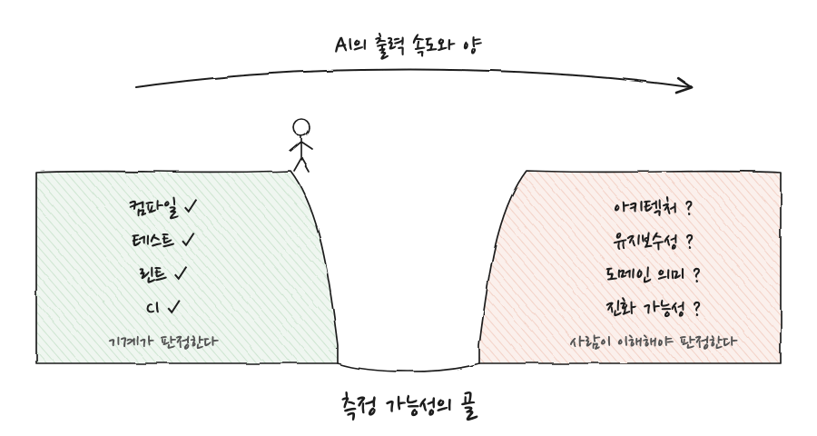
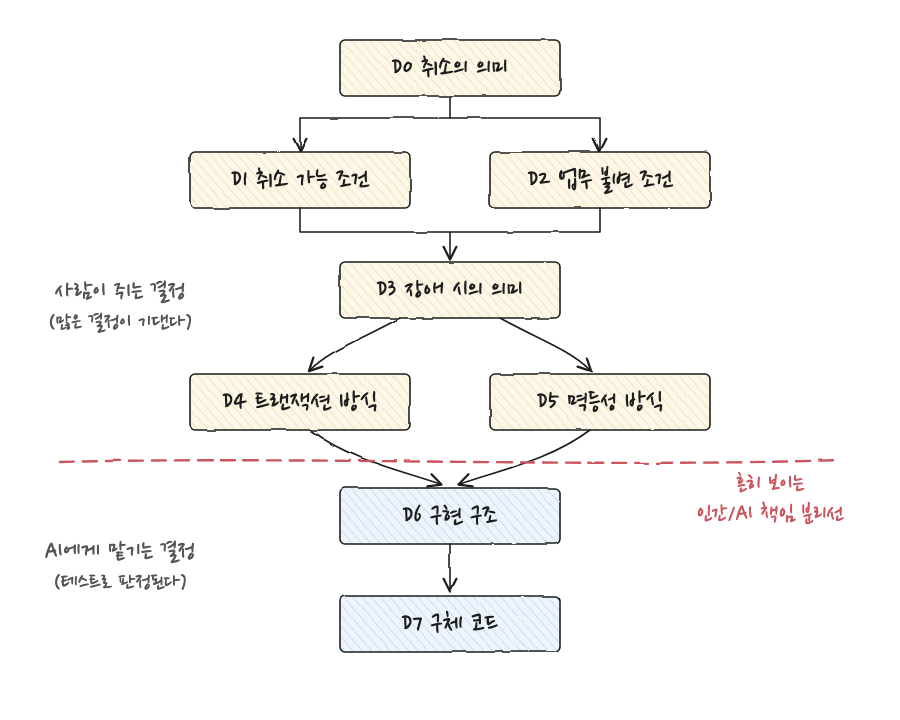
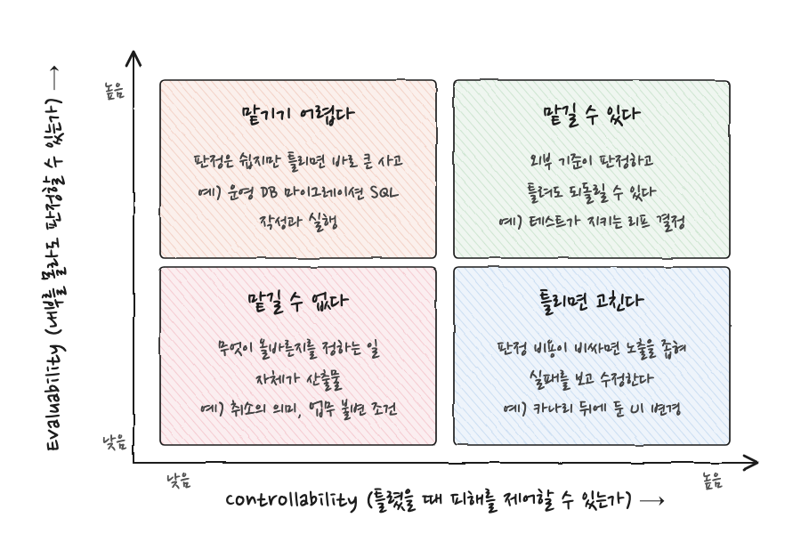
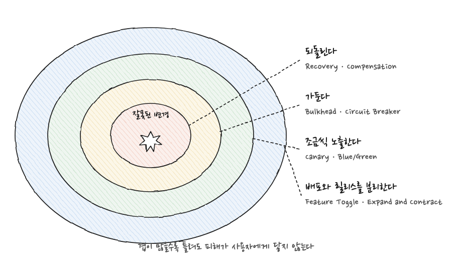
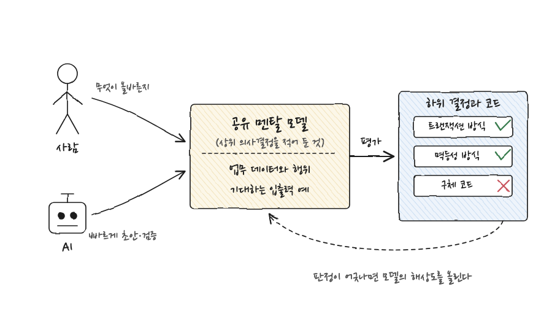

코딩 에이전트에게 기능 하나를 통째로 맡겼을때, 돌아온 코드가 테스트를 통과했는데도 어딘가 찜찜했던 경험이 한 번쯤 있을 것이다. 결과를 눈으로 바로 판정할 수 있는 일은 마음 편히 맡기지만, 업무 규칙이 얽힌 코드를 맡길 때는 매번 "어디까지 넘겨도 되는가"를 두고 망설인다. 이 글은 그 망설임을 두 개의 기준으로 정리한다. 하나는 성과물의 내부를 이해하지 않아도 올바르다고 판정할 수 있는가(Evaluability)이고, 다른 하나는 틀렸을 때 피해를 제어할 수 있는가(Controllability)이다. 

## AI 시대에 인지 부채가 다시 불거지는 이유

개발팀에는 코드에 쌓이는 기술 부채와는 다른 종류의 부채가 있다. 시스템이 바뀌는 속도를 팀의 공유 이해가 따라가지 못해, 시스템을 안전하고 확신 있게 바꾸는 데 필요한 공유 멘탈 모델이 서서히 침식되는 현상이다. 이것을 **인지 부채** (cognitive debt)라고 부른다. 기술 부채가 코드 안에 있다면 인지 부채는 사람 안에 있다. 변경할 때 자신이 없어지고, 리뷰 부담이 늘고, 디버깅이 느려지고, 새 팀원이 적응하는 데 오래 걸리는 형태로 드러난다.

성과물의 내부를 끝까지 이해하지 못한 채 쓰는 일은 AI 이전부터 있었다. 외부 라이브러리의 구현을 모두 읽고 쓰는 사람은 없고, 동료가 짠 모듈도 인터페이스만 보고 호출한다. 그렇다면 왜 지금 이 문제가 다시 부각되는가. 예전에는 시간을 들이면 계측할 수 있었던 것, 적어도 계측하고 있다는 체면은 차릴 수 있었던 것이 AI의 출력 속도와 양을 따라가지 못해 계측 불가능한 영역으로 밀려났기 때문이다. 하루에 사람이 읽을 수 있는 코드 양은 그대로인데 생성되는 코드 양은 몇 배로 늘었으니, 읽어서 이해하는 방식의 품질 확인은 산술적으로 무너진다.



위 그림처럼 품질 확인 항목은 두 언덕으로 나뉜다. 왼쪽 언덕의 컴파일, 테스트, 린트, CI는 기계가 몇 초 만에 판정하므로 AI가 아무리 빨리 출력해도 따라간다. 오른쪽 언덕의 아키텍처, 유지보수성, 도메인 의미, 앞으로의 진화 가능성은 사람이 내용을 이해해야 판정할 수 있다. 두 언덕 사이의 골이 **계측 가능성의 골** 이다. 큰 단위의 일을 AI에게 맡기면 그 안에서 수많은 의사결정이 이루어지는데, 그 결정들의 효과와 영향은 대부분 오른쪽 언덕에 속하므로 계측되지 않은 채 코드베이스에 스며든다. 인지 부채는 바로 이 골에서 쌓인다.

## 주문 취소 하나에 숨은 의사결정

골의 깊이를 실감하려면 평범한 요청 하나를 들여다보는 편이 빠르다. 기존 EC 시스템에 "사용자가 주문을 취소할 수 있게 해 달라"는 요구가 들어왔다고 하자. 개발자는 코딩 에이전트에게 이렇게 요청한다.

> 주문 취소를 구현해 줘. 결제가 끝난 주문이면 환불하고, 재고도 되돌려 줘.

에이전트는 다음과 비슷한 코드를 돌려줄 가능성이 높다.

```java
@Transactional
public void cancel(OrderId id) {
    Order order = repository.find(id);

    payment.refund(order.paymentId());
    inventory.restore(order.items());

    order.cancel();
    repository.save(order);
}
```

열 줄 남짓한 코드이고, 요청한 세 가지(취소, 환불, 재고 복원)가 모두 들어 있다. 테스트도 통과한다. 그런데 이 코드에는 요청에 없던 결정이 여럿 암묵적으로 내려져 있다.

- 환불을 먼저 하고 재고를 되돌리는 순서로 한다.
- 외부 결제 시스템의 환불 호출을 DB 트랜잭션과 같은 의미로 다룬다. 즉 롤백할 수 있는 것처럼 취급한다.
- 이미 출하된 주문도 취소할 수 있다.
- 환불이 성공한 뒤 DB가 롤백되는 상황은 허용한다.
- 재고 복원은 반드시 한 번만 일어난다고 가정한다.

다섯 가지는 성질이 서로 다르다. 첫 번째는 구현 순서의 문제이고, 두 번째와 네 번째는 외부 시스템과 트랜잭션 경계에 관한 기술 결정이며, 세 번째는 업무 규칙이고, 다섯 번째는 멱등성에 관한 운영 가정이다. 요청자는 이 중 어느 것도 명시하지 않았고, 에이전트는 어느 것도 물어보지 않았다. 코드 리뷰어가 이 다섯 가지를 모두 짚어 내려면 결제 시스템의 특성과 출하 업무의 규칙을 이미 알고 있어야 한다. 그 지식이 바로 공유 멘탈 모델이고, 그것 없이 코드만 읽어서는 판정할 수 없다.

## 의사결정은 DAG를 이룬다

그렇다면 이 결정들은 서로 어떤 관계인가. 독립적으로 흩어져 있지 않고 방향이 있는 의존 구조를 이룬다. "취소란 무엇인가"라는 결정이 "어떤 조건에서 취소할 수 있는가"와 "취소 전후로 지켜야 할 업무 불변 조건은 무엇인가"를 정하고, 그 둘이 "장애가 났을 때 취소는 어떤 상태로 남아야 하는가"를 정한다. 장애 시의 의미가 정해져야 트랜잭션 방식과 멱등성 방식을 고를 수 있고, 그것이 정해져야 구현 구조와 구체 코드가 결정된다. 순환이 없는 이 의존 그래프를 DAG(Directed Acyclic Graph, 방향 비순환 그래프)라고 부른다.



이 구조에서 중요한 결정은 많은 결정이 기대고 있는 상위 노드다. 취소의 의미가 바뀌면 그 아래 모든 결정이 다시 내려져야 하지만, 구체 코드가 바뀌어도 위쪽은 흔들리지 않는다. 문제는 이 구조가 코드에는 드러나지 않는다는 데 있다. 앞의 열 줄짜리 코드만 봐서는 D3 장애 시의 의미가 "환불 성공 후 DB 롤백 허용"으로 결정되었다는 사실을 읽어 낼 수 없다.

현재 많은 팀이 긋고 있는 인간과 AI의 책임 분리선은 그림의 점선 근처에 있다. 리프(가장 아래 노드)에서 위로 거슬러 올라가며 "이 결정까지 넘기면 품질 특성을 평가할 수 없게 된다"는 지점이 그 팀이 AI에게 맡길 수 있는 영역의 경계가 된다. 구체 코드와 구현 구조는 테스트가 판정해 주므로 넘기고, 트랜잭션 방식부터는 사람이 쥔다. 다만 이 선의 위치는 고정되어 있지 않다. 테스트 자산이 두텁고 결제 시스템의 특성을 검증 코드로 적어 둔 팀이라면 선을 한 칸 위로 올릴 수 있고, 그렇지 않은 팀은 한 칸 아래로 내려야 한다. 선의 위치를 정하는 기준이 다음 절의 주제다.

## 위임의 두 조건, Evaluability와 Controllability

어떤 결정을 넘겨도 되는가를 한 문장으로 줄이면 "이해하지 않아도 올바르다고 판정할 수 있는가"이다. 이 문장을 뜯어 보면 두 가지 조건이 나온다.

첫 번째는 성과물의 내부를 이해하지 않아도 외부 기준으로 올바르다고 판정할 수 있는가이다. 컴파일러, 테스트, 타입 검사, 스키마 검증, 확인용 SQL처럼 사람의 이해를 대신해 주는 외부 기준이 있으면 이 조건이 충족된다. 이 성질을 **Evaluability** (평가 가능성)라고 부른다. 앞 절의 분리선을 결정하던 기준이 바로 이것이다.

두 번째는 판정이 틀렸거나 판정 자체를 건너뛰었을 때, 그 피해를 제어할 수 있는가이다. 되돌릴 수 있는가, 영향 범위를 좁힐 수 있는가, 일부 사용자에게만 먼저 노출할 수 있는가가 여기에 해당한다. 이 성질을 **Controllability** (제어 가능성)라고 부른다. Evaluability가 사전 판정에 관한 조건이라면 Controllability는 사후 수습에 관한 조건이다.



두 조건을 축으로 놓으면 위 그림처럼 네 칸이 나온다. 오른쪽 위, 둘 다 높은 칸이 마음 놓고 맡길 수 있는 영역이다. 테스트가 판정하고 틀려도 되돌릴 수 있는 리프 결정이 여기에 들어간다. 왼쪽 아래, 둘 다 낮은 칸은 맡길 수 없는 영역이다. 취소의 의미나 업무 불변 조건처럼 "무엇을 올바르다고 할 것인가"를 정하는 일 자체가 산출물인 결정은, 판정할 외부 기준이 아직 없고 틀렸을 때 그 아래 모든 결정이 함께 틀어지므로 피해도 제어되지 않는다.

흥미로운 쪽은 나머지 두 칸이다. Evaluability가 높아도 Controllability가 낮으면 위임하기 어렵다. 운영 환경의 데이터 마이그레이션 SQL을 작성해서 실행하는 일을 생각해 보자. 실행 결과가 올바른지는 확인용 SQL 한 번이면 쉽게 알 수 있으니 Evaluability는 높다. 그러나 잘못된 DDL이나 데이터 갱신이 실행되는 순간 이미 큰 사고이고, 확인용 SQL은 사고가 난 뒤에야 그 사실을 알려 준다. 판정이 쉽다는 것과 틀려도 괜찮다는 것은 전혀 다른 문제이고, 위임 여부를 가르는 것은 후자다. 반대로 Evaluability가 낮아도 Controllability가 높으면 "틀리면 고친다"는 전략이 성립한다. 올바른지 미리 판정하기 어려운 UI 변경이라도 카나리 뒤에 두고 소수 사용자에게만 노출하면, 실패를 관측한 뒤 수정하는 비용이 사전 판정 비용보다 싸진다.

## Controllability를 높이는 장치는 이미 손에 있다

두 축 가운데 Controllability 쪽은 다행히 새로 발명할 것이 없다. 틀린 변경의 피해를 사용자에게 닿지 않게 하는 장치는 소프트웨어 공학이 지난 이십 년간 쌓아 온 자산 그대로다.

| 목적 | 장치 |
| :--- | :--- |
| 배포와 릴리스를 분리한다 | Feature Toggle, Expand and Contract |
| 조금씩 노출한다 (Progressive Exposure) | Canary Release, Blue/Green Deployment |
| 잘못을 국소에 가둔다 | Bulkhead, Circuit Breaker |
| 실행된 뒤에도 되돌린다 | Recovery, Compensation |



네 장치는 그림처럼 겹을 이룬다. 배포는 했지만 토글이 꺼져 있으면 잘못된 코드는 실행조차 되지 않는다. 토글을 켜더라도 카나리 단계면 일부 사용자에게만 닿는다. 그 사용자에게서 장애가 나도 Bulkhead와 Circuit Breaker가 다른 기능으로 번지는 것을 막는다. 거기까지 뚫려 실제로 잘못된 처리가 실행되었더라도 보상 트랜잭션으로 되돌릴 수 있다. 겹이 하나 늘 때마다 "틀려도 되는" 결정의 범위가 한 칸씩 넓어지고, 그만큼 AI에게 넘길 수 있는 영역도 넓어진다.

개인적으로 이 대목이 가장 반가웠다. AI 시대의 위임 문제를 풀려면 뭔가 새로운 AI 전용 도구가 필요할 것 같은 분위기가 있는데, 적어도 Controllability 축은 Feature Toggle과 카나리 릴리스를 제대로 갖추는 평범한 일로 환원된다. 앞의 운영 DB 마이그레이션 예로 돌아가면, Expand and Contract로 스키마 변경을 되돌릴 수 있는 단계로 쪼개고 새 컬럼을 토글 뒤에 두면, 같은 작업이 왼쪽 위 칸에서 오른쪽 위 칸으로 옮겨 간다. 작업의 성격이 바뀐 것이 아니라 피해를 가두는 겹을 늘렸을 뿐이다.

## Evaluability에 비용을 얼마나 쓸 것인가

Evaluability 쪽은 사정이 다르다. 외부 기준을 만드는 데는 비용이 들고, 그 비용이 지나치면 AI에게 맡겨서 얻는 속도를 도로 잃는다. 모든 기능에 대해 사람이 이해할 수 있을 만큼 촘촘한 사양과 테스트를 먼저 쓰라고 하면, 그것은 결국 사람이 다 설계하고 AI는 타이핑만 하는 구도로 돌아간다.

그래서 당분간의 주류는 Resilience(회복 탄력성) 쪽으로 기울 것으로 보인다. 틀림은 기본적으로 받아들이고, 실패를 알아차리면 고치면 된다는 태도다. 무거운 E2E 평가를 매번 돌리는 것은 분석과 운영 비용이 너무 크므로, 중간 단계를 검증하는 가벼운 행동 평가로 쪼개 로컬에서 몇 초 안에 돌리자는 접근도 같은 방향이다. 둘 다 Evaluability를 완벽하게 만들기보다 Controllability로 보완하면서, 평가는 싸고 빠른 것부터 갖추자는 선택이다.

이 관점은 인지 부채를 다루는 방식도 바꾼다. 인지 부채를 "AI가 만든 코드를 사람이 다 이해하지 못하는 상태"로 정의하면 출력량이 늘수록 부채는 필연적으로 쌓인다. 하지만 Evaluability가 충분히 유지되는 영역이라면 AI가 만든 성과물의 내용을 사람이 이해하지 않아도 된다. 이것이 **하네스 엔지니어링** (harness engineering, 에이전트의 출력을 자동으로 판정하고 제약하는 장치를 설계하는 일)의 기초 개념이다. 사람이 쥐어야 할 것은 코드의 내용이 아니라 판정 기준이고, 공유 멘탈 모델이 담아야 할 것도 구현의 세부가 아니라 "무엇이 올바른가"가 된다.

여기까지를 한 번 정리하면 이렇다. 사람이 놓을 수 있는 의사결정은 Evaluability와 Controllability가 모두 높은 결정이다. Evaluability가 유지되면 성과물의 내용을 몰라도 되고, Controllability를 높이는 장치는 기존 자산으로 충분하다. 다만 Evaluability를 높이는 데 비용이 너무 들거나 개발 루프를 몇 번이고 돌려야 한다면 경제 합리성이 사라진다.

## Evaluability에 대한 과신

여기까지의 논의는 그럴듯하다. 다만 비슷한 이야기는 오늘도 세계 어딘가에서 누군가 하고 있다. 문제는 Evaluability의 정의 자체에 있다. "성과물의 내부를 이해하지 않아도 외부 기준으로 올바르다고 판정할 수 있다"는 조건은, 그 외부 기준을 누가 어떻게 만드는가라는 질문을 비켜 간다. 현장에서 들리는 세 가지 처방과 그 현실을 나란히 놓으면 이렇다.

| 처방 | 현실 |
| :--- | :--- |
| AI가 틀리지 않도록 사양을 정확히 쓴다 | 처음부터 그렇게 쓸 수 있었다면 애초에 고생하지 않았다 |
| 도메인 전문가와 함께 올바른 사양을 쓴다 | 그런 사람이 있다면 데려와 주기 바란다 |
| 개발 루프를 돌리며 틀린 것을 고쳐 나가면 올바른 결과에 가까워진다 | 기준이 없는 상태에서 루프를 몇 번 돌려야 성공인지 알 수 없다 |

세 처방 모두 "무엇이 올바른가"가 어딘가에 이미 존재한다고 가정한다. 그러나 DAG의 상위 노드로 올라갈수록 사정은 반대다. 취소의 의미, 취소 가능 조건, 업무 불변 조건 같은 상위 의사결정은 무엇을 올바르다고 할지를 정하는 일 자체가 산출물이다. 판정 기준이 산출물이므로 그것을 판정할 외부 기준은 정의상 존재하지 않고, 따라서 위임할 수 없다. 두 기준으로 위임 범위를 넓혀 가더라도 결국 이 벽에 부딪힌다. 여기가 한계인가.

## 인지 부채의 해법, 공유 멘탈 모델을 평가자로 만든다

한계를 넘을 실마리는 인지 부채의 정의로 돌아가면 보인다. 침식되는 것은 공유 멘탈 모델이었다. 그렇다면 상위 의사결정을 사람 머릿속에 두지 말고 모델로 적어 두고, 그 모델을 AI와 협업해 빠르게 만들고, 그 모델을 하위 의사결정의 평가자(Evaluator)로 쓰면 된다. 위임할 수 없는 상위 결정을 억지로 위임하자는 제안이 아니다. 상위 결정을 외부화해서, 그 아래 결정들의 Evaluability를 만들어 내는 재료로 쓰자는 제안이다.



모델은 두 부분으로 이루어진다. 업무에서 다루는 데이터와 행위를 적은 부분, 그리고 그 행위를 실제로 실행했을 때 기대하는 구체적인 입출력 예시다. 올바르다고 말할 수 있는 사양을 처음부터 쓸 수 있는 사람은 없으므로, 모델과 예시를 번갈아 고쳐 가며 만든다. 주문 취소 예제로 그 흐름을 따라가면 이렇다.

1. 주문 상태를 미결제, 결제 완료, 출하 준비 중, 출하 완료, 취소 완료의 다섯 가지로 두고, 취소 행위는 환불과 재고 복원에 의존한다고 대충 적는다. 예시는 결제 완료 주문을 취소하는 한 줄뿐이다.
2. 도구가 모델의 표현력에 비해 예시가 부족한 지점을 분석해, 나머지 네 상태에 대한 예시의 뼈대를 만들어 준다. 기대 결과 칸은 비어 있고, 그 칸을 채우는 것은 사람의 몫이다.
3. 빈칸을 채우려다 보면 "출하 완료된 주문은 취소할 수 없다", "이미 취소된 주문을 다시 취소하면 어떻게 되는가" 같은 질문에 답해야 한다. 사양의 해상도가 올라가고, 취소 행위의 결과가 단순한 주문이 아니라 취소된 주문, 출하 준비에 들어감, 이미 취소됨 같은 여러 경우로 나뉜다는 것을 알게 되어 모델을 고치고 싶어진다.
4. 모델을 고치면 기존 예시가 컴파일되지 않으므로 예시를 다시 손본다. 이 과정을 반복한다.

충분한 모델과 예시를 다 쓴 순간, 사양을 진짜 의미에서 만족하는 동작하는 도메인 모델이 손에 있다. 테스트를 먼저 쓸지 나중에 쓸지라는 구분은 사라지고, 예시가 곧 사양이고 곧 테스트다. 이렇게 만든 모델은 그 자체가 외부 기준이므로, 남은 바깥쪽(컨트롤러, DB 접근, 외부 결제 연동)은 "이 모델을 만족하도록 만들어 달라"고 코딩 에이전트에게 넘길 수 있다. 그 영역이야말로 에이전트가 가장 잘하는 일이다. 도구가 무엇이든 핵심은 같다. 사람이 쥐는 산출물을 코드가 아니라 모델과 예시로 옮긴다.

인지 부채의 관점에서 보면 이 전환의 의미가 분명해진다. 공유 멘탈 모델이 사람 머릿속에만 있을 때는 코드가 늘어나는 속도에 비례해 침식된다. 그것을 실행 가능한 모델과 예시로 외부화하면, 침식되는 대신 컴파일러가 지켜 주는 자산이 된다. AI가 코드를 아무리 빨리 생성해도, 그 코드가 모델을 만족하는지는 기계가 판정하고, 모델이 현실과 어긋나는 순간은 예시의 빈칸으로 드러난다. 사람이 이해해야 할 범위가 코드 전체에서 모델로 좁아지는 만큼, 인지 부채가 쌓이는 속도도 느려진다.

## 요약

- AI 시대의 인지 부채는 성과물을 이해하지 못해서가 아니라, AI의 출력 속도가 사람의 계측 속도를 넘어서면서 계측 가능성의 골에 결정들이 쌓이기 때문에 커진다.
- 기능 요청 하나에는 성질이 다른 여러 의사결정이 숨어 있고, 그 결정들은 DAG를 이룬다. 많은 결정이 기대는 상위 노드일수록 중요하지만 코드에는 드러나지 않는다.
- 위임할 수 있는 결정은 Evaluability(내부를 몰라도 외부 기준으로 판정할 수 있는가)와 Controllability(틀렸을 때 피해를 제어할 수 있는가)가 모두 높은 결정이다. 판정이 쉽다고 위임해도 되지는 않으며, 운영 DB 마이그레이션이 그 반례다.
- Controllability는 Feature Toggle, 카나리, Bulkhead, 보상 트랜잭션 같은 기존 자산으로 높일 수 있다. Evaluability는 비용 문제가 있어 당분간 Resilience로 보완하는 흐름이 주류가 될 것으로 보인다.
- 무엇이 올바른지를 정하는 상위 의사결정은 위임할 수 없다. 대신 그것을 모델과 예시로 외부화해 하위 결정의 평가자로 쓰면, 공유 멘탈 모델의 침식을 늦추면서 위임 범위를 넓힐 수 있다.

솔직히 말하면 나는 아직 네 번째 칸, 즉 "틀리면 고친다"는 전략에 완전히 마음을 놓지 못한다. 카나리 뒤에 두면 안전하다는 말은 관측 체계가 실패를 제때 잡아낸다는 전제 위에서만 성립하고, 업무 규칙의 오류는 장애처럼 요란하게 드러나지 않는 경우가 많기 때문이다. 그래서 내 경우 코딩 에이전트에게 일을 맡기기 전에 두 질문을 먼저 적어 본다. 이 결과를 내가 읽지 않고도 판정할 외부 기준이 있는가. 그 기준이 틀렸을 때 되돌릴 겹이 몇 개나 있는가. 두 질문에 모두 답할 수 있는 결정만 넘기고, 답할 수 없는 결정은 모델로 적는 데 시간을 쓴다. 느려 보이지만, 계측 가능성의 골에 떨어진 결정을 나중에 건져 올리는 비용에 비하면 싸다.

## 참조 사이트

- [人間はどの意思決定を手放せるのか](https://speakerdeck.com/kawasima/ningen-ha-dono-ishi-kettei-o-tebanaseru-no-ka)
- [cognitive debt](https://margaretstorey.com/blog/2026/02/09/cognitive-debt/)
- [cognitive debt revisited](https://margaretstorey.com/blog/2026/02/18/cognitive-debt-revisited/)
